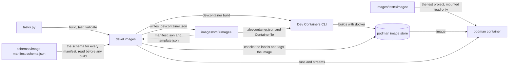

# Dev Containers

Dev Container images for `ghcr.io/froazin/devcontainers`, with the Python tooling that builds and tests them locally with podman. Nothing is published yet, and Dev Container features are planned.

## How it's built

Each image has a source folder in `images/src/<image>/` and a test project in `images/test/<image>/`. The Invoke tasks in `tasks.py` are thin wrappers around the `devel.images` package:

- `validate` checks that `schemas/image-manifest.schema.json`, the `ImageManifest` dataclass, each image's `manifest.json` and its `template.json` agree. It renders each template to check it.
- `build` runs the same checks on every image first, so a bad manifest stops it before it builds anything. It then renders each image's `template.json` with its manifest into the `.devcontainer.json` that the Dev Containers CLI builds from, builds the image, checks its labels and tags it through the podman API.
- `test` builds the images, unless it's given `--skip-build`, then runs each image's `test.sh` inside a podman container of the built image.

The `features/` folder is ready for Dev Container features.

This diagram shows how the parts fit together:



## Design docs

| Doc | Covers |
| --- | --- |
| [Container images](docs/container-images/overview.md) | The image pipeline, the `devel.images` package, how images are found and how to add an image |
| [Image manifests](docs/container-images/manifests.md) | `manifest.json`, its schema, the `ImageManifest` dataclass, rendering `template.json` and validation |
| [Image builds](docs/container-images/builds.md) | The Dev Containers CLI build, image names and tags, labels and tagging with podman |
| [Image tests](docs/container-images/tests.md) | The test runner and the `test_utils.sh` check helpers |
| [Image READMEs](docs/container-images/readmes.md) | The shape of each image's `README.md` and where its values come from |
| [Dev tooling](docs/dev-tooling.md) | How `tasks.py` and the `devel` packages fit together, the task flags and the Python and npm tooling |
| [Claude Code hooks](docs/claude-code-hooks.md) | The hook that checks the image manifests after Claude edits them |

## Prerequisites

| Tool | Used for |
| --- | --- |
| Python 3.14, as the system `python3.14` | The Python tooling. uv only uses the system interpreter (see [Python in Dev tooling](docs/dev-tooling.md#python)) |
| [uv](https://docs.astral.sh/uv/) | The virtual environment and the Python dev dependencies |
| Node.js and npm, in the versions that `engines` in `package.json` allows: Node 24.14.1 or later, with npm 11.10.0 or later | The Dev Containers CLI, from `package.json`. `npm install` fails on an older Node or npm, because older npm versions ignore the release age that `.npmrc` sets (see [Node and npm](docs/dev-tooling.md#node-and-npm)) |
| podman, with its API socket running | Building, tagging and testing images. The tooling tags and tests images through the podman API, so Docker on its own isn't enough |
| A `docker` command that runs podman, such as the podman-docker shim | The Dev Containers CLI builds with `docker` |
| [ShellCheck](https://www.shellcheck.net/) and [shfmt](https://github.com/mvdan/sh) | Checking shell scripts. They aren't project dependencies |

On a machine with systemd, the user unit `podman.socket` provides the API socket.

The project is for use on an Ubuntu 26.04 Windows Subsystem for Linux (WSL) instance built with the [froazin/dotfiles WSL provisioning](https://github.com/froazin/dotfiles#wsl-provisioning). The provisioning installs podman with the podman-docker shim, and enables podman's API socket for every user. The instance has every tool above except Node.js. The provisioning installs nvm instead, so run `nvm install` in the repository to install the version `.nvmrc` sets.

## Set up

1. Create the virtual environment with access to the system site packages. [Dev tooling decisions](docs/dev-tooling.md#decisions) says why.

   ```bash
   uv venv --system-site-packages
   ```

1. Install the dev dependencies:

   ```bash
   uv sync
   ```

> [!WARNING]
> If `uv sync` or any `uv run` command runs before step 1, it creates a `.venv` **without** system site packages. `uv sync` then keeps that `.venv` as it is.
>
> Recreate it with `uv venv --system-site-packages --clear`, then run `uv sync` again.

uv and npm only install versions published at least 7 days ago. See [Tool configuration](docs/dev-tooling.md#tool-configuration).

## Build and test

Run every command from the repository root.

| Task | Command |
| --- | --- |
| List the tasks | `uv run invoke --list` |
| Check the image manifests | `uv run invoke validate images` |
| Build every image as a dev build | `uv run invoke build images` |
| Build every image as a release, tagged with its version | `uv run invoke build images --is-release` |
| Build the images whose folder name matches a glob | `uv run invoke build images --filter base` |
| Build without the build cache | `uv run invoke build images --no-cache` |
| Build, then test, the images | `uv run invoke test images` |
| Test the images already built | `uv run invoke test images --skip-build` |
| Lint Python | `uv run ruff check .` |
| Check Python formatting | `uv run ruff format --check .` |
| Format Python | `uv run ruff format .` |
| Type check | `uv run pyright` |
| Run the unit tests | `uv run pytest` |
| Check shell scripts | `shellcheck images/test/*/*.sh .claude/hooks/*.sh` |
| Check shell formatting | `shfmt -d images/test .claude/hooks` |

- Run `uv run invoke --help <task>` for a task's options. [Task flags](docs/dev-tooling.md#task-flags) describes them.
- ShellCheck and shfmt read their settings from `.shellcheckrc` and `.editorconfig`, so run them without formatting flags.

### Tests that need podman

The unit tests mock podman and the Dev Containers CLI, so they don't need podman. `invoke build` and `invoke test` do. They need every tool in [Prerequisites](#prerequisites) except ShellCheck and shfmt. `invoke test --skip-build` builds nothing, so besides Python and uv it needs only podman with its API socket.

A build runs `npm install`, and creates and tags real images in podman's image store. A test run creates, runs and removes a real container of each image it tests.

### CI

There's no CI yet. Dependabot checks the uv and npm dependencies once a week, and groups each ecosystem's updates into one pull request (PR). See [Dependency updates](docs/dev-tooling.md#dependency-updates).

## Licence

MIT. See [LICENSE](LICENSE).
