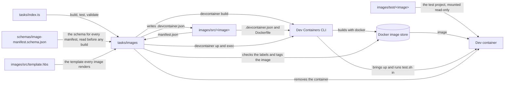

# Dev Containers

Dev Container images for `ghcr.io/froazin/devcontainers`, with the TypeScript tooling that builds and tests them locally with Docker. CI publishes each new image version from `main`, and Dev Container features are planned.

## How it's built

Each image has a source folder in `images/src/<image>/` and a test project in `images/test/<image>/`. The npm script `tasks` runs `tasks/index.ts`, a thin wrapper around the `tasks/images` package, which checks each manifest, renders the shared image template, `images/src/template.hbs`, into each image's `.devcontainer.json`, builds the image with the Dev Containers command-line interface (CLI), checks its labels, tags it and runs its tests in a dev container of the image:



Node.js runs the TypeScript directly, by stripping the types, so nothing is compiled to JavaScript. TypeScript's own compiler, `tsc`, only type checks.

## Design docs

| Doc | Covers |
| --- | --- |
| [Container images](docs/images/overview.md) | The image pipeline and the rules for adding or changing an image |
| [Image manifests](docs/images/manifests.md) | How the schema, `ImageManifest`, the manifests and the templates are kept in step |
| [Image builds](docs/images/builds.md) | Image names, tags and labels, and why the build works the way it does |
| [Image tests](docs/images/tests.md) | The test runner and the shared `test_utils.sh` helpers |
| [systemd in the images](docs/images/systemd.md) | How every image runs systemd as PID 1, and stops when the editor closes |

## Prerequisites

| Tool | Notes |
| --- | --- |
| Node.js and npm, in the versions `engines` in `package.json` allows | Node.js runs the tasks' TypeScript directly. `npm install` fails on an older npm, which would ignore the release age `.npmrc` sets |
| Docker, with its daemon running | The Dev Containers CLI builds with `docker`, and the tasks tag and test images through Docker's API socket. They use `DOCKER_HOST` when it's set |
| [ShellCheck](https://www.shellcheck.net/) and [shfmt](https://github.com/mvdan/sh) | Not project dependencies |

The project runs on an Ubuntu 26.04 Windows Subsystem for Linux (WSL) instance built with the [froazin/dotfiles WSL provisioning](https://github.com/froazin/dotfiles#wsl-provisioning), with Docker installed. Run `nvm install` in the repository for the Node.js version `.nvmrc` sets.

## Set up

```bash
npm install
```

## Build and test

Run every command from the repository root. npm takes any flag before `--` as its own, so put `--` straight after `npm run tasks` whenever you pass a flag. `npm run tasks -- <task> --help` lists a task's flags.

| Task | Command |
| --- | --- |
| Check the image manifests | `npm run tasks -- validate images` |
| Build every image as a dev build | `npm run tasks -- build images` |
| Build every image as a release | `npm run tasks -- build images --is-release` |
| Build, then test, the images | `npm run tasks -- test images` |
| Test the images already built | `npm run tasks -- test images --skip-build` |
| Lint and check formatting | `npm run lint` |
| Fix formatting and safe lint findings | `npm run format` |
| Type check | `npm run typecheck` |
| Run the unit tests | `npm test` |
| Check shell scripts | `shellcheck images/src/*/*.sh images/test/*.sh images/test/*/*.sh .claude/hooks/*.sh` |
| Check shell formatting | `shfmt -d images/src images/test .claude/hooks` |
| Lint the workflows and actions | `docker run --rm -v "$PWD:/repo:ro" -w /repo rhysd/actionlint:1.7.10` |

The unit tests use fakes for Docker and the Dev Containers CLI. The `build` and `test` tasks create real images and containers in Docker's store.

### CI

GitHub Actions runs `ci.yml` on every pull request to `main`, and `release.yml` on every push to `main`. Each is a list of jobs. `ci.yml`'s jobs run these workflows, apart from the one that finds the changes, and `release.yml` runs `ci-checks.yml`, then its own release jobs:

| Workflow | Does | Runs in |
| --- | --- | --- |
| `ci-checks.yml` | The checks above | `ci.yml` and `release.yml` |
| `ci-version-review.yml` | Claude Haiku checks each changed image's version against [Add an image](docs/images/overview.md#add-an-image) | `ci.yml` |
| `ci-images.yml` | Builds and tests each changed image | `ci.yml` |
| `ci-code-review.yml` | Claude Sonnet reviews each image whose own files changed, following `REVIEW.md` | `ci.yml` |
| `ci-actions.yml` | Lints the workflows and actions with actionlint, and runs `prepare-code-review` against the pull request and `unreleased-images` against the real tags | `ci.yml`, when the pull request changes a workflow, an action or `.github/actionlint.yaml` |

On a pull request, the [changed-images](.github/actions/changed-images/action.yml) action works out which images changed, and a change to shared build tooling counts as a change to every image. The version review, the build and the code review then run in turn, each only once the one before passes. The code review posts each finding as a review comment, and the `Protect Main` ruleset holds the pull request until every comment is resolved and the branch is up to date with `main`. The reasons for each step are in the [workflows](.github/workflows/).

On `main`, `release.yml` runs the checks again and releases each image whose version is newer than every one of its Git tags, `<image>-vX.Y.Z`. The [unreleased-images](.github/actions/unreleased-images/action.yml) action checks every image, not only the ones a push changed, so a release an earlier run missed is made by the next, unless a later bump has already replaced that version. A version behind the newest tag gets a warning and isn't released, so a revert never moves the floating tags back. A build job builds and tests the release with a read-only token. A publish job, which runs none of the repository's code, then pushes its tags to `ghcr.io/froazin/devcontainers` and adds the Git tag on the pushed commit. A change that doesn't bump an image's version, such as to its README, releases nothing.

- The reviews need a `CLAUDE_CODE_OAUTH_TOKEN` repository secret. Create it with `claude setup-token`, which prints a token that lasts a year, and save it with `gh secret set CLAUDE_CODE_OAUTH_TOKEN`. Without it, both reviews skip and pass.
- The repository only allows actions owned by GitHub and an allow list, so a new action from anywhere else needs a pattern there, or the run fails to start.
- The first push creates the package in the GitHub Container Registry as private (inferred). Make it public once in the package's settings.

## Licence

MIT. See [LICENSE](LICENSE).
