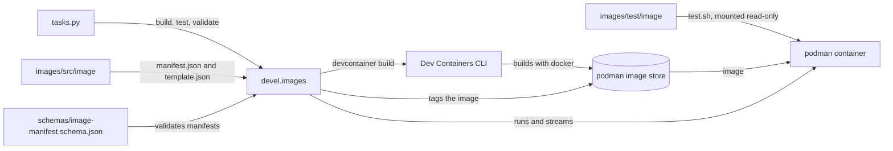

# Dev Containers

Dev Container images and features for `ghcr.io/froazin/devcontainers`, with the Python tooling that builds and tests them.

## Where it runs

The project is for use with [froazin/dotfiles](https://github.com/froazin/dotfiles), on an Ubuntu 26.04 WSL instance that runs containers with podman rather than Docker. The dotfiles' [WSL provisioning](https://github.com/froazin/dotfiles#wsl-provisioning) installs podman and its `docker` shim (`podman-docker`), and enables podman's API socket for every user.

The tooling tags and tests images through the podman API, so it needs podman: Docker on its own isn't enough. For everything the project needs, see [Prerequisites](CONTRIBUTING.md#prerequisites).

## How it's built

Each image has a source folder in `images/src/` and a test project in `images/test/`. Invoke tasks in `tasks.py` call the `devel.images` package, which:

1. Validates each image's `manifest.json` against `schemas/image-manifest.schema.json`.
1. Renders the image's `template.json` with the manifest into the `.devcontainer.json` that the Dev Containers CLI builds from.
1. Builds the image with the Dev Containers CLI and tags it with podman.
1. Runs the image's `test.sh` inside a podman container of the built image.

Images are built and tagged locally. Nothing is published yet. The `features/` folder is set up for Dev Container features, but none exist yet.

This diagram shows how the parts fit together:

## Design docs

| Doc | Covers |
| --- | --- |
| [Container images](docs/container-images/overview.md) | The image pipeline, the `devel.images` package, image names and how images are found |
| [Image manifests](docs/container-images/manifests.md) | `manifest.json`, its schema, the `ImageManifest` dataclass, templates and validation |
| [Image builds](docs/container-images/builds.md) | Rendering, the Dev Containers CLI build and tagging with podman |
| [Image tests](docs/container-images/tests.md) | The test runner and the `test_utils.sh` check helpers |
| [Dev tooling](docs/dev-tooling.md) | How `tasks.py` and the `devel` packages fit together, and the Python and npm tooling |
| [Claude Code hooks](docs/claude-code-hooks.md) | The hook that checks the image manifests after Claude edits them |

## Contributing

To set up, build and test the project, see [CONTRIBUTING.md](CONTRIBUTING.md).

## Licence

MIT. See [LICENSE](LICENSE).
