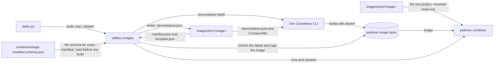

# Dev Containers

Dev Container images for `ghcr.io/froazin/devcontainers`, with the Python tooling that builds and tests them locally with podman. Nothing is published yet, and Dev Container features are planned.

## How it's built

Each image has a source folder in `images/src/<image>/` and a test project in `images/test/<image>/`. The Invoke tasks in `tasks.py` are thin wrappers around the `utilities.images` package, which checks each manifest, renders its `template.json` into a `.devcontainer.json`, builds the image with the Dev Containers command-line interface (CLI), checks its labels, tags it and runs its tests in a podman container:



## Design docs

| Doc | Covers |
| --- | --- |
| [Container images](docs/images/overview.md) | The image pipeline and the rules for adding or changing an image |
| [Image manifests](docs/images/manifests.md) | How the schema, `ImageManifest`, the manifests and the templates are kept in step |
| [Image builds](docs/images/builds.md) | Image names, tags and labels, and why the build works the way it does |
| [Image tests](docs/images/tests.md) | The test runner and the `test_utils.sh` helpers |
| [Dev tooling](docs/dev-tooling.md) | How `tasks.py` and `utilities` fit together, and the Python, Node and dependency settings |
| [Claude Code hooks](docs/claude-code-hooks.md) | The hook that checks the image manifests after Claude edits them |
| [CI](docs/ci.md) | The GitHub Actions workflows and the Claude reviews of each image's version and code |

## Prerequisites

| Tool | Notes |
| --- | --- |
| Python 3.14, as the system `python3.14` | uv only uses the system interpreter |
| [uv](https://docs.astral.sh/uv/) | |
| Node.js and npm, in the versions `engines` in `package.json` allows | `npm install` fails on an older npm, which would ignore the release age `.npmrc` sets |
| podman, with its API socket running | The tooling tags and tests images through the podman API, so Docker isn't enough. On systemd, the user unit `podman.socket` provides it |
| A `docker` command that runs podman, such as the podman-docker shim | The Dev Containers CLI builds with `docker` |
| [ShellCheck](https://www.shellcheck.net/) and [shfmt](https://github.com/mvdan/sh) | Not project dependencies |

The project runs on an Ubuntu 26.04 Windows Subsystem for Linux (WSL) instance built with the [froazin/dotfiles WSL provisioning](https://github.com/froazin/dotfiles#wsl-provisioning), which has every tool above except Node.js. Run `nvm install` in the repository for the version `.nvmrc` sets.

## Set up

```bash
uv venv --system-site-packages
uv sync
```

> [!WARNING]
> Create the `.venv` before any other `uv` command. Otherwise `uv` creates one **without** system site packages and keeps it. Recreate it with `uv venv --system-site-packages --clear`, then run `uv sync` again. [Tool configuration](docs/dev-tooling.md#tool-configuration) says why it needs them.

## Build and test

Run every command from the repository root. `uv run invoke --help <task>` lists a task's flags.

| Task | Command |
| --- | --- |
| Check the image manifests | `uv run invoke validate images` |
| Build every image as a dev build | `uv run invoke build images` |
| Build every image as a release | `uv run invoke build images --is-release` |
| Build, then test, the images | `uv run invoke test images` |
| Test the images already built | `uv run invoke test images --skip-build` |
| Lint and check formatting | `uv run ruff check . && uv run ruff format --check .` |
| Type check | `uv run pyright` |
| Run the unit tests | `uv run pytest` |
| Check shell scripts | `shellcheck images/test/*/*.sh .claude/hooks/*.sh` |
| Check shell formatting | `shfmt -d images/test .claude/hooks` |

The unit tests mock podman and the Dev Containers CLI. `invoke build` and `invoke test` create real images and containers in podman's store.

### CI

GitHub Actions runs the checks above on every pull request to `main`, then reviews, builds and tests each image the pull request changes, with Claude reviews of each image's version and code. See [CI](docs/ci.md).

## Licence

MIT. See [LICENSE](LICENSE).
