# CI

How the GitHub Actions workflows check a pull request (PR): the lint and unit tests, the image builds and tests, and Claude's reviews of each image's version and code. It's for engineers who change a workflow, or add an image and want to know what CI runs on it. The commands CI runs are the ones in [Build and test](../README.md#build-and-test).

## Contents

1. [Overview](#overview)
1. [How it works](#how-it-works)
1. [Version review](#version-review)
1. [Code review](#code-review)
1. [Set up](#set-up)
1. [Security](#security)
1. [Decisions](#decisions)
1. [Limits](#limits)
1. [Sources](#sources)

## Overview

Two workflows in [.github/workflows/](../.github/workflows/) run on every PR to `main`:

- [ci.yml](../.github/workflows/ci.yml) runs the checks every change needs, and makes a rough guess at whether the PR could change an image.
- [ci-images.yml](../.github/workflows/ci-images.yml) is a reusable workflow that `ci.yml` calls. It works out which images changed, reviews the version of each one, builds and tests them, then reviews their code.

This flowchart shows the jobs and what passes between them:

```mermaid
flowchart LR
    accTitle: The CI jobs for a pull request
    accDescr: A pull request to main starts ci.yml. Its checks job runs the lint, type check, unit tests, manifest checks and shell checks. Its changes job lists the pull request's files and decides whether an image could have changed. When both pass and an image could have changed, ci.yml calls ci-images.yml. Its changes job diffs the branch from where it left main and lists the changed images. Then one versions job runs for each changed image, where Claude Haiku reviews the image's version against the branch's commits. When every review passes, one images job runs for each changed image to build and test it. When every build passes, one code-review job runs for each image whose own files changed, where Claude Sonnet reviews the changes to those files and comments on the pull request for each finding.
    pr[Pull request to main] --> checks[ci.yml: checks]
    pr --> rough[ci.yml: changes]
    checks -->|passed| workflow[ci-images.yml]
    rough -->|an image could have changed| workflow
    workflow --> changes[changes]
    changes -->|changed images and the merge base| versions[versions, one per image: review with Claude Haiku]
    versions -->|every version passed| images[images, one per image: build and test]
    images -->|every build passed| review[code-review, one per image whose files changed: review with Claude Sonnet]
    review -->|a comment per finding| comments[Review comments on the pull request]
```

## How it works

### ci.yml

- `concurrency` cancels a run when a newer commit reaches the same PR.
- **`checks`** runs Ruff, Pyright, pytest, `invoke validate images`, ShellCheck and shfmt.
- **`changes`** lists the PR's files through the GitHub API, and outputs `true` when any of them is under a path in its `PATHS` list. It's deliberately rough: keep `PATHS` a superset of what `ci-images.yml` checks. The API lists at most 3000 files, so a longer PR counts as changing an image.
- **`images`** calls `ci-images.yml` when both jobs pass and `changes` says `true`. It passes `CLAUDE_CODE_OAUTH_TOKEN` on, and grants `actions: read`, `contents: read` and `pull-requests: write`, the most any job in the called workflow uses. A called workflow can't raise what its caller grants.

### ci-images.yml

- **`changes`** checks out the full history and finds where the branch left `main` with `git merge-base`. It diffs from there to `HEAD`.
  - A change under a path in its `SHARED` list, such as `devel/images/` or `tasks.py`, can affect every image, so it includes them all.
  - Otherwise it includes each image with a change in `images/src/<image>/` or `images/test/<image>/`.
  - It outputs the image names as a JSON list, and the merge base for the reviews.
  - It also outputs `sources`, the images with a change in their own folders, for the code review. A change to shared tooling alone adds no image to it.
  - Image names go into `--filter`, which takes a glob, so a folder name with characters outside `[a-z0-9._-]` fails the job.
- **`versions`** runs once for each changed image, and reviews its version. See [Version review](#version-review).
- **`images`** waits for every `versions` job to pass, so no image is built until every changed image's version is right. Then it runs once for each changed image, with `fail-fast` off, so one image failing doesn't cancel the others. It sets up Python, uv and Node.js, starts podman's API socket and puts a `docker` that runs podman first on `PATH`. Then it runs `invoke test images --filter <image>`. Why the tooling needs podman is in [Prerequisites](../README.md#prerequisites).
- **`code-review`** waits for every `images` job to pass, then runs once for each image in `sources`, with `fail-fast` off, and reviews its code. See [Code review](#code-review).

## Version review

The `versions` job asks Claude Haiku 5.5 to check that the image's `version` is bumped the way [Add an image](images/overview.md#add-an-image) says. The review runs through [anthropics/claude-code-action](https://github.com/anthropics/claude-code-action).

- The prompt in [ci-images.yml](../.github/workflows/ci-images.yml) states the version rules and the steps. Change both the prompt and [Add an image](images/overview.md#add-an-image) when the rules change.
- It runs once for each changed image, with `fail-fast` off, and each job reviews its own image. Claude reads the version at the merge base and at the PR's head commit, then the commits between them that touch `images/src/<image>/`. A breaking change to one image doesn't count against another.
- The PR is squash-merged, so Claude treats the branch as one change and expects one step up, set by the most significant change among those commits. A new image must be at `0.0.1`.
- Claude also lists the image's release tags, `<image>-vX.Y.Z`, with `git tag --list '<image>-v[0-9]*'`. When the PR changes the version or adds the image, the version must be newer than every one of them. An unchanged version may equal the newest tag. The checkout's `fetch-depth: 0` fetches the tags as well as the history.
- Claude can only run `git log`, `git show`, `git diff` and `git tag --list`, and read files. It returns its verdict as JSON that matches the `--json-schema` in `claude_args`.
- The next step writes the verdict to the job summary. When the verdict is `fail`, or Claude returns none, it adds an error on the image's `manifest.json` and fails the job, so no image is built.
- Without the token, such as on a PR from a fork or from Dependabot, the job adds a notice, skips the review and passes, so the builds still run.

## Code review

The `code-review` job asks Claude Sonnet 5.5 to review the lines a PR adds or changes in one image's own files, `images/src/<image>/` and `images/test/<image>/`, and to comment on the PR for each finding.

- Claude follows `REVIEW.md` as it is on `main`, read with `git show`, so a PR can't change its own review's rules. It leaves the version to the version review.
- It reports Important findings and Nits, as `REVIEW.md` defines them, but no pre-existing issues, which are out of scope for the PR.
- Every comment must be resolved before the PR can merge, because the `Protect Main` ruleset requires conversation resolution. So Claude posts Nits sparingly, at most three per review, and none from an image's fourth review on a PR.
- A step before the review counts the image's earlier reviews: runs of `ci.yml` on the PR where the image's review step succeeded, read from the Actions API. That's why the job needs `actions: read`. It also saves the review comments already on the image's files to `.code-review/comments.json`, and Claude doesn't raise an issue one of them already raises.
- Claude posts each finding with the action's own tool, `mcp__github_inline_comment__create_inline_comment`, as a review comment on its line or block in the PR's diff. It passes `confirmed: true`, so each comment posts at once. Without it, the action holds the comment until the run ends, then posts it unfiltered, because only an API key turns its filter on.
- Claude can only use that tool, run `git log`, `git show` and `git diff`, and read files.
- The job passes whatever Claude finds. The unresolved comments are what hold the PR back.
- Without the token, the job adds a notice, skips the review and passes.

## Set up

The reviews need a `CLAUDE_CODE_OAUTH_TOKEN` repository secret, so runs use the maintainer's Claude subscription rather than API billing.

1. Run `claude setup-token` and sign in. It prints a token that lasts one year, and doesn't save it anywhere.
1. Save it as the secret with `gh secret set CLAUDE_CODE_OAUTH_TOKEN`, and paste the token when it asks.
1. Repeat both steps before the token expires. Until then, the reviews are skipped with a notice.

The repository only allows actions owned by GitHub and an allow list. The list holds `astral-sh/setup-uv@*`, `anthropics/claude-code-action@*` and `oven-sh/setup-bun@*`, which the Claude action uses internally. Add a pattern for any new action outside GitHub, or the run fails to start.

## Security

- **The token stays in the review steps.** Only the review steps in `versions` and `code-review` get it. The `images` jobs, which run the PR's code, never see it.
- **The workflow's token, as narrow as each review allows.** Both reviews pass it as `github_token`. The version review's has `contents: read` and `pull-requests: read`, so Claude can't comment, push or change the PR. The code review's adds `pull-requests: write` and `actions: read`, so Claude can comment.
- **PR content is data.** The PR's author writes its commit messages and files, so both prompts say to treat them, and earlier comments, as data. `--allowedTools` limits Claude to git's read commands, the file-reading tools and, in the code review, the action's comment tool. So the most text in the PR can make Claude do is post a review comment. It can't push, merge, approve or edit the PR, because no tool it has can. `--disallowedTools` denies uv, because `.claude/settings.json` allows `uv run invoke validate images`, which would run the PR's `tasks.py` with the token.
- **Trusted config.** For a PR, the action restores `.claude/`, `CLAUDE.md` and other config paths from `main` before Claude starts, so a PR can't change the instructions Claude loads (from the action's source, see [Sources](#sources)). A PR can still change the prompt, because the workflow runs from the PR's branch.

## Decisions

- **Review before building.** A wrong version fails the PR before any image is built, without waiting for the builds. The review took about 13 seconds on its first run (observed). The cost is that one image's failed review holds back every image's build.
- **Review the code after the builds.** The maintainer chose it, so no tokens go on code that doesn't build or pass its tests. The cost is a slower first look at the code, and that one image's failed build holds back every image's review.
- **Claude posts its own comments, with the action's tool.** The maintainer chose it over a separate job that posts Claude's findings, because it's simpler. The cost is a token that can write to the PR in Claude's job, limited by `--allowedTools` to the comment tool. The `gh` CLI would need `gh api`, which can also edit or close the PR.
- **A comment per finding, on its lines.** The maintainer chose it over one comment per image, so each finding can be discussed and resolved where it is.
- **Resolved comments, not a failing check.** The maintainer chose to hold a PR back with unresolved comments rather than fail the job on an Important finding, so a wrong finding is resolved with a reply rather than a re-run. That's why Nits are capped, and stop after three reviews: each one blocks the merge until it's resolved.
- **A prompt, not the code-review plugin.** The plugin reviews the whole PR, with no way to scope it to an image, and stops once Claude has commented, which would skip every push after the first.
- **One run per image, with the prompt in the workflow.** The matrix already splits the work by image, so a single Haiku run per image is enough. Agents in `.claude/agents/` would add files to maintain for a check this small.
- **The workflow's token, not the Claude GitHub App's.** The App's token exchange skips the run whenever the PR changes the workflow file, so the review couldn't run on any PR that changes it. The review only reads git history, so the App's extra access isn't needed.
- **A subscription token, not an API key.** The maintainer chose to use their Claude subscription. The token is tied to their account.
- **Commit SHAs, not version tags.** Every action outside the repository is pinned to the full SHA of a release's commit, with the version in a comment, such as `actions/checkout@3d3c42e5aac5ba805825da76410c181273ba90b1 # v7.0.1`. The maintainer chose it because the action's owner can move, retarget or delete a tag, but not a commit. Dependabot updates the SHA and the comment together, weekly, with the same 7-day cooldown as the other ecosystems (see [Dependency updates](dev-tooling.md#dependency-updates)). So each pin is a release at least 7 days old, such as `anthropics/claude-code-action` at `v1.0.253`.
- **Pin a new action the same way.** Resolve the release tag to its commit, following an annotated tag to the commit it points at, and check the release is at least 7 days old. `gh api repos/OWNER/REPO/git/ref/tags/TAG` gives the tag, and `gh api repos/OWNER/REPO/git/tags/SHA` follows an annotated one.

## Limits

- Both reviews are Claude's judgement, so they can be wrong, especially on whether a change is breaking or a finding is Important. Read the summary when a review fails, and when you aren't sure it passed for the right reason.
- Claude decides whether an earlier comment already raises an issue, so it can repeat one, or miss a new issue that looks like an old one.
- The Nit limits are in the prompt, so nothing stops Claude posting more.
- An admin can bypass the `Protect Main` ruleset, and merge with unresolved comments.
- A comment can only go on a line in the PR's diff. When Claude can't place a finding, it's lost, apart from Claude's summary in the review step's log.
- PRs from forks and from Dependabot get no reviews, because GitHub withholds the secret.
- `ci-images.yml` diffs from the merge base to the merge commit GitHub makes for the PR. If `main` has moved on, that diff also holds `main`'s newer changes, so it can include images the PR didn't change (inferred). That builds more than needed, but never misses an image.
- The token expires after a year, and nothing warns before it does.

## Sources

- https://github.com/anthropics/claude-code-action, its `action.yml`, `docs/usage.md` and `docs/security.md`, and its source at `v1.0.253`: `src/github/token.ts` for the App token exchange and its workflow check, `src/github/operations/restore-config.ts` for the config it restores, and `src/mcp/github-inline-comment-server.ts` and `src/entrypoints/post-buffered-inline-comments.ts` for the comment tool
- https://code.claude.com/docs/en/github-actions
- https://code.claude.com/docs/en/authentication
- https://docs.github.com/en/actions/sharing-automations/reusing-workflows
- https://docs.github.com/en/actions/writing-workflows/choosing-what-your-workflow-does/accessing-contextual-information-about-workflow-runs#context-availability
- https://docs.github.com/en/rest/pulls/comments, for review comments
- https://docs.github.com/en/rest/actions/workflow-runs and https://docs.github.com/en/rest/actions/workflow-jobs, for counting the earlier reviews
