# CI

How the GitHub Actions workflows check a pull request (PR): the lint and unit tests, the image builds and tests, and the review of each image's version. It's for engineers who change a workflow, or add an image and want to know what CI runs on it. The commands CI runs are the ones in [Build and test](../README.md#build-and-test).

## Contents

1. [Overview](#overview)
1. [How it works](#how-it-works)
1. [Version review](#version-review)
1. [Set up](#set-up)
1. [Security](#security)
1. [Decisions](#decisions)
1. [Limits](#limits)
1. [Sources](#sources)

## Overview

Two workflows in [.github/workflows/](../.github/workflows/) run on every PR to `main`:

- [ci.yml](../.github/workflows/ci.yml) runs the checks every change needs, and makes a rough guess at whether the PR could change an image.
- [ci-images.yml](../.github/workflows/ci-images.yml) is a reusable workflow that `ci.yml` calls. It works out which images changed, reviews the version of each one, then builds and tests them.

This flowchart shows the jobs and what passes between them:

```mermaid
flowchart LR
    accTitle: The CI jobs for a pull request
    accDescr: A pull request to main starts ci.yml. Its checks job runs the lint, type check, unit tests, manifest checks and shell checks. Its changes job lists the pull request's files and decides whether an image could have changed. When both pass and an image could have changed, ci.yml calls ci-images.yml. Its changes job diffs the branch from where it left main and lists the changed images. Then one versions job runs for each changed image, where Claude Haiku reviews the image's version against the branch's commits. When every review passes, one images job runs for each changed image to build and test it.
    pr[Pull request to main] --> checks[ci.yml: checks]
    pr --> rough[ci.yml: changes]
    checks -->|passed| workflow[ci-images.yml]
    rough -->|an image could have changed| workflow
    workflow --> changes[changes]
    changes -->|changed images and the merge base| versions[versions, one per image: review with Claude Haiku]
    versions -->|every version passed| images[images, one per image: build and test]
```

## How it works

### ci.yml

- `concurrency` cancels a run when a newer commit reaches the same PR.
- **`checks`** runs Ruff, Pyright, pytest, `invoke validate images`, ShellCheck and shfmt.
- **`changes`** lists the PR's files through the GitHub API, and outputs `true` when any of them is under a path in its `PATHS` list. It's deliberately rough: keep `PATHS` a superset of what `ci-images.yml` checks. The API lists at most 3000 files, so a longer PR counts as changing an image.
- **`images`** calls `ci-images.yml` when both jobs pass and `changes` says `true`. It passes `CLAUDE_CODE_OAUTH_TOKEN` on, and grants `contents: read` and `pull-requests: read`, the most the called workflow can use.

### ci-images.yml

- **`changes`** checks out the full history and finds where the branch left `main` with `git merge-base`. It diffs from there to `HEAD`.
  - A change under a path in its `SHARED` list, such as `devel/images/` or `tasks.py`, can affect every image, so it includes them all.
  - Otherwise it includes each image with a change in `images/src/<image>/` or `images/test/<image>/`.
  - It outputs the image names as a JSON list, and the merge base for the version review.
  - Image names go into `--filter`, which takes a glob, so a folder name with characters outside `[a-z0-9._-]` fails the job.
- **`versions`** runs once for each changed image, and reviews its version. See [Version review](#version-review).
- **`images`** waits for every `versions` job to pass, so no image is built until every changed image's version is right. Then it runs once for each changed image, with `fail-fast` off, so one image failing doesn't cancel the others. It sets up Python, uv and Node.js, starts podman's API socket and puts a `docker` that runs podman first on `PATH`. Then it runs `invoke test images --filter <image>`. Why the tooling needs podman is in [Prerequisites](../README.md#prerequisites).

## Version review

The `versions` job asks Claude Haiku 5.5 to check that the image's `version` is bumped the way [Add an image](images/overview.md#add-an-image) says. The review runs through [anthropics/claude-code-action](https://github.com/anthropics/claude-code-action).

- The prompt in [ci-images.yml](../.github/workflows/ci-images.yml) states the version rules and the steps. Change both the prompt and [Add an image](images/overview.md#add-an-image) when the rules change.
- It runs once for each changed image, with `fail-fast` off, and each job reviews its own image. Claude reads the version at the merge base and at the PR's head commit, then the commits between them that touch `images/src/<image>/`. A breaking change to one image doesn't count against another.
- The PR is squash-merged, so Claude expects one step up, set by the most significant change among those commits.
- Claude also lists the image's release tags, `<image>-vX.Y.Z`, with `git tag --list '<image>-v[0-9]*'`. When the PR changes the version or adds the image, the version must be newer than every one of them. An unchanged version may equal the newest tag. The checkout's `fetch-depth: 0` fetches the tags as well as the history.
- Claude can only run `git log`, `git show`, `git diff` and `git tag --list`, and read files. It returns its verdict as JSON that matches the `--json-schema` in `claude_args`.
- The next step writes the verdict to the job summary. When the verdict is `fail`, or Claude returns none, it adds an error on the image's `manifest.json` and fails the job, so no image is built.
- Without the token, such as on a PR from a fork or from Dependabot, the job adds a notice, skips the review and passes, so the builds still run.

## Set up

The review needs a `CLAUDE_CODE_OAUTH_TOKEN` repository secret, so runs use the maintainer's Claude subscription rather than API billing.

1. Run `claude setup-token` and sign in. It prints a token that lasts one year, and doesn't save it anywhere.
1. Save it as the secret with `gh secret set CLAUDE_CODE_OAUTH_TOKEN`, and paste the token when it asks.
1. Repeat both steps before the token expires. Until then, the review is skipped with a notice.

The repository only allows actions owned by GitHub and an allow list. The list holds `astral-sh/setup-uv@*`, `anthropics/claude-code-action@*` and `oven-sh/setup-bun@*`, which the Claude action uses internally. Add a pattern for any new action outside GitHub, or the run fails to start.

## Security

- **The token stays in one job.** Only the review step in `versions` gets the token. The `images` jobs, which run the PR's code, never see it.
- **Read-only GitHub access.** The review passes the workflow's own token as `github_token`, with `contents: read` and `pull-requests: read`. Claude can't comment, push or change the PR.
- **PR content is data.** Commit messages are written by the PR's author, so the prompt says to treat them as data. `--allowedTools` limits Claude to git's read commands and the file-reading tools, so text in a commit can't make it write anything.
- **Trusted config.** For a PR, the action restores `.claude/`, `CLAUDE.md` and other config paths from `main` before Claude starts, so a PR can't change the instructions Claude loads (from the action's source, see [Sources](#sources)). A PR can still change the prompt, because the workflow runs from the PR's branch.

## Decisions

- **Review before building.** A wrong version fails the PR before any image is built, without waiting for the builds. The review took about 13 seconds on its first run (observed). The cost is that one image's failed review holds back every image's build.
- **One run per image, with the prompt in the workflow.** The matrix already splits the work by image, so a single Haiku run per image is enough. Agents in `.claude/agents/` would add files to maintain for a check this small.
- **The workflow's token, not the Claude GitHub App's.** The App's token exchange skips the run whenever the PR changes the workflow file, so the review couldn't run on any PR that changes it. The review only reads git history, so the App's extra access isn't needed.
- **A subscription token, not an API key.** The maintainer chose to use their Claude subscription. The token is tied to their account.
- **Versions, not commit SHAs.** Actions are pinned to full version tags, and Dependabot updates them weekly with the same 7-day cooldown as the other ecosystems (see [Dependency updates](dev-tooling.md#dependency-updates)). So `anthropics/claude-code-action` is pinned to a release at least 7 days old.

## Limits

- The review is Claude's judgement, so it can be wrong, especially on whether a change is breaking. Read its summary when it fails, and when you aren't sure it passed for the right reason.
- PRs from forks and from Dependabot get no review, because GitHub withholds the secret.
- `ci-images.yml` diffs from the merge base to the merge commit GitHub makes for the PR. If `main` has moved on, that diff also holds `main`'s newer changes, so it can include images the PR didn't change (inferred). That builds more than needed, but never misses an image.
- The token expires after a year, and nothing warns before it does.

## Sources

- https://github.com/anthropics/claude-code-action, its `action.yml`, `docs/usage.md` and `docs/security.md`, and its source at `v1.0.253`: `src/github/token.ts` for the App token exchange and its workflow check, and `src/github/operations/restore-config.ts` for the config it restores
- https://code.claude.com/docs/en/github-actions
- https://code.claude.com/docs/en/authentication
- https://docs.github.com/en/actions/sharing-automations/reusing-workflows
- https://docs.github.com/en/actions/writing-workflows/choosing-what-your-workflow-does/accessing-contextual-information-about-workflow-runs#context-availability
