```mermaid
flowchart LR
    accTitle: The CI jobs for a pull request
    accDescr: A pull request to main starts ci.yml. Its checks job runs the lint, type check, unit tests, manifest checks and shell checks. Its changes job lists the pull request's files and decides whether an image could have changed. When both pass and an image could have changed, ci.yml calls ci-images.yml. Its changes job diffs the pull request against main and lists the changed images. Then one versions job runs for each changed image, where Claude Haiku reviews the image's version against the branch's commits. When every review passes, one images job runs for each changed image to build and test it. When every build passes, one code-review job runs for each image whose own files changed, where Claude Sonnet reviews the changes to those files and comments on the pull request for each finding.
    pr[Pull request to main] --> checks[ci.yml: checks]
    pr --> rough[ci.yml: changes]
    checks -->|passed| workflow[ci-images.yml]
    rough -->|an image could have changed| workflow
    workflow --> changes[changes]
    changes -->|changed images and the merge base| versions[versions, one per image: review with Claude Haiku]
    versions -->|every version passed| images[images, one per image: build and test]
    images -->|every build passed| review[code-review, one per image whose files changed: review with Claude Sonnet]
    review -->|a comment per finding| comments[Review comments on the pull request]
```

# CI

The high-level design of the GitHub Actions workflows that check a pull request (PR), including Claude's reviews of each image's version and code. It's for engineers who change a workflow. The reasons for individual steps are in the workflows' comments.

## Contents

1. [Overview](#overview)
1. [Version review](#version-review)
1. [Code review](#code-review)
1. [Set up](#set-up)
1. [Security](#security)
1. [Limits](#limits)

## Overview

[ci.yml](../.github/workflows/ci.yml) runs the checks every change needs on every PR to `main`, then calls [ci-images.yml](../.github/workflows/ci-images.yml) when an image could have changed. That works out which images changed from the merge base with `main`, and runs each one through three stages. Each stage waits for every image to pass the one before:

A change to shared tooling, under a path in `SHARED`, rebuilds every image. `PATHS` in `ci.yml` must stay a superset of what `ci-images.yml` checks, or image builds get skipped.

## Version review

Claude Haiku checks each changed image's version against the rules in [Add an image](images/overview.md#add-an-image), which its prompt copies. A failed review stops every build, so a wrong version fails fast.

## Code review

Claude Sonnet reviews the lines a PR changes in one image's own folders, following `REVIEW.md` from `main`, and posts each finding as a review comment. The job always passes. The `Protect Main` ruleset requires every conversation to be resolved, so the comments hold the PR back instead, and a wrong finding is settled with a reply rather than a re-run. That's why the prompt caps Nits.

## Set up

The reviews need a `CLAUDE_CODE_OAUTH_TOKEN` repository secret, so runs use the maintainer's Claude subscription. Create it with `claude setup-token`, which prints a token that lasts a year, and save it with `gh secret set CLAUDE_CODE_OAUTH_TOKEN`. Without it, both reviews skip and pass.

The repository only allows actions owned by GitHub and an allow list, so a new action from anywhere else needs a pattern there or the run fails to start.

## Security

Both reviews read text the PR's author wrote, so they're built to limit what a prompt injection can do:

- **The token stays in the review steps.** The jobs that run the PR's code never see it.
- **The workflow's token is as narrow as each review allows.** The version review's is read-only. The code review's can comment, and read the Actions API.
- **Few tools.** The version review can run git's read commands and read files. The code review can only read files and post review comments. Neither can run `uv`, which would run the PR's `tasks.py` with the token.
- **Trusted input.** Only people who can push can start a review, the code review only sees review threads from trusted authors and the action restores `.claude/` and `CLAUDE.md` from `main`. A PR can still change the prompts, because the workflow runs from its branch.
- **Pinned actions.** Every action outside the repository is pinned to a full commit SHA, of a release at least 7 days old, because an owner can move a tag but not a commit.

## Limits

- Both reviews are Claude's judgement, and the Nit caps are only in the prompt.
- PRs from forks and from Dependabot get no reviews, because GitHub withholds the secret.
- The token expires after a year, and nothing warns before it does.
- Nothing runs after a merge to `main`. Publishing images and tagging releases are planned.
