# CI

How the GitHub Actions workflows check a pull request (PR): the lint and unit tests, the image builds and tests, and Claude's reviews of each image's version and code. It's for engineers who change a workflow, or want to know what CI runs on an image.

## Contents

1. [Overview](#overview)
1. [Version review](#version-review)
1. [Code review](#code-review)
1. [Set up](#set-up)
1. [Security](#security)
1. [Decisions](#decisions)
1. [Limits](#limits)

## Overview

[ci.yml](../.github/workflows/ci.yml) runs on every PR to `main` and calls the reusable [ci-images.yml](../.github/workflows/ci-images.yml). This flowchart shows the jobs and what passes between them:

```mermaid
flowchart LR
    accTitle: The CI jobs for a pull request
    accDescr: A pull request to main starts ci.yml. Its checks job runs the lint, type check, unit tests, manifest checks and shell checks. Its changes job lists the pull request's files and decides whether an image could have changed. When both pass and an image could have changed, ci.yml calls ci-images.yml. Its changes job diffs the pull request against main and lists the changed images. Then one versions job runs for each changed image, where Claude Haiku reviews the image's version against the branch's commits. When every review passes, one images job runs for each changed image to build and test it. When every build passes, one code-review job runs for each image whose own files changed, where Claude Sonnet reviews the changes to those files and comments on the pull request for each finding.
    pr[Pull request to main] --> checks[ci.yml: checks]
    pr --> rough[ci.yml: changes]
    checks -->|passed| workflow[ci-images.yml]
    rough -->|an image could have changed| workflow
    workflow --> changes[changes]
    changes -->|changed images and the merge base| versions[versions, one per image: review with Claude Haiku]
    versions -->|every version passed| images[images, one per image: build and test]
    images -->|every build passed| review[code-review, one per image whose files changed: review with Claude Sonnet]
    review -->|a comment per finding| comments[Review comments on the pull request]
```

- **`ci.yml` `changes`** is a rough filter on the PR's files. Keep its `PATHS` a superset of what `ci-images.yml` checks, or image builds get skipped.
- **`ci-images.yml` `changes`** diffs the PR from its merge base with `main`. A change under a path in `SHARED`, such as `utilities/images/` or `tasks.py`, includes every image. Otherwise it includes each image whose `images/src/<image>/` or `images/test/<image>/` changed. Its `sources` output, the images whose own folders changed, is what the code review runs on.
- **`images`** runs `invoke test images --filter <image>` on Ubuntu 26.04, with podman's socket started and a `docker` that runs podman. Each image builds in its own job.

## Version review

Claude Haiku checks that each changed image's `version` is bumped as [Add an image](images/overview.md#add-an-image) says. The prompt in `ci-images.yml` copies those rules, so change both together.

- Claude compares the version at the merge base and at the PR's head, reads the commits that touch the image's folder and lists its release tags. It treats the branch as one change, because the PR is squash-merged.
- It can only run git's read commands and read files, and returns a JSON verdict. A `fail` adds an error on the image's `manifest.json` and fails the job, so no image is built.

## Code review

Claude Sonnet reviews the lines a PR changes in one image's own folders, and posts each finding as a review comment on its line.

- It follows `REVIEW.md` as it is on `main`, so a PR can't change its own review's rules. Until `main` has one, it follows the PR's, with a notice.
- The `Protect Main` ruleset requires every conversation to be resolved, so the comments are what hold a PR back, not the job, which always passes. That's why the prompt caps Nits: three per review, after the first review only on lines changed since the last, and none from an image's fourth review on a PR. A step counts the earlier reviews from the Actions API, which is why the job needs `actions: read`.
- Anyone can comment on a public PR, so Claude only sees review threads from the owner, members, collaborators and the Actions bot. It doesn't repeat an issue a thread already raises, or reopen a resolved one.
- It posts with the action's inline comment tool and `confirmed: true`. Without it, the action holds the comments until the run ends, then posts them unfiltered, because only an API key turns the filter on.

## Set up

The reviews need a `CLAUDE_CODE_OAUTH_TOKEN` repository secret, so runs use the maintainer's Claude subscription. Create it with `claude setup-token`, which prints a token that lasts a year, and save it with `gh secret set CLAUDE_CODE_OAUTH_TOKEN`. Without it, both reviews add a notice, skip and pass.

The repository only allows actions owned by GitHub and an allow list: `astral-sh/setup-uv@*`, `anthropics/claude-code-action@*` and `oven-sh/setup-bun@*`, which the Claude action uses. A new action outside GitHub needs a pattern there, or the run fails to start.

## Security

- **The token stays in the review steps.** The `images` jobs, which run the PR's code, never see it.
- **The workflow's token is as narrow as each review allows.** The version review's is read-only. The code review's adds `pull-requests: write` and `actions: read`, so it can comment.
- **PR content is data.** Both prompts treat the PR's commits, files and comments as data, and only people who can push to the repository can start a review.
- **Few tools.** The version review can run git's read commands and read files. The code review can only read files and post review comments, so the most a prompt injection can make it do is post a comment. It has no Bash, because git's `--output` writes files. Both deny uv, because `.claude/settings.json` allows `uv run invoke validate images`, which would run the PR's `tasks.py` with the token.
- **A comment is a way out.** Claude can read the job's token from `.git/config`, and comments are public. The comment tool redacts GitHub tokens, but a prompt injection could still leak other things Claude can read.
- **Trusted config.** The action restores `.claude/`, `CLAUDE.md` and other config from `main` before Claude starts. A PR can still change the prompt, because the workflow runs from the PR's branch.

## Decisions

- **Review the version before building,** so a wrong version fails fast. **Review the code after the builds,** so no tokens go on code that doesn't build. Either way, one image's failure holds back every image's next stage.
- **Unresolved comments, not a failing check,** so a wrong finding is settled with a reply rather than a re-run.
- **A prompt, not the code-review plugin.** The plugin reviews the whole PR, with no way to scope it to an image, and stops after it has commented once.
- **The workflow's token, not the Claude GitHub App's.** The App's token exchange skips the run whenever the PR changes the workflow file.
- **Actions pinned to commit SHAs,** with the version in a comment, because an owner can move a tag but not a commit. Pin a new action to a release at least 7 days old, following an annotated tag to its commit. Dependabot updates the pins weekly.

## Limits

- Both reviews are Claude's judgement, so they can be wrong. Read the version review's summary when it fails.
- The Nit caps are in the prompt, so nothing enforces them.
- A finding Claude can't place on a line goes only in the job summary, where nothing holds the PR back.
- PRs from forks and from Dependabot get no reviews, because GitHub withholds the secret. An admin can bypass the ruleset.
- The token expires after a year, and nothing warns before it does.
- Nothing runs after a merge to `main`. Publishing images and tagging releases are planned.
