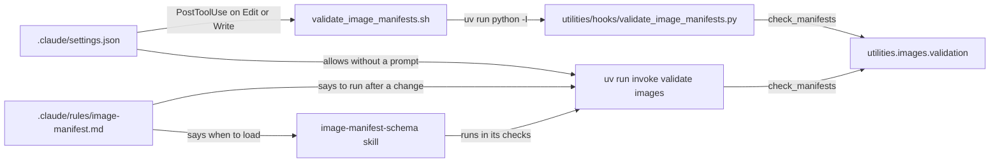

# Claude Code hooks

How the project's Claude Code hook checks the image manifests after Claude edits them. It's for engineers who change the hook, its wrapper, its settings or the rule and skill that go with it.

## Contents

1. [Overview](#overview)
1. [The wrapper](#the-wrapper)
1. [Exit codes](#exit-codes)
1. [Decisions](#decisions)
1. [Limits](#limits)

## Overview

After each Edit or Write, the hook runs the image manifest checks when the edited file is one they cover, and sends any errors back to Claude. The checks are `check_manifests`, described in [Image manifests](images/manifests.md#validation). This diagram shows the parts and how the guidance for Claude points to them:

- [`.claude/settings.json`](../.claude/settings.json) registers the [wrapper](../.claude/hooks/validate_image_manifests.sh) for `Edit|Write`, with a 60-second timeout.
- [`validate_image_manifests.py`](../utilities/hooks/validate_image_manifests.py) reads `tool_input.file_path` from stdin and runs the checks only for a path that matches `WATCHED`.
- `WATCHED` must match the `paths` of [.claude/rules/image-manifest.md](../.claude/rules/image-manifest.md). Nothing checks that they agree.

## The wrapper

The wrapper runs `exec uv run --directory "$root" --quiet python -I utilities/hooks/validate_image_manifests.py`, with the root found from its own path.

- `--directory` makes uv use this project's environment whatever the working directory is.
- `--quiet` keeps uv's progress and warnings out of stderr, which Claude Code passes to Claude on exit 2. uv's own errors still print.
- `-I` keeps `PYTHONPATH`, user site-packages and the script's directory off the import path, so nothing outside the project changes what the hook imports.
- It fails open: without `uv` on `PATH` or without a `.venv`, it prints why to stderr and exits 0. `uv run` would otherwise create a `.venv` without system site packages. Claude never sees stderr from a hook that exits 0, and a person sees it only in verbose output (inferred), so the skipped checks go unnoticed.

## Exit codes

| Exit | When | What happens |
| --- | --- | --- |
| 0 | The file isn't watched, stdin isn't JSON or the checks pass | Nothing |
| 0 | `uv` isn't on `PATH`, or there's no `.venv` | The wrapper's message on stderr, unseen |
| 1 | The import fails, or the checks raise anything other than `ImageError` | The user sees a hook error notice. Claude doesn't (inferred). It's a bug, so it isn't caught |
| 2 | `check_manifests` raises `ImageError` | Claude gets the errors, then `Fix them by following the image-manifest-schema skill.` |
| 2 | uv can't find the interpreter or sync the `.venv` | Claude gets uv's error (observed) |

## Decisions

- **The Python lives in `utilities/hooks`, not `.claude/hooks`.** Pyright doesn't check files under a dot-directory, even when they're named explicitly (observed with Pyright 1.1.414). Only the `sh` wrapper sits in `.claude/hooks`.
- **The wrapper runs `uv run`,** so the hook uses the same environment as a person's terminal.
- **The path filter is in Python,** because a hook's `matcher` matches tool names, not file paths.
- **One command by hand.** People and Claude both run `uv run invoke validate images`, which `settings.json` allows without a prompt, so the script has no by-hand mode.

## Limits

- The hook sees one edit at a time, so a change across several files can fail after each edit until the last. The rule tells Claude to carry on and run `uv run invoke validate images` at the end.
- It only runs for Edit and Write. A change through Bash or by hand doesn't trigger it, and nor does a change to `validation.py` itself.
- Claude Code cancels a run that reaches the timeout and discards its output, such as a slow first sync of the `.venv`.
