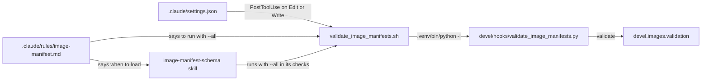
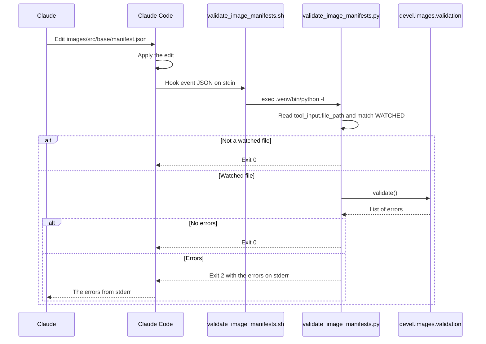

# Claude Code hooks

How the project's Claude Code automation checks the image manifests after Claude edits them. It's for engineers who change the hook, its wrapper, its settings or the guidance that goes with it.

## Contents

1. [Overview](#overview)
1. [How it works](#how-it-works)
1. [Interfaces](#interfaces)
1. [Errors](#errors)
1. [Rule and skill](#rule-and-skill)
1. [Tests](#tests)
1. [Decisions](#decisions)
1. [Limits](#limits)
1. [Sources](#sources)

## Overview

The project has one hook. After each Edit or Write, it runs the image manifest checks when the edited file is one they cover, and sends any errors back to Claude. The checks themselves live in `devel.images.validation`, which [Image manifests](container-images/manifests.md) describes. The hook only decides when to run them and how to report the result.

This diagram shows the parts and how the guidance for Claude points to them:



| File | What it holds |
| --- | --- |
| [`.claude/settings.json`](../.claude/settings.json) | The hook registration and a permission to run the wrapper with `--all` |
| [`.claude/hooks/validate_image_manifests.sh`](../.claude/hooks/validate_image_manifests.sh) | A POSIX `sh` wrapper that runs the script with the project's `.venv` |
| [`devel/hooks/validate_image_manifests.py`](../devel/hooks/validate_image_manifests.py) | The hook logic: which files to watch and how to report errors |
| [`devel/hooks/test/test_validate_image_manifests.py`](../devel/hooks/test/test_validate_image_manifests.py) | The tests for the script and the wrapper |

## How it works

### Registration

`.claude/settings.json` registers a `PostToolUse` hook with the matcher `Edit|Write`. Its command is `"$CLAUDE_PROJECT_DIR"/.claude/hooks/validate_image_manifests.sh`, with a `timeout` of `60` seconds. The same file allows `Bash(.claude/hooks/validate_image_manifests.sh --all)`, so Claude can run the full check without a permission prompt.

### The wrapper

The wrapper finds the repository root from its own path (`$(dirname "$0")/../..`), so it works from any working directory. It then runs:

```sh
exec "$python" -I "$root/devel/hooks/validate_image_manifests.py" "$@"
```

`$python` is `.venv/bin/python` at the root, because the checks need `jsonschema` and `jinja2` from the `dev` dependency group. `-I` runs Python in isolated mode, which keeps `PYTHONPATH`, user site-packages and the script's directory off the import path. The hook then imports only what the project's environment provides.

If `.venv/bin/python` isn't an executable file, the wrapper prints `Can't run the image manifest checks: there's no .venv. Run uv sync.` to stderr. It exits 1 when its first argument is `--all`, and 0 otherwise.

### The script

`main` in `validate_image_manifests.py` follows these steps:

1. **Hook mode** (no `--all`): it reads the hook event as JSON from stdin. If stdin isn't valid JSON, it exits 0.
1. It takes `tool_input.file_path` from the event. `edited_file` returns an empty string when the event doesn't have that shape.
1. `is_watched` resolves the path, makes it relative to `ROOT` and matches it against each pattern in `WATCHED` with `PurePosixPath.full_match`. If nothing matches, it exits 0 without running the checks.
1. It changes directory to `ROOT` and appends `ROOT` to `sys.path`, because the checks use paths relative to the root and import `devel` from it. Python never puts the root on the path for this script: it would add the script's directory, `devel/hooks`, and `-I` leaves out even that. So the hook works from any working directory.
1. It imports `devel.images.validation` and calls `validate()`, which returns a list of error strings.
1. It reports the result, as [Errors](#errors) describes.

With `--all`, the script skips steps 1 to 3 and doesn't read stdin.

`WATCHED` holds these patterns, relative to the root:

- `schemas/image-manifest.schema.json`
- `images/src/*/manifest.json`
- `images/src/*/template.json`
- `devel/images/manifest.py`

`full_match` matches the whole path, and its `*` doesn't cross a `/`. So `images/src/base/manifest.json` matches, but `images/src/base/nested/manifest.json` doesn't.

This sequence diagram shows an Edit to a watched file:



## Interfaces

- **Input in hook mode:** the `PostToolUse` event JSON on stdin. The script reads only `tool_input.file_path`.
- **Input by hand:** `.claude/hooks/validate_image_manifests.sh --all`. The wrapper passes its arguments to the script, which checks only for `--all`.

| Exit | When | Output |
| --- | --- | --- |
| 0 | The file isn't watched, stdin isn't JSON or the checks pass | With `--all`, a success line on stdout: `The image manifests, their schema, ImageManifest and the templates agree.` |
| 0 | Hook mode with no `.venv` | The wrapper's message on stderr |
| 1 | `--all` with no `.venv`, or the import of `devel.images.validation` fails | A message on stderr that says to run `uv sync` |
| 2 | `validate()` returns errors | On stderr, `The image manifest checks failed:`, then one `- ` line per error and `Fix them by following the image-manifest-schema skill.` |

## Errors

- For a `PostToolUse` hook, Claude Code passes stderr to Claude when the hook exits 2. The tool call has already run, so the errors tell Claude what to fix next rather than undoing the edit.
- Claude Code treats any other non-zero exit as a non-blocking error and doesn't pass stderr to Claude. So a failed import (exit 1) reaches the user, not Claude.
- The hook fails open: without a `.venv` it exits 0, so it never blocks work in a checkout that hasn't run `uv sync`. With `--all`, the same case exits 1, so a check run by hand can't pass without running.
- The hook prints only the error strings from `validate()`, which hold file paths and field names from the repository.

## Rule and skill

The hook is one of three parts that keep the manifests in step. Each holds a different piece:

- **[`.claude/rules/image-manifest.md`](../.claude/rules/image-manifest.md):** a rule scoped by `paths` to the same four patterns as `WATCHED`. It tells Claude when to load the skill and to run the wrapper with `--all` after every change to these files. It also says why the hook can report errors partway through a change.
- **[`.claude/skills/image-manifest-schema/SKILL.md`](../.claude/skills/image-manifest-schema/SKILL.md):** the procedure for changing a manifest field, which ends by running the wrapper with `--all`.
- **The hook:** the automatic check after each edit, whose stderr points Claude to the skill.

If you change `WATCHED`, change the rule's `paths` to match (observed: they hold the same four patterns, and nothing checks that they agree).

## Tests

[`test_validate_image_manifests.py`](../devel/hooks/test/test_validate_image_manifests.py) imports the script as the top-level module `validate_image_manifests`. It tests that:

- `is_watched` matches each `WATCHED` file and ignores other files, nested paths, paths outside the repository and an empty path.
- `edited_file` reads `tool_input.file_path` and returns an empty string for other shapes.
- `main` skips unwatched files without calling `validate`, ignores input that isn't JSON and exits 2 with the errors on stderr.
- `main` with `--all` checks without reading stdin, and prints the success line.
- The real wrapper passes with `--all` against the repository, and exits 0 with empty stderr for a hook event on a watched file and on an unwatched one.

The wrapper tests run the real checks, so they need the `.venv`. See [CONTRIBUTING.md](../CONTRIBUTING.md) for how to run the tests.

## Decisions

- **The Python lives in `devel/hooks`, not `.claude/hooks`.** Pyright 1.1.414 doesn't check files under a dot-directory, even when they're named in `include` or on the command line (observed). [`pyrightconfig.json`](../pyrightconfig.json) also excludes `**/.*`. Only the `sh` wrapper sits in `.claude/hooks`, where `settings.json` points.
- **The tests import the hook as a top-level module.** `pyproject.toml` adds `devel/hooks` to the pytest `pythonpath`, and `pyrightconfig.json` adds it to `extraPaths`, so `import validate_image_manifests` resolves in both.
- **The wrapper runs the `.venv` Python directly with `-I`.** The checks need the project's dependencies. `-I` stops `PYTHONPATH`, user site-packages or a module in `devel/hooks` changing what the hook imports.
- **The path filter is in Python, not in the matcher.** The `matcher` matches tool names, not file paths, so `is_watched` decides which edits need the checks.
- **The hook runs after the tool.** `validate()` reads the files on disk, so it can only check an edit once Claude Code has applied it.

## Limits

- The hook sees one edit at a time. A change that touches several files, such as renaming a field in the schema and every manifest, can fail the checks after each edit until the last one. The rule tells Claude to carry on and run `--all` at the end.
- It only checks paths inside the repository. `is_watched` returns `False` for a path that isn't under `ROOT`.
- It runs only for the Edit and Write tools. A change made another way, such as through Bash or by hand, doesn't trigger it, so run the wrapper with `--all` afterwards.
- It runs every check on every watched edit, not only the checks for the edited file.

## Sources

- https://code.claude.com/docs/en/hooks
- https://docs.python.org/3/using/cmdline.html#cmdoption-I
- Observed with Pyright 1.1.414: a file with a type error under a dot-directory reports no errors, when the directory is in `include` and when the file is named on the command line.
