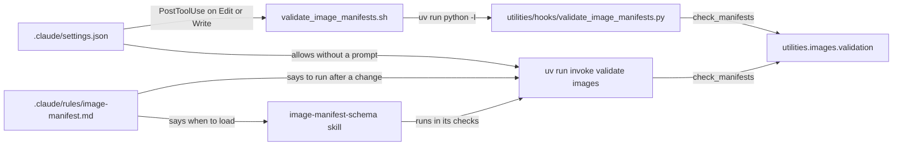

# Claude Code hooks

The high-level design of the Claude Code hook that checks the image manifests after Claude edits them. It's for engineers who change the hook, its wrapper or the rule and skill that go with it.

## Contents

1. [Overview](#overview)
1. [Design](#design)
1. [Limits](#limits)

## Overview

After each Edit or Write to a file the manifest checks cover, the hook runs the checks and sends any errors back to Claude. A path-scoped rule tells Claude when to load the `image-manifest-schema` skill, and the hook's errors point it there too:

## Design

- **Exit 2 is how Claude sees the errors.** Claude Code passes a `PostToolUse` hook's stderr to Claude only on exit 2. The hook exits 0 when there's nothing to report. Exit 1 means a bug, such as a failed import, which only the user sees.
- **It fails open.** Without `uv` or a `.venv`, the wrapper exits 0, because `uv run` would otherwise create a `.venv` without system site packages. Nobody is told the checks were skipped.
- **The wrapper runs `uv run --quiet python -I` from the repository root,** so the hook uses the project's environment, uv's warnings stay out of what Claude sees and nothing outside the project changes what Python imports.
- **The Python lives in `utilities/hooks`, not `.claude/hooks`,** because Pyright doesn't check files under a dot-directory (observed with Pyright 1.1.414).
- **`WATCHED` in the script mirrors the rule's `paths`.** Nothing checks that they agree.

## Limits

- The hook sees one edit at a time, so a change across several files can fail after each edit until the last. The rule tells Claude to run `uv run invoke validate images` at the end.
- It only runs for Edit and Write, not for changes through Bash or by hand.
