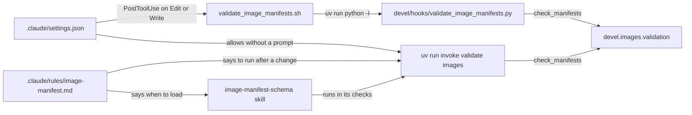

# Claude Code hooks

How the project's Claude Code automation checks the image manifests after Claude edits them. It's for engineers who change the hook, its wrapper, its settings or the guidance that goes with it.

## Contents

1. [Overview](#overview)
1. [How it works](#how-it-works)
1. [Interfaces](#interfaces)
1. [Errors](#errors)
1. [Rule and skill](#rule-and-skill)
1. [Tests](#tests)
1. [Decisions](#decisions)
1. [Limits](#limits)
1. [Sources](#sources)

## Overview

The project has one hook. After each Edit or Write, it runs the image manifest checks when the edited file is one they cover, and sends any errors back to Claude. The checks live in `devel.images.validation`, which [Image manifests](images/manifests.md) describes. The hook only decides when to run them and how to report the result. To run the same checks by hand, use `uv run invoke validate images`, as [Build and test](../README.md#build-and-test) lists.

This diagram shows the parts and how the guidance for Claude points to them:



| File | What it holds |
| --- | --- |
| [`.claude/settings.json`](../.claude/settings.json) | The hook registration, and a permission to run `uv run invoke validate images` |
| [`.claude/hooks/validate_image_manifests.sh`](../.claude/hooks/validate_image_manifests.sh) | A POSIX `sh` wrapper that runs the script through `uv run` |
| [`devel/hooks/validate_image_manifests.py`](../devel/hooks/validate_image_manifests.py) | The hook logic: which files to watch and how to report errors |
| [`devel/hooks/test/test_validate_image_manifests.py`](../devel/hooks/test/test_validate_image_manifests.py) | The tests for the script and the wrapper |

## How it works

### Registration

`.claude/settings.json` registers a `PostToolUse` hook with the matcher `Edit|Write`. Its command is `"$CLAUDE_PROJECT_DIR"/.claude/hooks/validate_image_manifests.sh`, with a `timeout` of `60` seconds. The same file allows `Bash(uv run invoke validate images)`, so Claude can run the checks by hand without a permission prompt.

### The wrapper

The wrapper finds the repository root from its own path (`$(dirname "$0")/../..`), so it works from any working directory. It then runs:

```sh
exec uv run --directory "$root" --quiet python -I devel/hooks/validate_image_manifests.py
```

- `uv run` syncs the `dev` dependency group into `.venv` first, and the checks need that group.
- `--directory "$root"` runs uv from the repository root, so it uses this project's environment whatever the working directory is. Run from another project, `uv run` would use that project's environment instead.
- `--quiet` keeps uv's progress and warning messages out of stderr, which Claude Code passes to Claude when the hook exits 2. With `VIRTUAL_ENV` set to another project's environment, uv's mismatch warning stays out of it too (observed). uv's own errors still print (observed), as [Errors](#errors) describes.
- `-I` runs Python in isolated mode. It keeps `PYTHONPATH`, user site-packages and the script's directory off the import path, so none of them can change what the hook imports.

Before it hands over to uv, the wrapper checks two things. When one fails, it prints `Can't run the image manifest checks:` and the reason to stderr, and exits 0:

- `uv` must be on `PATH`.
- `.venv` must exist at the root. Without it, `uv run` would create one without system site packages, which [Set up](../README.md#set-up) says to avoid.

### The script

The script reads the hook event from stdin and takes the edited path from `tool_input.file_path`. It does nothing unless the path matches a pattern in `WATCHED`. For a watched file, it changes directory to the repository root and appends the root to `sys.path`, because the checks use paths relative to the root and import `devel` from it. Python doesn't put the root on the path for a script in `devel/hooks`. It then calls `check_manifests` and reports the result, as [Interfaces](#interfaces) shows.

This sequence diagram shows an Edit to a watched file:

```mermaid
sequenceDiagram
    accTitle: An Edit that triggers the image manifest hook
    accDescr: Claude edits a watched file. After the edit, Claude Code runs the wrapper with the hook event on stdin, and the wrapper runs the Python script through uv run. The script checks the path and, for a watched file, calls check_manifests. When check_manifests raises ImageError, the script exits 2 and Claude Code passes the errors on stderr to Claude.
    participant Claude
    participant CC as Claude Code
    participant Wrapper as validate_image_manifests.sh
    participant Script as validate_image_manifests.py
    participant Validation as devel.images.validation
    Claude->>CC: Edit images/src/base/manifest.json
    CC->>CC: Apply the edit
    CC->>Wrapper: Hook event JSON on stdin
    Wrapper->>Script: exec uv run python -I
    Script->>Script: Read tool_input.file_path and match WATCHED
    alt Not a watched file
        Script-->>CC: Exit 0
    else Watched file
        Script->>Validation: check_manifests()
        alt Everything agrees
            Validation-->>Script: Returns
            Script-->>CC: Exit 0
        else Something disagrees
            Validation-->>Script: Raises ImageError
            Script-->>CC: Exit 2 with the errors on stderr
            CC-->>Claude: The errors from stderr
        end
    end
```



## Interfaces

- **Input:** the `PostToolUse` event JSON on stdin. The script reads only `tool_input.file_path`, and takes no arguments.
- **Watched files:** the patterns in `WATCHED` in [`validate_image_manifests.py`](../devel/hooks/validate_image_manifests.py), relative to the repository root. `is_watched` matches the whole path with `PurePosixPath.full_match`, whose `*` doesn't cross a `/`. So a `manifest.json` in a subfolder of an image folder isn't watched.

| Exit | When | Output |
| --- | --- | --- |
| 0 | The file isn't watched, stdin isn't JSON or the checks pass | None |
| 0 | `uv` isn't on `PATH`, or there's no `.venv` | The wrapper's message on stderr |
| 1 | The import of `devel.images.validation` fails, or the checks raise any exception other than `ImageError` | A message or a traceback on stderr |
| 2 | `check_manifests` raises `ImageError` | On stderr, the `ImageError` message, which lists each error, then `Fix them by following the image-manifest-schema skill.` |
| 2 | uv can't find the interpreter or sync the `.venv` | uv's error on stderr (observed: uv exits 2) |

## Errors

- For a `PostToolUse` hook, Claude Code shows stderr to Claude when the hook exits 2. The tool call has already run, so the errors tell Claude what to fix next rather than undoing the edit.
- Claude Code treats any other non-zero exit as a non-blocking error. The user sees a hook error notice with the first line of stderr, and Claude doesn't see it (inferred). So a failed import, or an exception other than `ImageError`, reaches the user, not Claude. Such an exception is a bug, as [Between tasks.py and devel](dev-tooling.md#between-taskspy-and-devel) describes, so the script doesn't catch it.
- The hook fails open only without `uv` or a `.venv`. The wrapper then exits 0, so it doesn't block work in a checkout that isn't set up. Its message goes to stderr, which Claude never sees from a hook that exits 0, and a person sees only in verbose or debug output (inferred). So nobody is told that the checks were skipped.
- A checkout that's partly set up doesn't fail open. When uv can't find the interpreter or sync the `.venv`, uv exits 2 (observed), so Claude Code passes uv's error to Claude instead of the checks' result. One cause is a machine without the system Python 3.14, since uv never downloads a Python of its own (see [Python](dev-tooling.md#python)).
- Claude Code cancels a run that reaches the 60-second `timeout` and discards its output, as the hooks docs say. A slow first sync of the `.venv`, for example, then skips the checks, and Claude doesn't see their result.
- On exit 2 the hook prints the `ImageError` message and the pointer to the skill. The message holds file paths, field names and values from the repository's own files, with the error text from jsonschema, the JSON parser and Jinja2. It holds nothing from outside the repository.

## Rule and skill

The hook is one of three parts that keep the manifests in step. Each holds a different piece:

- **[`.claude/rules/image-manifest.md`](../.claude/rules/image-manifest.md):** a rule scoped by `paths` to the same patterns as `WATCHED`. It tells Claude when to load the skill and to run `uv run invoke validate images` after every change to these files. It also says why the hook can report errors partway through a change.
- **[`.claude/skills/image-manifest-schema/SKILL.md`](../.claude/skills/image-manifest-schema/SKILL.md):** the procedure for changing a manifest field, which ends by running `uv run invoke validate images` and the project checks.
- **The hook:** the automatic check after each edit, whose stderr points Claude to the skill.

If you change `WATCHED`, change the rule's `paths` to match. Nothing checks that they agree (observed).

## Tests

[`test_validate_image_manifests.py`](../devel/hooks/test/test_validate_image_manifests.py) imports the script as the top-level module `validate_image_manifests`, as [Decisions](#decisions) explains.

- The wrapper tests run the real checks through `uv run`, so they need `uv` and the `.venv`. Install uv as [Prerequisites](../README.md#prerequisites) lists and create the `.venv` as [Set up](../README.md#set-up) describes. Run the tests as [Build and test](../README.md#build-and-test) lists.
- The test of the wrapper without `uv` sets `PATH` to `/usr/bin:/bin`, so pytest skips it when `uv` itself lives in `/usr/bin` or `/bin`.

## Decisions

- **The Python lives in `devel/hooks`, not `.claude/hooks`.** Pyright 1.1.414 doesn't check files under a dot-directory, even when they're named in `include` or on the command line (observed). Only the `sh` wrapper sits in `.claude/hooks`, where `settings.json` points. Pyright's settings are in [Python](dev-tooling.md#python).
- **The tests import the hook as a top-level module.** They import it as `validate_image_manifests`. [How imports resolve](dev-tooling.md#how-imports-resolve) describes how pytest and Pyright find it.
- **The wrapper runs the script through `uv run`.** That's how a person runs the project's commands, so the hook and a terminal use the same environment and dependencies, rather than one that only works on a machine where `.venv` happens to be in step.
- **There's one command to run the checks by hand.** People and Claude both run `uv run invoke validate images`, and `settings.json` allows it. So the script has no by-hand mode, and both report the message that `check_manifests` builds.
- **The path filter is in Python, not in the matcher.** The `matcher` matches tool names, not file paths, so `is_watched` decides which edits need the checks.
- **The hook runs after the tool.** `check_manifests` reads the files on disk, so it can only check an edit once Claude Code has applied it.

## Limits

- The hook sees one edit at a time. A change that touches several files, such as renaming a field in the schema and every manifest, can fail the checks after each edit until the last one. The rule tells Claude to carry on and run `uv run invoke validate images` at the end.
- It only checks paths inside the repository. `is_watched` returns `False` for a path that isn't under the root.
- It runs only for the Edit and Write tools. A change made another way, such as through Bash or by hand, doesn't trigger it, so run `uv run invoke validate images` afterwards.
- It doesn't watch `devel/images/validation.py`, the checks themselves. A fix made there doesn't run the hook again, so run `uv run invoke validate images` afterwards.
- It runs every check on every watched edit, not only the checks for the edited file.

## Sources

- https://code.claude.com/docs/en/hooks
- https://docs.astral.sh/uv/reference/cli/#uv-run
- https://docs.astral.sh/uv/concepts/projects/dependencies/#default-groups
- https://docs.python.org/3/using/cmdline.html#cmdoption-I
- Observed with Pyright 1.1.414: a file with a type error under a dot-directory reports no errors, when the directory is in `include` and when the file is named on the command line.
- Observed with uv: `--quiet` keeps the warning about a `VIRTUAL_ENV` that doesn't match the project out of stderr.
- Observed with uv 0.13.5: `uv run --quiet` still prints its own errors to stderr and exits 2, with a `--directory` that doesn't exist and with a project whose `requires-python` no interpreter meets.
