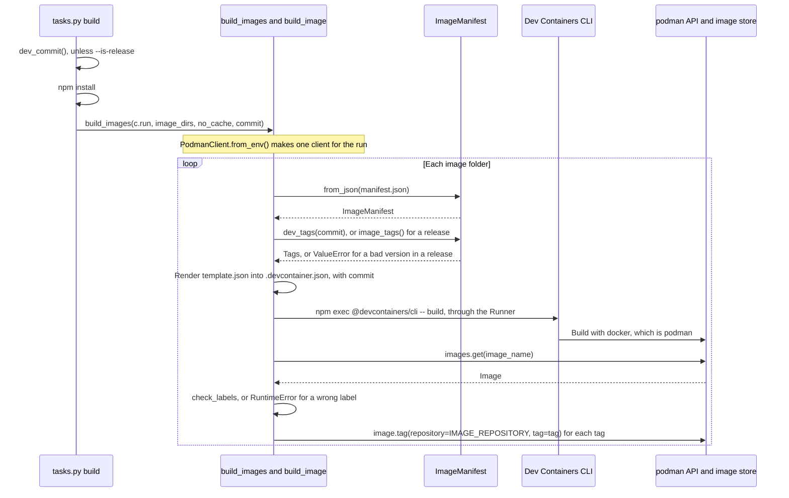

# Image builds

How `devel.images` builds, labels and tags each image: it renders the image's `.devcontainer.json`, runs the Dev Containers CLI and tags the result with podman. It's for engineers who change [build.py](../../devel/images/build.py) or the `build` task in [tasks.py](../../tasks.py).

## Contents

1. [Overview](#overview)
1. [How it works](#how-it-works)
1. [Interfaces](#interfaces)
1. [Errors](#errors)
1. [Decisions](#decisions)
1. [Limits](#limits)
1. [Sources](#sources)

## Overview

[build.py](../../devel/images/build.py) turns an image folder in `images/src/` into a tagged image in podman's local image store. It doesn't find the image folders or run the image tests, and it doesn't define the manifest or its tags:

- [Container images](overview.md) covers how image folders are found and how images are named.
- [Image manifests](manifests.md) covers `manifest.json`, `ImageManifest`, the tag scheme and the template syntax.
- [Image tests](tests.md) covers what `invoke test images` does after the build.
- [Dev tooling](../dev-tooling.md) covers how the `build` and `test` tasks in `tasks.py` call `build_images`, and the Python and npm tooling.

For the commands, see [CONTRIBUTING.md](../../CONTRIBUTING.md).

## How it works

This sequence diagram shows one run of `invoke build images`, from the task to podman:



### Before the build

- Unless the task is given `--is-release`, the build is a dev build. `tasks.py` calls `dev_commit` and passes the result to `build_images` as `commit`. For a release, it passes `None`. It does this before `npm install`, so a failure stops the task before anything is installed or built.
- `dev_commit` reads the repository with pygit2, not the `git` command. It opens the repository at or above the working directory, takes the short SHA of `HEAD` from `short_id` and adds `-dirty` when `status` lists any file, such as `535a69a-dirty`.
- `status` lists staged, unstaged and untracked changes. It leaves out files that `.gitignore` ignores, such as the rendered `.devcontainer.json`, so rendering doesn't make the next build dirty. `untracked_files="normal"` lists an untracked folder once instead of every file in it.
- `tasks.py` runs `npm install` before it calls `build_images` (see [Dev tooling](../dev-tooling.md#tasks-and-suites)). That installs `@devcontainers/cli` from [package.json](../../package.json), within its `^0.88.0` range. The repository tracks no `package-lock.json`, as [Dev tooling](../dev-tooling.md#node-and-npm) describes.
- `build_images` makes one client with `podman.PodmanClient.from_env()` and passes it to `build_image` for every image. In podman-py 5.8.0, `from_env` reads `CONTAINER_HOST` or `DOCKER_HOST` and doesn't contact the service, so the first request is the `images.get` after the first build (inferred from the podman-py source).

### For each image

`build_image` does these steps in order:

1. Loads `manifest.json` with `ImageManifest.from_json`.
1. Names the image with `image_name`: after its folder for a release, such as `ghcr.io/froazin/devcontainers:base`, and with `-dev` for a dev build, such as `ghcr.io/froazin/devcontainers:base-dev`. [Image names and paths](overview.md#image-names-and-paths) describes both. A dev build never takes the release name, so it can't take a tag off a release image in the store.
1. Works out the tags before it writes or builds anything. With a `commit`, it uses `manifest.dev_tags(commit)`: each tag with `-dev`, on its own and with a `_<commit>` suffix, such as `base-dev` and `base-dev_9027c9d` or `base-dev_9027c9d-dirty`. Without one, for a release, it uses `manifest.image_tags()`, the version tags. [The ImageManifest dataclass](manifests.md#the-imagemanifest-dataclass) describes both.
1. Renders `template.json` with the manifest and `commit` into `.devcontainer.json` in the image folder, overwriting it. [Rendering template.json](manifests.md#rendering-templatejson) covers the Jinja2 settings, and [Labels](#labels) the values it adds for the labels.
1. Runs the Dev Containers CLI through the `Runner`. `devcontainer_build` joins this command, with `--no-cache` only when `no_cache` is true:

   ```text
   npm exec @devcontainers/cli -- build --workspace-folder=<image_dir> --image-name=<image_name> --no-lockfile [--no-cache]
   ```

1. Checks the built image's labels with `check_labels`, against `manifest.labels(commit)`. A missing or wrong label raises `RuntimeError` before anything is tagged, as [Labels](#labels) describes.
1. Tags the image with `tag_image`: one `client.images.get(image_name)`, then `image.tag(repository=IMAGE_REPOSITORY, tag=tag)` for each tag, printing `Tagging image <image_name> as <tag>` before each one.

### Labels

Each image carries the standard OCI labels, set from build arguments that the template fills in:

| Label | Build argument | Release value | Dev build value |
| --- | --- | --- | --- |
| `org.opencontainers.image.version` | `IMAGE_VERSION` | `version`, such as `0.1.0` | `<version>-dev+<commit>`, such as `0.1.0-dev+418e94b-dirty` |
| `org.opencontainers.image.title` | `IMAGE_TITLE` | `name` | The same |
| `org.opencontainers.image.description` | `IMAGE_DESCRIPTION` | `description` | The same |
| `org.opencontainers.image.source` | `IMAGE_SOURCE` | `https://github.com/<owner>/<repo>` | The same |

- `ImageManifest.render_template` passes `image_version` and `image_source` to the template, as well as every manifest field. The image's `template.json` puts the four values in `build.args`, after the manifest's `build_args`.
- The `Containerfile` declares each one with `ARG` after `FROM`, runs `RUN true` and sets the labels with one `LABEL` instruction. An `ARG` before `FROM` isn't visible after it, so the label arguments can't share the `BASE_IMAGE` line.
- `RUN true` stops podman's layer cache from keeping old label values. podman caches layers by default, and the cache key for an `ARG` or `LABEL` step is its text, without the argument values. Without the `RUN`, a release built after a dev build kept the dev version label. The cache key for a `RUN` step does include the build arguments, so a changed value rebuilds from there, and the same values still reuse the cache (both observed with podman 5.7.0 and buildah 1.42.1). It costs one layer of about 1 kB.
- After the build, `check_labels` reads the four labels back from the image and compares them with `manifest.labels(commit)`. That catches a stale cache, and a template or `Containerfile` that leaves a label out: buildah sets a label to `""` when its argument isn't passed (observed).
- A dev build's version is a SemVer 2.0.0 pre-release with build metadata, so a dev image never carries the version of a release. Labels can hold `+`, which tags can't.

### Where the image lands

- The command passes no `--docker-path`, so the CLI runs `docker`. In CLI 0.88.0, the `build` command's `--docker-path` has no default, and the code falls back to `docker` when it isn't set (observed in its source).
- The CLI builds into whatever store `docker` writes to. The podman client then looks the image up in podman's store. If `docker` isn't podman, the image lands in a store the podman client can't see, and `images.get` fails.
- On the dev machine, `/usr/bin/docker` is a shell script that runs `exec /usr/bin/podman "$@"` (observed).

## Interfaces

| Name | In | What it is |
| --- | --- | --- |
| `build_images(run, image_dirs, no_cache=False, commit=None)` | [build.py](../../devel/images/build.py), exported by `devel.images` | Builds and tags each folder in `image_dirs`, in order. `commit` makes a dev build, and `None` a release |
| `build_image(run, client, image_dir, no_cache=False, commit=None)` | [build.py](../../devel/images/build.py) | Builds and tags one image with a client it's given |
| `dev_commit(path=".")` | [build.py](../../devel/images/build.py), exported by `devel.images` | Returns the short SHA of the commit checked out in the repository at or above `path`, with `-dirty` when the working tree has uncommitted changes. Raises `RuntimeError` when pygit2 can't read it |
| `check_labels(client, image_name, expected)` | [build.py](../../devel/images/build.py) | Raises `RuntimeError` when the image's labels differ from `expected` |
| `Runner` | [build.py](../../devel/images/build.py) | `Callable[[str], object]` that runs a shell command, such as Invoke's `c.run` |
| `render_template(image_dir, manifest, commit=None)` | [build.py](../../devel/images/build.py) | Returns the rendered template, for a dev build of `commit` or, with `None`, a release. Validation also calls it, as a release (see [Image manifests](manifests.md)) |

- Why the package takes a `Runner` instead of importing Invoke is in [Dev tooling](../dev-tooling.md#between-taskspy-and-devel). The tests in [test_build.py](../../devel/images/test/test_build.py) pass a list's `append` and check the command text.
- The constants that `build.py` imports from [config.py](../../devel/images/config.py) are listed in [Image names and paths](overview.md#image-names-and-paths).
- `build_images` returns nothing. A failure is an exception.

## Errors

Each error stops the whole run. Images built before it stay built and tagged, and later images aren't built. Errors in the task before the build, such as `npm` missing from `PATH`, are in [Dev tooling](../dev-tooling.md#errors).

| Cause | What happens |
| --- | --- |
| A manifest field is missing or unknown | `ImageManifest.from_json` raises `TypeError` before anything is built |
| pygit2 can't read the commit, such as outside a Git repository, in a bare repository or when it can't read a file in `.git` | `dev_commit` raises `RuntimeError` with pygit2's message, before `npm install`. It catches `pygit2.GitError` and `OSError`, because pygit2 raises a plain `OSError` for a file it can't read (observed) |
| The repository has no commits yet | `dev_commit` raises `RuntimeError` saying so, before `npm install`. pygit2's own message is only `'HEAD'` (observed) |
| `version` isn't `MAJOR.MINOR.PATCH` integers, in a release | `image_tags` raises `ValueError` before rendering or building. `test_build_image_checks_the_version_before_building` checks that no command runs. A dev build only puts `version` in its label, so `invoke validate images` is what catches it there |
| The template uses a field the manifest doesn't have | Jinja2 raises `UndefinedError`. `render_devcontainer` renders before it opens the file, so an existing `.devcontainer.json` is left as it was |
| The CLI build fails | Invoke's `c.run` raises `UnexpectedExit` on a non-zero exit, its default (inferred from Invoke's docs) |
| The built image has a missing or wrong label | `check_labels` raises `RuntimeError` with each wrong label, after the build and before tagging. The image keeps only the name the CLI gave it |
| The image isn't in podman's store, or podman's API service isn't reachable | `images.get` raises, such as `podman.errors.ImageNotFound`, after the CLI has built the image |

## Decisions

The code doesn't record why these choices were made. The reasons given are inferred, unless a bullet says otherwise.

- **Tag with podman-py, not the CLI:** the CLI gets one `--image-name`, and `tag_image` adds every tag through the podman client. The tag list stays in Python, where `test_tag_image_applies_each_tag_to_the_repository` checks it with a mock client. The [image tests](tests.md) use the same client library.
- **Pass `--no-lockfile`:** the CLI otherwise generates and verifies a lockfile for Dev Container features (`--no-lockfile` is "Disable lockfile generation and verification." in its source). The images don't use features, and no lockfile is kept in the image folders.
- **Work out the tags first:** a bad `version` fails before `.devcontainer.json` is overwritten or a slow build starts.
- **Read Git with pygit2, not the `git` command:** the maintainer chose to drop direct Git CLI calls from the build. pygit2 reads the repository in process, so the build doesn't need `git` on `PATH` or parse its output.
- **Count untracked files as dirty:** an untracked file in an image folder is part of the build context, so the image can differ from the commit. This matches `git status`, which lists untracked files. `git describe --dirty` doesn't count them.
- **Name dev builds `<folder>-dev`:** the maintainer chose it so a dev build is easy to tell from a release, which keeps the plain tags. The dev build's name doesn't change with the commit, so `invoke test images --skip-build` finds the latest dev build without knowing its SHA.
- **Separate the SHA with `_`:** the maintainer wanted SemVer's `+`, but podman rejects it in a tag with `invalid reference format` (observed). `_` is the usual stand-in for `+` in container tags.
- **Set the labels through build arguments:** the maintainer chose to fill them in from the manifest through the template, so the `Containerfile` doesn't repeat the manifest's values.
- **Break the cache with `RUN true`, not `--label` or `--no-cache`:** the maintainer wanted the labels in the `Containerfile`. Passing `--label` through `build.options` would also avoid the stale cache, and `--no-cache` would make every build slow.
- **One podman client per run:** `build_images` makes it once, and `build_image` takes it as an argument, so the tests can pass a mock.

## Limits

- No push or publish. The command doesn't pass the CLI's `--push`, and nothing else uploads the images. The image name and every tag exist only in the local podman store.
- One architecture. The command doesn't pass `--platform`, so the CLI builds for the host's platform (inferred).
- Images build one after another, in the order `image_dirs` gives them.
- `docker` must be podman, and podman's API service must be running for the tagging step.
- Tags are only added. Old tags from an earlier version or commit stay in the local store. A new dev build takes `<tag>-dev` over, so the old dev image keeps only its `_<commit>` tag.
- A dev tag names the commit that's checked out. `-dirty` says that the working tree had uncommitted changes, not what they were. Two dirty builds of the same commit give the same tags, and the later build takes them over. So do two clean builds of the same commit.
- Any uncommitted change in the repository makes the build dirty, even one outside `images/`, such as an edit to a doc.
- The labels can't be checked from `test.sh`, because a container can't see its image's labels. `check_labels` checks them during the build instead.
- Nothing stops a manifest's `build_args` from using a label argument's name. The rendered `build.args` then has the same key twice. The template writes the label arguments last, and the Dev Containers CLI keeps the last value for a repeated key (observed with `devcontainer read-configuration`, CLI 0.88.0), so the manifest's value is silently dropped.
- The schema allows a tag of up to 100 characters. With the default 7-character short SHA, the dev suffix adds 12 characters, or 18 with `-dirty`, so the longest tag is 118. `short_id` follows Git's `core.abbrev` setting, up to the full 40 characters (observed with pygit2 1.20.1). A short SHA of 18 or more characters can push a long tag past the 128 characters the OCI distribution spec's tag pattern allows, and tagging then fails after the build (inferred).

## Sources

- Dev Containers CLI: https://github.com/devcontainers/cli
- podman-py: https://podman-py.readthedocs.io/
- pygit2: https://www.pygit2.org/
- OCI distribution spec, tag pattern: https://github.com/opencontainers/distribution-spec/blob/main/spec.md
- OCI image spec, pre-defined annotation keys: https://github.com/opencontainers/image-spec/blob/main/annotations.md
- SemVer 2.0.0: https://semver.org/
- Dockerfile `ARG` and `FROM`: https://docs.docker.com/reference/dockerfile/#understand-how-arg-and-from-interact
- Invoke `Context.run`: https://docs.pyinvoke.org/en/stable/api/context.html
- Observed on the dev machine: `/usr/bin/docker` is a podman shim, and CLI 0.88.0 falls back to `docker` when `--docker-path` isn't set, in `node_modules/@devcontainers/cli/dist/spec-node/devContainersSpecCLI.js`.
