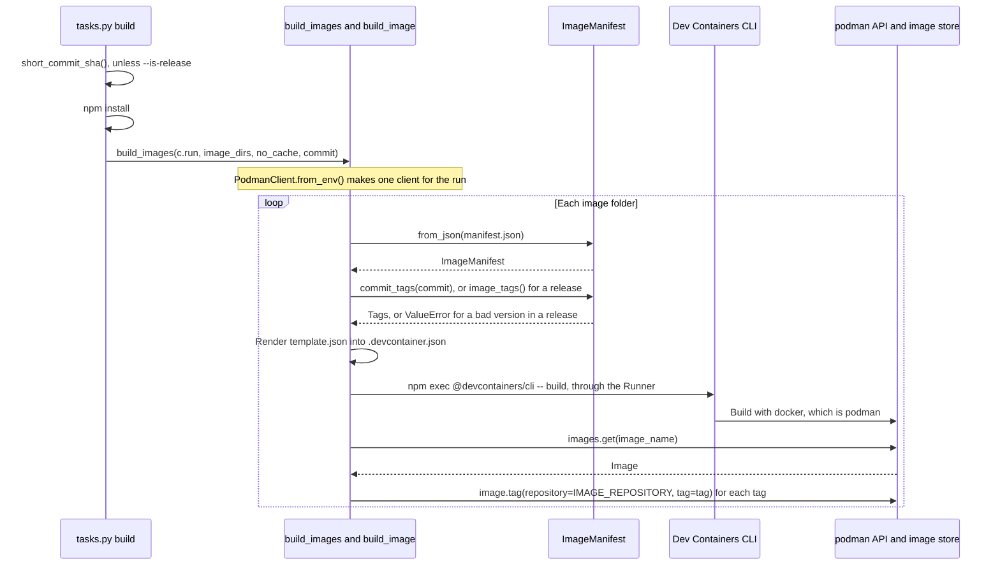

# Image builds

How `devel.images` builds and tags each image: it renders the image's `.devcontainer.json`, runs the Dev Containers CLI and tags the result with podman. It's for engineers who change [build.py](../../devel/images/build.py) or the `build` task in [tasks.py](../../tasks.py).

## Contents

1. [Overview](#overview)
1. [How it works](#how-it-works)
1. [Interfaces](#interfaces)
1. [Errors](#errors)
1. [Decisions](#decisions)
1. [Limits](#limits)
1. [Sources](#sources)

## Overview

[build.py](../../devel/images/build.py) turns an image folder in `images/src/` into a tagged image in podman's local image store. It doesn't find the image folders or run the image tests, and it doesn't define the manifest or its tags:

- [Container images](overview.md) covers how image folders are found and how images are named.
- [Image manifests](manifests.md) covers `manifest.json`, `ImageManifest`, the tag scheme and the template syntax.
- [Image tests](tests.md) covers what `invoke test images` does after the build.
- [Dev tooling](../dev-tooling.md) covers how the `build` and `test` tasks in `tasks.py` call `build_images`, and the Python and npm tooling.

For the commands, see [CONTRIBUTING.md](../../CONTRIBUTING.md).

## How it works

This sequence diagram shows one run of `invoke build images`, from the task to podman:



### Before the build

- Unless the task is given `--is-release`, `tasks.py` calls `short_commit_sha`, which runs `git rev-parse --short HEAD`, and passes the result to `build_images` as `commit`. For a release, it passes `None`. It does this before `npm install`, so a failure stops the task before anything is installed or built.
- `tasks.py` runs `npm install` before it calls `build_images` (see [Dev tooling](../dev-tooling.md#tasks-and-suites)). That installs `@devcontainers/cli` from [package.json](../../package.json), at the version [package-lock.json](../../package-lock.json) locks.
- `build_images` makes one client with `podman.PodmanClient.from_env()` and passes it to `build_image` for every image. In podman-py 5.8.0, `from_env` reads `CONTAINER_HOST` or `DOCKER_HOST` and doesn't contact the service, so the first request is the `images.get` after the first build (inferred from the podman-py source).

### For each image

`build_image` does these steps in order:

1. Loads `manifest.json` with `ImageManifest.from_json`.
1. Names the image after its folder, such as `ghcr.io/froazin/devcontainers:base`, as [Image names and paths](overview.md#image-names-and-paths) describes.
1. Works out the tags before it writes or builds anything. With a `commit`, it uses `manifest.commit_tags(commit)`: each tag on its own and with a `-<commit>` suffix, such as `base-9027c9d`. Without one, for a release, it uses `manifest.image_tags()`, the version tags. [The ImageManifest dataclass](manifests.md#the-imagemanifest-dataclass) describes both.
1. Renders `template.json` with the manifest into `.devcontainer.json` in the image folder, overwriting it. [Rendering template.json](manifests.md#rendering-templatejson) covers the Jinja2 settings.
1. Runs the Dev Containers CLI through the `Runner`. `devcontainer_build` joins this command, with `--no-cache` only when `no_cache` is true:

   ```text
   npm exec @devcontainers/cli -- build --workspace-folder=<image_dir> --image-name=<image_name> --no-lockfile [--no-cache]
   ```

1. Tags the image with `tag_image`: one `client.images.get(image_name)`, then `image.tag(repository=IMAGE_REPOSITORY, tag=tag)` for each tag, printing `Tagging image <image_name> as <tag>` before each one.

### Where the image lands

- The command passes no `--docker-path`, so the CLI runs `docker`. In CLI 0.88.0, the `build` command's `--docker-path` has no default, and the code falls back to `docker` when it isn't set (observed in its source).
- The CLI builds into whatever store `docker` writes to. The podman client then looks the image up in podman's store. If `docker` isn't podman, the image lands in a store the podman client can't see, and `images.get` fails.
- On the dev machine, `/usr/bin/docker` is a shell script that runs `exec /usr/bin/podman "$@"` (observed).

## Interfaces

| Name | In | What it is |
| --- | --- | --- |
| `build_images(run, image_dirs, no_cache=False, commit=None)` | [build.py](../../devel/images/build.py), exported by `devel.images` | Builds and tags each folder in `image_dirs`, in order. `commit` picks the commit tags, and `None` the version tags of a release |
| `build_image(run, client, image_dir, no_cache=False, commit=None)` | [build.py](../../devel/images/build.py) | Builds and tags one image with a client it's given |
| `short_commit_sha()` | [build.py](../../devel/images/build.py), exported by `devel.images` | Returns the output of `git rev-parse --short HEAD`, or raises `RuntimeError` when Git fails or isn't installed |
| `Runner` | [build.py](../../devel/images/build.py) | `Callable[[str], object]` that runs a shell command, such as Invoke's `c.run` |
| `render_template(image_dir, manifest)` | [build.py](../../devel/images/build.py) | Returns the rendered template. Validation also calls it (see [Image manifests](manifests.md)) |

- Why the package takes a `Runner` instead of importing Invoke is in [Dev tooling](../dev-tooling.md#between-taskspy-and-devel). The tests in [test_build.py](../../devel/images/test/test_build.py) pass a list's `append` and check the command text.
- The constants that `build.py` imports from [config.py](../../devel/images/config.py) are listed in [Image names and paths](overview.md#image-names-and-paths).
- `build_images` returns nothing. A failure is an exception.

## Errors

Each error stops the whole run. Images built before it stay built and tagged, and later images aren't built. Errors in the task before the build, such as `npm` missing from `PATH`, are in [Dev tooling](../dev-tooling.md#errors).

| Cause | What happens |
| --- | --- |
| A manifest field is missing or unknown | `ImageManifest.from_json` raises `TypeError` before anything is built |
| Git can't read the commit, such as outside a Git repository | `short_commit_sha` raises `RuntimeError` with Git's message, before `npm install` |
| `version` isn't `MAJOR.MINOR.PATCH` integers, in a release | `image_tags` raises `ValueError` before rendering or building. `test_build_image_checks_the_version_before_building` checks that no command runs. A build that isn't a release doesn't read `version`, so `invoke validate images` is what catches it there |
| The template uses a field the manifest doesn't have | Jinja2 raises `UndefinedError`. `render_devcontainer` renders before it opens the file, so an existing `.devcontainer.json` is left as it was |
| The CLI build fails | Invoke's `c.run` raises `UnexpectedExit` on a non-zero exit, its default (inferred from Invoke's docs) |
| The image isn't in podman's store, or podman's API service isn't reachable | `images.get` raises, such as `podman.errors.ImageNotFound`, after the CLI has built the image |

## Decisions

The code doesn't record why these choices were made. The reasons given are inferred.

- **Tag with podman-py, not the CLI:** the CLI gets one `--image-name`, and `tag_image` adds every tag through the podman client. The tag list stays in Python, where `test_tag_image_applies_each_tag_to_the_repository` checks it with a mock client. The [image tests](tests.md) use the same client library.
- **Pass `--no-lockfile`:** the CLI otherwise generates and verifies a lockfile for Dev Container features (`--no-lockfile` is "Disable lockfile generation and verification." in its source). The images don't use features, and no lockfile is kept in the image folders.
- **Work out the tags first:** a bad `version` fails before `.devcontainer.json` is overwritten or a slow build starts.
- **One podman client per run:** `build_images` makes it once, and `build_image` takes it as an argument, so the tests can pass a mock.

## Limits

- No push or publish. The command doesn't pass the CLI's `--push`, and nothing else uploads the images. The image name and every tag exist only in the local podman store.
- One architecture. The command doesn't pass `--platform`, so the CLI builds for the host's platform (inferred).
- Images build one after another, in the order `image_dirs` gives them.
- `docker` must be podman, and podman's API service must be running for the tagging step.
- Tags are only added. Old tags from an earlier version or commit stay in the local store.
- A commit tag names the commit that's checked out, even when the working tree has uncommitted changes. Two builds of the same commit give the same tags, and the later build takes them over.

## Sources

- Dev Containers CLI: https://github.com/devcontainers/cli
- podman-py: https://podman-py.readthedocs.io/
- Invoke `Context.run`: https://docs.pyinvoke.org/en/stable/api/context.html
- Observed on the dev machine: `/usr/bin/docker` is a podman shim, and CLI 0.88.0 falls back to `docker` when `--docker-path` isn't set, in `node_modules/@devcontainers/cli/dist/spec-node/devContainersSpecCLI.js`.
