# Image manifests

How each image's `manifest.json` is described, loaded, rendered into its template and checked. It's for engineers who change a manifest field, the schema, the `ImageManifest` dataclass or a `template.json`.

## Contents

1. [Overview](#overview)
1. [Manifest fields](#manifest-fields)
1. [Schema design rules](#schema-design-rules)
1. [The ImageManifest dataclass](#the-imagemanifest-dataclass)
1. [Rendering template.json](#rendering-templatejson)
1. [Validation](#validation)
1. [Decisions](#decisions)
1. [Limits](#limits)
1. [Sources](#sources)

## Overview

Four files describe an image's settings, and they must agree:

- [`schemas/image-manifest.schema.json`](../../schemas/image-manifest.schema.json) is the JSON schema for every manifest.
- [`ImageManifest`](../../devel/images/manifest.py) is the dataclass the code loads a manifest into.
- `images/src/<image>/manifest.json` holds one image's values, such as [the base image's manifest](../../images/src/base/manifest.json).
- `images/src/<image>/template.json` is a Jinja2 template that renders into the image's `.devcontainer.json`, such as [the base image's template](../../images/src/base/template.json).

[`devel/images/validation.py`](../../devel/images/validation.py) checks that they agree. Building and tagging the image is in [Image builds](builds.md), and how images fit together is in [Container images](overview.md).

This flowchart shows how the files relate and which check compares which:

```mermaid
flowchart LR
    accTitle: How the manifest files relate and which check compares them
    accDescr: schema_errors checks the schema against the draft 2020-12 metaschema and checks that it rejects unknown fields. dataclass_errors compares the schema's properties, required list and defaults with ImageManifest, and its property types with SCHEMA_TYPES. manifest_errors validates each manifest.json against the schema, loads it into ImageManifest and renders template.json in memory. The build renders the same template into .devcontainer.json, and VS Code checks each manifest.json against the schema.
    meta["Draft 2020-12 metaschema"]
    schema["image-manifest.schema.json"]
    dc["ImageManifest"]
    types["SCHEMA_TYPES"]
    man["manifest.json"]
    tpl["template.json"]
    out[".devcontainer.json"]
    vscode[".vscode/settings.json"]
    meta -->|"schema_errors: check_schema and additionalProperties false"| schema
    schema <-->|"dataclass_errors: properties, required and defaults"| dc
    types -->|"dataclass_errors: property types"| schema
    man -->|"manifest_errors: iter_errors"| schema
    man -->|"keyword arguments"| dc
    dc -->|"render_template: every field"| tpl
    tpl -->|"manifest_errors: in-memory render must parse as JSON"| tpl
    tpl -->|"render_devcontainer during the build"| out
    vscode -->|"json.schemas: editor checks"| man
```



## Manifest fields

| Field | Type | Required | Schema constraint | Used by |
| --- | --- | --- | --- | --- |
| `name` | string | Yes | `minLength` 1 | `template.json`, as the dev container's `name` |
| `description` | string | Yes | `minLength` 1 | No code or template reads it |
| `registry` | string | Yes | A host with an optional port, such as `ghcr.io` | No code or template reads it. See [Limits](#limits) |
| `owner` | string | Yes | Lowercase letters and digits, joined by single `.`, `_` or `-` characters | No code or template reads it |
| `repo` | string | Yes | The same pattern as `owner` | No code or template reads it |
| `version` | string | Yes | `MAJOR.MINOR.PATCH`, with no leading zeros | `ImageManifest.image_tags` |
| `tags` | array of strings | Yes | At least one, unique, each matching `^[a-zA-Z0-9_][a-zA-Z0-9_.-]{0,99}$` | `ImageManifest.image_tags` |
| `build_args` | object of strings | No, defaults to `{}` | Keys match `^[a-zA-Z_][a-zA-Z0-9_]*$` | `template.json`, as `build.args` for the `Containerfile` |

The top level sets `"additionalProperties": false`, so the schema rejects any other field.

VS Code checks each manifest against the schema as you edit it. The `json.schemas` entry in [`.vscode/settings.json`](../../.vscode/settings.json) maps `/images/src/*/manifest.json` to `./schemas/image-manifest.schema.json`.

## Schema design rules

Follow these rules whenever you change the schema or `ImageManifest`. [`validation.py`](../../devel/images/validation.py) enforces the ones marked **checked**, as [Validation](#validation) describes.

- Use JSON Schema draft 2020-12: `"$schema": "https://json-schema.org/draft/2020-12/schema"`.
- Keep `"additionalProperties": false` at the top level, because `ImageManifest` rejects unknown fields (**checked** by `schema_errors`).
- Give every property a `description`. Add `examples` for anything with a format, such as a version or a registry.
- Put a field in `required` if, and only if, its dataclass field has no default (**checked** by `dataclass_errors`).
- For an optional field, set the schema's `default` to the same value as the dataclass default (**checked** by `dataclass_errors`).
- Give a string with a fixed format a `pattern` anchored with `^` and `$`. Keep the pattern the same as what the code accepts. For example, `version` must be `MAJOR.MINOR.PATCH`, because `image_tags` splits it into three integers.
- When a property's `description` says how the code uses the field, check that the code does that. For example, `tags` lists the suffixes `image_tags` adds.
- Map each dataclass type to its schema type with this table (**checked** by `dataclass_errors`):

  | Schema | Dataclass |
  | --- | --- |
  | `"type": "string"` | `str` |
  | `"type": "array", "items": {"type": "string"}` | `list[str]` |
  | `"type": "object", "additionalProperties": {"type": "string"}` | `dict[str, str]` |

- `SCHEMA_TYPES` in `validation.py` holds the same mapping. Add a type there before you use it in `ImageManifest`.
- Give a field with a mutable default, such as a list or a dict, `field(default_factory=...)`. Python's `dataclass` raises `ValueError` for a plain `[]` or `{}` default (observed).

## The ImageManifest dataclass

[`ImageManifest`](../../devel/images/manifest.py) is declared `@dataclass(frozen=True, kw_only=True)`:

- **Frozen:** assigning to a field raises `FrozenInstanceError` (observed).
- **Keyword only:** every field must be passed by name.
- **Defaults:** only `build_args` has one, `field(default_factory=dict)`, so each manifest gets its own empty dict.
- **`from_json(path)`:** passes the parsed JSON straight to the constructor as keyword arguments. An unknown field raises `TypeError`, and so does a missing required one. It doesn't check the schema.
- **`image_tags()`:** returns each tag on its own and with `-MAJOR`, `-MAJOR.MINOR` and `-MAJOR.MINOR.PATCH` suffixes, in that order. For the base image, `["base"]` and `0.0.1` give `base`, `base-0`, `base-0.0` and `base-0.0.1` (observed). `version` must split on `.` into exactly three integers, or it raises `ValueError`. How the build applies these tags is in [Image builds](builds.md).
- **`render_template(template)`:** renders a Jinja2 template with every field, through `template.render(**self.__dict__)`.

## Rendering template.json

`render_template(image_dir, manifest)` in [`build.py`](../../devel/images/build.py) returns the rendered text. It builds a Jinja2 `Environment` with:

- `loader=jinja2.FileSystemLoader(image_dir)`, so a template can only load files from its own image folder.
- `undefined=jinja2.StrictUndefined`, so a variable the manifest doesn't have fails the render instead of rendering empty.
- `keep_trailing_newline=True`, so the output ends the way the template does.

Every manifest field is a template variable. The base template passes `name` through Jinja2's `tojson` filter, which quotes and escapes it as JSON, and loops over `build_args.items()` to fill `build.args`. The loop passes each key and value through `tojson` too. It adds a comma after every item but the last:

```jinja
{{ key | tojson }}: {{ value | tojson }}{{ "," if not loop.last }}
```

`.devcontainer.json` is generated. The build writes it next to the template, and [`.gitignore`](../../.gitignore) ignores `images/src/*/.devcontainer.json`. Edit `template.json`, never `.devcontainer.json`.

## Validation

`validate(schema_path, src_folder)` loads the schema and returns a list of errors, which is empty when everything agrees. It runs `schema_errors` first and returns straight away if the schema is invalid, since the other checks rely on it (inferred). Otherwise it returns the errors from `dataclass_errors` followed by those from `manifest_errors`.

`schema_errors(schema)`:

- Checks the schema against draft 2020-12 with `Draft202012Validator.check_schema`.
- Checks that the top level sets `"additionalProperties": false`.

`dataclass_errors(schema)` compares the schema with the fields of `ImageManifest`:

- Every property has a field, and every field has a property.
- Every name in `required` has a property.
- A field is in `required` if, and only if, it has no default.
- An optional property's schema `default` equals the dataclass default. For a `default_factory`, it calls the factory to get the value.
- Each field's type is in `SCHEMA_TYPES`, and the property holds every key and value the mapping gives, comparing nested objects the same way. Other keys, such as `pattern`, are allowed.

`manifest_errors(schema, src_folder)` checks each `images/src/*/manifest.json`, in sorted order:

- It reports a file that isn't valid JSON, and moves on to the next.
- It reports every schema error, and moves on to the next.
- If the image has a `template.json`, it loads the manifest into `ImageManifest` and renders the template in memory, without writing `.devcontainer.json`. It reports a Jinja2 `TemplateError` or a `TypeError` from either step, and output that doesn't parse as JSON.

`invoke validate images` in [`tasks.py`](../../tasks.py) runs `validate()`. It exits with status 1 and lists the errors, or prints that everything agrees. A Claude Code hook runs the same checks after an edit (see [Claude Code hooks](../claude-code-hooks.md)). How to run the checks is in [CONTRIBUTING.md](../../CONTRIBUTING.md), and the task tooling is in [Dev tooling](../dev-tooling.md).

## Decisions

The reasons below are inferred from the code, except the one for `"additionalProperties": false`, which the `schema_errors` message states.

- **A schema and a dataclass:** the schema gives editors and the validator a description of each field, and the dataclass gives the code typed fields. `dataclass_errors` keeps the two in step, rather than generating one from the other.
- **Strict loading:** `from_json` doesn't filter the JSON, and the schema sets `"additionalProperties": false`, so a misspelt field fails in both places instead of being ignored.
- **`StrictUndefined`:** a template that uses a removed or renamed field fails the render, rather than producing a `.devcontainer.json` with an empty value.
- **Render in memory:** validation renders each template without writing files or building images, so it's quick enough to run after every edit.

## Limits

- The image name doesn't come from the manifest. `registry`, `owner` and `repo` aren't used: the build names images from `IMAGE_REPOSITORY` in [`config.py`](../../devel/images/config.py) (see [Image builds](builds.md)). `description` isn't used either.
- Write every string value in a template with `tojson`, never inside quotes such as `"{{ name }}"`. Quotes alone render invalid JSON for a value that holds `"` or `\`. `manifest_errors` reports that, but the schema can't prevent it.
- `dataclass_errors` doesn't check that a `pattern` matches what the code accepts. Keep them in step by hand.
- The build loads a manifest with `from_json`, which doesn't validate it against the schema. Run `invoke validate images` first. How a bad manifest fails the build is in [Image builds](builds.md#errors).
- For an image folder with a `manifest.json` but no `template.json`, validation checks the manifest against the schema but renders nothing. Discovery skips that folder (see [Discovery](overview.md#discovery)).

## Sources

- https://json-schema.org/draft/2020-12
- https://jinja.palletsprojects.com/en/stable/templates/#jinja-filters.tojson
- https://jinja.palletsprojects.com/en/stable/api/#jinja2.StrictUndefined
- https://code.visualstudio.com/docs/languages/json#_mapping-in-the-user-settings
