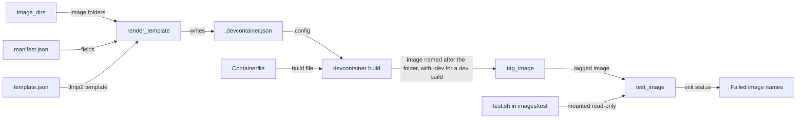

# Container images

How the repository turns each image folder into a built, tagged and tested container image, described at the level of the parts. It's for engineers who change an image or the `devel.images` package. Each stage has its own doc: [Image manifests](manifests.md), [Image builds](builds.md) and [Image tests](tests.md). [Image READMEs](readmes.md) covers each image's README.

## Contents

1. [Overview](#overview)
1. [Image folders](#image-folders)
1. [The devel.images package](#the-develimages-package)
1. [Image names and paths](#image-names-and-paths)
1. [Discovery](#discovery)
1. [Errors](#errors)
1. [Limits](#limits)

## Overview

The `devel.images` package does the work, and [tasks.py](../../tasks.py) runs it through the `build`, `test` and `validate` Invoke tasks. The package finds the images, renders their Dev Container configuration, builds and tags them, runs their tests and checks their manifests. It doesn't publish anything (see [Image builds](builds.md#limits)). For the commands, see [CONTRIBUTING.md](../../CONTRIBUTING.md), and for Invoke and the rest of the tooling, see [Dev tooling](../dev-tooling.md).

This flowchart shows one image going through the whole pipeline:

1. `image_dirs` finds the image folders under `images/src`, as [Discovery](#discovery) describes.
1. The build renders each image's `template.json` with the fields of its `manifest.json`, and writes the result to `.devcontainer.json` in the same folder.
1. The Dev Containers CLI builds the image from that file and the `Containerfile`, and names it after the folder, with `-dev` for a dev build.
1. The build tags the image with the tags it works out from the manifest, through the podman Python client. [Image builds](builds.md) covers these three steps.
1. The tests run the image's `test.sh` in a podman container of the built image, and collect the names of the images that fail. See [Image tests](tests.md).

`invoke test images` runs the build first, unless it's given `--skip-build` (see [Dev tooling](../dev-tooling.md#task-flags)). `invoke validate images` checks the manifests against their schema and renders each template without building anything. See [Image manifests](manifests.md).

## Image folders

Each image has a source folder, `images/src/<image>/`, and can have a test folder, `images/test/<image>/`, with the same name. The `base` image is the only one so far.

| File | Folder | What it's for |
| --- | --- | --- |
| `manifest.json` | `images/src/<image>/` | The image's settings, such as its name, version, tags and build arguments. Required. See [Image manifests](manifests.md) |
| `template.json` | `images/src/<image>/` | The Jinja2 template that the build renders into `.devcontainer.json`. Required. See [Rendering template.json](manifests.md#rendering-templatejson) |
| `.devcontainer.json` | `images/src/<image>/` | The Dev Container configuration that the build generates from `template.json`. See [Rendering template.json](manifests.md#rendering-templatejson) |
| `Containerfile` | `images/src/<image>/` | The image's build file. The `base` template names it as `build.dockerfile`, with the image folder as `build.context` |
| `README.md` | `images/src/<image>/` | The image's README, for people who use the image. Its shape is in [Image READMEs](readmes.md). The tooling doesn't read it |
| `test.sh` | `images/test/<image>/` | The test script that runs inside the built image. Optional: an image without one isn't tested |
| `test_utils.sh` | `images/test/<image>/` | The POSIX `sh` check helpers that `test.sh` sources. See [Image tests](tests.md) |

The `base` image's [Containerfile](../../images/src/base/Containerfile) declares `ARG BASE_IMAGE` and starts `FROM ${BASE_IMAGE}`, and its [manifest.json](../../images/src/base/manifest.json) sets `BASE_IMAGE` as a build argument.

## The devel.images package

[`devel/images/__init__.py`](../../devel/images/__init__.py) re-exports `ImageManifest`, `build_images`, `image_dirs`, `test_images` and `validate`. How `tasks.py` calls them is in [Dev tooling](../dev-tooling.md#tasks-and-suites).

| Module | What it does | Detail |
| --- | --- | --- |
| [config.py](../../devel/images/config.py) | Holds the paths, file names and registry settings as constants | [Image names and paths](#image-names-and-paths) |
| [discovery.py](../../devel/images/discovery.py) | `image_dirs` finds the image folders to work on | [Discovery](#discovery) |
| [manifest.py](../../devel/images/manifest.py) | The `ImageManifest` dataclass loads a `manifest.json`, renders a template with its fields and works out the image tags | [Image manifests](manifests.md) |
| [build.py](../../devel/images/build.py) | Renders `.devcontainer.json`, runs `devcontainer build` and tags the image | [Image builds](builds.md) |
| [testing.py](../../devel/images/testing.py) | Runs each image's `test.sh` in a podman container and returns the names of the images that failed | [Image tests](tests.md) |
| [validation.py](../../devel/images/validation.py) | Checks that the schema, `ImageManifest`, each `manifest.json` and its `template.json` agree | [Image manifests](manifests.md) |

The unit tests for the package are in [devel/images/test/](../../devel/images/test/). A Claude Code hook also runs `devel.images.validation`. See [Claude Code hooks](../claude-code-hooks.md).

## Image names and paths

[config.py](../../devel/images/config.py) joins `IMAGE_REGISTRY`, `IMAGE_OWNER` and `IMAGE_REPO` into `IMAGE_REPOSITORY`, which is `ghcr.io/froazin/devcontainers`. `image_name` names a release build of each image `<IMAGE_REPOSITORY>:<folder name>`, such as `ghcr.io/froazin/devcontainers:base`, and a dev build `<IMAGE_REPOSITORY>:<folder name>-dev`, such as `ghcr.io/froazin/devcontainers:base-dev`. The build names the image with it, and the tests look for the image by the same name, and the build adds its tags to the same repository. For the manifest fields that don't affect the name, see [Image manifests](manifests.md#limits).

| Constant | Value | Used by |
| --- | --- | --- |
| `DEVCONTAINERS_BASE_COMMAND` | `npm exec @devcontainers/cli --` | `build.py` |
| `IMAGES_PROJECT_FOLDER` | `images` | The two constants below |
| `IMAGES_SRC_FOLDER` | `images/src` | `discovery.py`, `validation.py` |
| `IMAGES_TEST_FOLDER` | `images/test` | `testing.py` |
| `IMAGE_REGISTRY` | `ghcr.io` | `IMAGE_REPOSITORY` |
| `IMAGE_OWNER` | `froazin` | `IMAGE_REPOSITORY` |
| `IMAGE_REPO` | `devcontainers` | `IMAGE_REPOSITORY` |
| `IMAGE_REPOSITORY` | `ghcr.io/froazin/devcontainers` | `build.py`, `image_name` |
| `IMAGE_DEV_SUFFIX` | `-dev` | `image_name`, `manifest.py` |
| `IMAGE_MANIFEST_FILE` | `manifest.json` | `discovery.py`, `build.py`, `validation.py` |
| `IMAGE_MANIFEST_SCHEMA` | `schemas/image-manifest.schema.json` | `validation.py` |
| `IMAGE_TEMPLATE_FILE` | `template.json` | `discovery.py`, `build.py`, `validation.py` |
| `IMAGE_DEVCONTAINER_FILE` | `.devcontainer.json` | `build.py` |
| `IMAGE_TEST_SCRIPT` | `test.sh` | `testing.py` |
| `IMAGE_TEST_MOUNT` | `/test-project` | `testing.py` |

- The paths are relative to the repository root. Invoke finds `tasks.py` from a subfolder but doesn't change directory, so the tasks only work from the root.
- Run from `images/`, `uv run invoke validate images` fails with `FileNotFoundError` for `schemas/image-manifest.schema.json`, and `image_dirs` fails with `FileNotFoundError` for `images/src` (both observed). `build` and `test` call `image_dirs` first, so they fail the same way (inferred from the code).

## Discovery

[`image_dirs`](../../devel/images/discovery.py) takes an optional `name_filter` and a `src_folder`, which defaults to `IMAGES_SRC_FOLDER`. It returns the image folders as paths joined onto `src_folder`, such as `images/src/base`, and the other modules take the image's name from the folder name.

1. It lists `src_folder` and sorts the entries by name, so images are always processed in the same order.
1. It skips any entry that isn't a directory, without a message.
1. If `name_filter` is set, it skips any folder whose name doesn't match it. The filter is a shell-style glob, matched with `fnmatch.fnmatchcase`, so it's case-sensitive: `Base` doesn't match `base`.
1. It checks that the folder has both `manifest.json` and `template.json`. If either is missing, it prints a message that lists every missing file and skips the folder, such as `Skipping empty: manifest.json, template.json not found.`

- The filter runs before the file check, so a folder the filter excludes is never reported as skipped.
- Discovery checks only that the two files exist. It doesn't read or check the manifest.
- `validate` doesn't use `image_dirs`. It finds every `images/src/*/manifest.json` itself, so it also checks the manifest in a folder that has no `template.json`. See [Validation](manifests.md#validation).

## Errors

- **Skipped folder:** a folder without a manifest or template prints a message and isn't an error.
- **Filter matches nothing:** `image_dirs` returns an empty list. How the `build` and `test` tasks report it is in [Dev tooling](../dev-tooling.md#errors).
- **No `images/src` folder:** `os.listdir` raises `FileNotFoundError`, which the tasks don't catch. See [Image names and paths](#image-names-and-paths) for when that happens.
- **Later stages:** for errors from rendering, building, tagging or testing, see [Image builds](builds.md) and [Image tests](tests.md).

## Limits

- The pipeline only covers images. The `features/src` and `features/test` folders hold only a `.gitkeep`.
- The folder name becomes the image tag, but nothing checks that it's a valid tag (inferred). A folder named like another image's dev build, such as `base-dev`, would share its name.
- Discovery doesn't recurse: each image is one folder directly under `images/src`.
