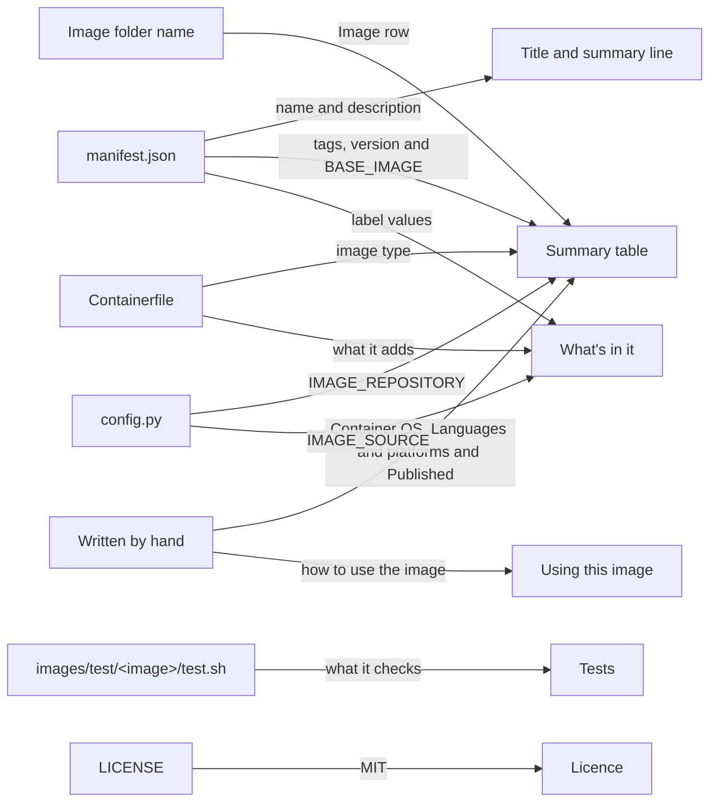

# Image READMEs

The shape of the `README.md` in each image folder, and where each part of it comes from. It's for engineers and Claude agents who add an image or change one.

## Contents

1. [Overview](#overview)
1. [Shape](#shape)
1. [Rules](#rules)
1. [Decisions](#decisions)
1. [Sources](#sources)

## Overview

Every image has a `README.md` in `images/src/<image>/`, for people who use the image. The tooling doesn't read it, so nothing checks it against the image. Keep it in step by hand, in the same change as the files it describes.

This diagram shows where each part of the README comes from:



The [base image's README](../../images/src/base/README.md) follows this shape.

## Shape

Follow this shape. The links in it are relative to the image folder, `images/src/<image>/`:

````markdown
# <name from manifest.json>

<description from manifest.json, as a sentence.>

## Summary

| Metadata | Value |
| --- | --- |
| Image | <the image name of a release build and of a dev build, in code spans> |
| Release tags | <every tag a release build creates, in code spans> |
| Dev tags | <every tag a dev build creates, in code spans, with `<short commit SHA>` for the commit. Say that a dev build is any build without `--is-release`, and when the SHA ends in `-dirty`> |
| Version | `<version from manifest.json>` |
| Base image | `<BASE_IMAGE from manifest.json>` |
| Image type | `Containerfile` |
| Container OS | <the OS and release> |
| Languages and platforms | <what it's for, or "Any"> |
| Published | No. Build the image locally, as [Build and test](../../../README.md#build-and-test) describes |

## Using this image

<How to use it once it's built, such as the `image` property in a `devcontainer.json`.>

## What's in it

<What the Containerfile adds to the base image, including the empty layer from `RUN true`, with a link to [Labels](../../../docs/container-images/builds.md#labels) for the reason. Then the four Open Container Initiative (OCI) labels and their values, as a list.>

## Tests

<What images/test/<image>/test.sh checks, with a link to it.>

## Licence

MIT. See [LICENSE](../../../LICENSE).
````

## Rules

- Take each value from its source:
  - The title and summary line from the manifest's `name` and `description`.
  - The Release tags, Dev tags, Version and Base image rows from `manifest.json`, with the tags worked out as [Names and tags](builds.md#names-and-tags) describes.
  - The Image row from the folder name and `IMAGE_REPOSITORY` in config.py, as [Names and tags](builds.md#names-and-tags) describes.
  - The Image type row from the `Containerfile`.
  - "What's in it" from the `Containerfile`, with the label values from `manifest.json` and `IMAGE_SOURCE`, as [Labels](builds.md#labels) lists.
- Write the Container OS, Languages and platforms and Published rows by hand, and the "Using this image" section too.
- When you change the manifest's `name`, `description`, `version`, `tags` or `build_args`, update the README in the same change. Do the same when you change what the `Containerfile` adds.
- When you change `test.sh`, update the Tests section to match.
- Describe only what exists. Change the Published row only once the image is published. Until then, "Using this image" names the local release build and says that a build without `--is-release` is named `<folder>-dev`.
- Write it like any other doc, following the [Docs](../../CLAUDE.md#docs) conventions.

## Decisions

The reasons below are inferred.

- **Adapted from upstream:** the shape follows the [devcontainers/images README for Ubuntu](https://github.com/devcontainers/images/blob/main/src/base-ubuntu/README.md). Its Summary table, "Using this image" and licence sections stay. Its metadata rows change to the values this repository's images have.
- **Two sections added:** "What's in it" and "Tests" say what the image adds and how that's checked, because nothing is published yet to look at.
- **Written by hand:** the README isn't rendered from the manifest, so it can explain the image in prose. The cost is that it can drift from the manifest, which the rules above guard against.

## Sources

- https://github.com/devcontainers/images/blob/main/src/base-ubuntu/README.md
