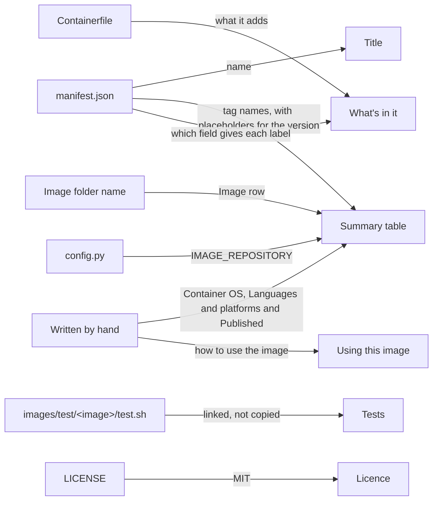

# Image READMEs

The shape of the `README.md` in each image folder, and where each part of it comes from. It's for engineers and Claude agents who add an image or change one.

## Contents

1. [Overview](#overview)
1. [Shape](#shape)
1. [Rules](#rules)
1. [Decisions](#decisions)
1. [Sources](#sources)

## Overview

Every image has a `README.md` in `images/src/<image>/`, for people who use the image. The tooling doesn't read it, so nothing checks it against the image. Keep it in step by hand, in the same change as the files it describes.

This diagram shows where each part of the README comes from:



The [base image's README](../../images/src/base/README.md) follows this shape.

## Shape

Follow this shape. The links in it are relative to the image folder, `images/src/<image>/`:

````markdown
# <name from manifest.json>

## Summary

| Metadata | Value |
| --- | --- |
| Image | <the image name of a release build and of a dev build, in code spans> |
| Release tags | <each tag in the manifest, on its own and with `-MAJOR`, `-MAJOR.MINOR` and `-MAJOR.MINOR.PATCH`, from the `version` in manifest.json, with one worked example at a made-up version such as `1.2.3`> |
| Dev tags | <each tag with `-dev`, on its own and with `_<short commit SHA>`. Say that a dev build is any build without `--is-release`, and when the SHA ends in `-dirty`> |
| Container OS | <the OS and release> |
| Languages and platforms | <what it's for, or "Undefined"> |
| Published | No. Build the image locally, as [Build and test](../../../README.md#build-and-test) describes |

## Using this image

<How to use it once it's built, such as the `image` property in a `devcontainer.json`.>

## What's in it

<What the Containerfile adds to the base image, including the empty layer from `RUN true`, with a link to [Labels](../../../docs/container-images/builds.md#labels) for the reason. Then the four Open Container Initiative (OCI) labels, as a list that says where each value comes from, with `MAJOR.MINOR.PATCH` for the version and one worked example.>

## Tests

<A link to images/test/<image>/test.sh, and a sentence on what it covers.>

## Licence

MIT. See [LICENSE](../../../LICENSE).
````

## Rules

- Don't copy a value that another file owns and that changes as the image does, such as the `version`, the tags and labels it gives, the manifest's `description` or the checks in `test.sh`. Write it as a placeholder, such as `MAJOR.MINOR.PATCH`, or say which field gives it. Add a worked example with made-up values, such as version `1.2.3`, so the README shows how to read it and stays true when the value changes.
- Write a value out only when it says what the image is and changes only when the image itself does: the title, from the manifest's `name`, the tag names, the Image row, as [Names and tags](builds.md#names-and-tags) describes, and the Container OS.
- Write the Container OS, Languages and platforms and Published rows by hand, and the "Using this image" section too.
- Update the README in the same change as one to the manifest's `name` or `tags`, to what the `Containerfile` adds or to the base image's OS. A version bump, or a change to `test.sh`, doesn't need one.
- Describe only what exists. Change the Published row only once the image is published. Until then, "Using this image" names the local release build and says that a build without `--is-release` is named `<folder>-dev`.
- Write it like any other doc, following the [Docs](../../CLAUDE.md#docs) conventions.

## Decisions

The reasons below are inferred.

- **Adapted from upstream:** the shape follows the [devcontainers/images README for Ubuntu](https://github.com/devcontainers/images/blob/main/src/base-ubuntu/README.md). Its Summary table, "Using this image" and licence sections stay. Its metadata rows change to what this repository's images have, and the rows that would copy the manifest, such as Version and Base image, are left out.
- **Two sections added:** "What's in it" and "Tests" say what the image adds and how that's checked, because nothing is published yet to look at.
- **Written by hand, without copied values:** the README isn't rendered from the manifest, so it can explain the image in prose. It uses placeholders and worked examples rather than the manifest's values, so a version bump can't make it stale. This is the maintainer's choice.

## Sources

- https://github.com/devcontainers/images/blob/main/src/base-ubuntu/README.md
