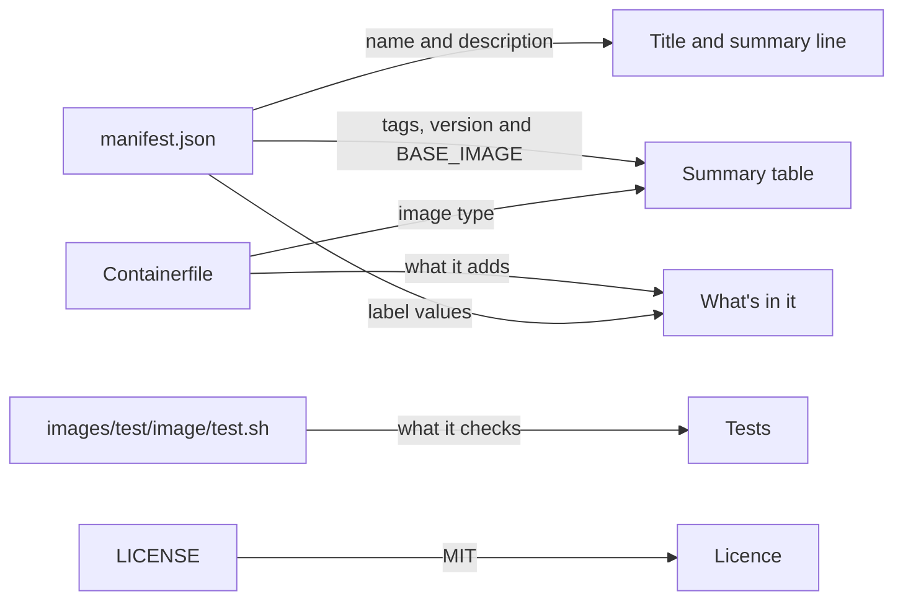

# Image READMEs

The shape of the `README.md` in each image folder, and where each part of it comes from. It's for engineers and Claude agents who add an image or change one.

## Contents

1. [Overview](#overview)
1. [Shape](#shape)
1. [Rules](#rules)
1. [Decisions](#decisions)
1. [Sources](#sources)

## Overview

Every image has a `README.md` in `images/src/<image>/`, for people who use the image. The tooling doesn't read it, so nothing checks it against the image. Keep it in step by hand, in the same change as the files it describes.

This diagram shows which file each part of the README comes from:



The [base image's README](../../images/src/base/README.md) follows this shape.

## Shape

Follow this shape. The links in it are relative to the image folder, `images/src/<image>/`:

````markdown
# <name from manifest.json>

<description from manifest.json, as a sentence.>

## Summary

| Metadata | Value |
| --- | --- |
| Image | `ghcr.io/froazin/devcontainers:<folder>`, or `ghcr.io/froazin/devcontainers:<folder>-dev` from a build without `--is-release` |
| Release tags | <every tag a release build creates, in code spans> |
| Development tags | <each tag as `<tag>-dev` and `<tag>-dev_<short commit SHA>`, from a build without `--is-release`, and that the SHA ends in `-dirty` when the working tree has uncommitted changes> |
| Version | `<version from manifest.json>` |
| Base image | `<BASE_IMAGE from manifest.json>` |
| Image type | `Containerfile` |
| Container OS | <the OS and release> |
| Languages and platforms | <what it's for, or "Any"> |
| Published | No. Build the image locally, as [CONTRIBUTING.md](../../../CONTRIBUTING.md) describes |

## Using this image

<How to use it once it's built, such as the `image` property in a `devcontainer.json`.>

## What's in it

<What the Containerfile adds to the base image, as a list. Say so if it adds nothing.>

## Tests

<What images/test/<image>/test.sh checks, with a link to it.>

## Licence

MIT. See [LICENSE](../../../LICENSE).
````

## Rules

- Take every value in the Summary table from `manifest.json` or the `Containerfile`.
- When you change the manifest's `name`, `description`, `owner`, `repo`, `version`, `tags` or `build_args`, or what the `Containerfile` adds, update the README in the same change. The `image-manifest` rule in [`.claude/rules/`](../../.claude/rules/image-manifest.md) says the same for Claude agents.
- List every tag a release build creates, as [The ImageManifest dataclass](manifests.md#the-imagemanifest-dataclass) describes for `image_tags`. The development tags come from `dev_tags`, as [Image builds](builds.md#for-each-image) describes.
- When you change `test.sh`, update the Tests section to match.
- Describe only what exists. Change the Published row only once the image is published. Until then, "Using this image" names the local release build and says that a build without `--is-release` is named `<folder>-dev`.
- Write it in the house style, as for any other doc.

## Decisions

- **Adapted from upstream:** the shape follows the [devcontainers/images README for Ubuntu](https://github.com/devcontainers/images/blob/main/src/base-ubuntu/README.md). Its Summary table, "Using this image" and licence sections stay. Its metadata rows change to the values this repository's manifest holds.
- **Two sections added:** "What's in it" and "Tests" say what the image adds and how that's checked, because nothing is published yet to look at.
- **Written by hand:** the README isn't rendered from the manifest, so it can explain the image in prose. The cost is that it can drift from the manifest, which the rules above guard against.

## Sources

- https://github.com/devcontainers/images/blob/main/src/base-ubuntu/README.md
