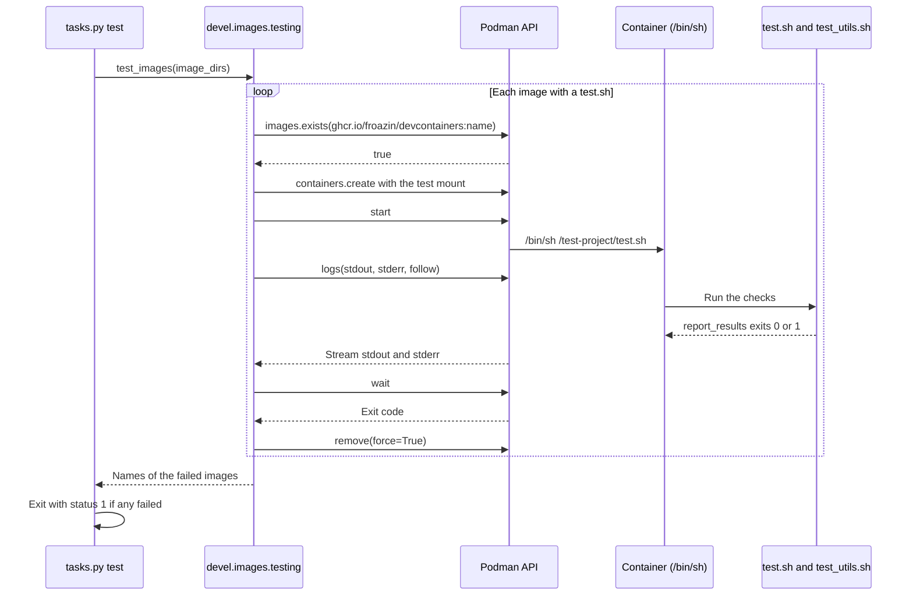

# Image tests

How the image tests run each image's test project inside the built image, and the `test_utils.sh` helpers a test project uses. It's for engineers who change [testing.py](../../devel/images/testing.py) or write the tests for an image.

## Contents

1. [Overview](#overview)
1. [How it works](#how-it-works)
1. [Interfaces](#interfaces)
1. [The test helpers](#the-test-helpers)
1. [Write tests for a new image](#write-tests-for-a-new-image)
1. [Errors](#errors)
1. [Decisions](#decisions)
1. [Limits](#limits)
1. [Sources](#sources)

## Overview

[testing.py](../../devel/images/testing.py) runs `images/test/<image>/test.sh` in a podman container of the image that [Image builds](builds.md) made, and returns the names of the images that failed. It doesn't build images, choose which images to test or turn failures into an exit status. The `test` task in [tasks.py](../../tasks.py) does those (see [Dev tooling](../dev-tooling.md)). Where the test folders sit among the other image files is in [Container images](overview.md).

A test project is a POSIX `sh` script, `test.sh`, that sources its own copy of [test_utils.sh](../../images/test/base/test_utils.sh), runs checks and ends with `report_results`. The only one so far is [images/test/base/test.sh](../../images/test/base/test.sh).

## How it works

This sequence diagram shows one test run, from the task to the report:



1. `test_images` connects with `podman.PodmanClient.from_env()` and takes the image name from the base name of each image folder.
1. It skips an image whose `images/test/<image>/test.sh` doesn't exist, and prints a message. A skipped image isn't a failure.
1. `test_image` checks that `ghcr.io/froazin/devcontainers:<image>` exists. It's the name the build gives the image (see [Image names and paths](overview.md#image-names-and-paths)).
1. It calls `client.containers.create` with the command `["/bin/sh", "/test-project/test.sh"]`, `working_dir="/test-project"`, `stop_timeout=0` and the mount from `test_mount`, which mounts the image's folder in `test_folder`.
1. `run_container` starts the container and streams its logs with `stdout=True`, `stderr=True`, `stream=True` and `follow=True`. It decodes each chunk with `errors="replace"` and prints it straight away with `flush=True`.
1. It returns the exit code from `container.wait()`. In a `finally` block, it always calls `container.remove(force=True)`, as [Errors](#errors) describes.
1. `test_image` passes when the exit code is `0`.

`test_mount` returns this bind mount, with `source` as an absolute path:

```python
{"type": "bind", "source": ".../images/test/<image>", "target": "/test-project", "read_only": True, "relabel": "z"}
```

## Interfaces

| Function | Takes | Returns |
| --- | --- | --- |
| `test_images` | Image folders, such as `images/src/base`, and an optional `test_folder` | The names of the images that failed, as `list[str]` |
| `test_image` | A `PodmanClient`, an image name and an optional `test_folder` | `True` when `test.sh` exits `0` |
| `run_container` | A created podman `Container` | Its exit code. The container is removed |
| `test_mount` | An image name and an optional `test_folder` | The mount as a `dict` |

- `test_folder` defaults to `IMAGES_TEST_FOLDER`, `images/test`. It's a relative path (see [Image names and paths](overview.md#image-names-and-paths)).
- The unit tests in [test_testing.py](../../devel/images/test/test_testing.py) mock the podman client and container. They don't start a container.

## The test helpers

[test_utils.sh](../../images/test/base/test_utils.sh) holds these functions. Each check prints a `🧪 Testing` line and then `✅  Passed!` or `❌  <label> check failed.`. It returns `1` on failure.

| Function | Passes when |
| --- | --- |
| `check LABEL COMMAND [ARGS...]` | `COMMAND` exits `0`. It runs in a subshell |
| `check_version_ge LABEL CURRENT REQUIRED` | `CURRENT` sorts at or above `REQUIRED` with `sort -V`. Text before the first digit of each, such as `v` or `git version `, is stripped |
| `check_multiple LABEL MINIMUM EXPRESSION...` | At least `MINIMUM` of the expressions exit `0`. Each one runs with `eval` in a subshell, so it can use the script's functions and variables |
| `check_os_packages LABEL PACKAGE...` | Every package has the `dpkg-query` status `ii `. A removed package whose config files remain doesn't count. It prints each installed package's version |
| `check_os_release KEY VALUE` | `KEY` in `/etc/os-release` is `VALUE`. It calls `check` with the label `os-release KEY is VALUE` |
| `report_results` | Not a check. It lists the failed checks and exits `1`, or prints `💯  All passed!` and exits `0` |

- A check with no command, expressions or packages fails. So does `check_version_ge` when `CURRENT` has no digit.
- `check` and `check_multiple` run their commands in a subshell, so a command that calls `exit` or sets a variable doesn't affect the rest of the script.
- A failed check appends its label to `FAILED`. `report_results` reads it.
- The helpers are POSIX `sh`, because `/bin/sh` in the Ubuntu images is dash.

## Write tests for a new image

1. Create `images/test/<image>/`, with the same name as the image's folder in `images/src/`.
1. Copy `test_utils.sh` from `images/test/base/`.
1. Write `test.sh` in POSIX `sh`. Start it the way the base image's does, then add checks and end with `report_results`:

   ```sh
   cd "$(dirname "$0")" || exit 1

   # shellcheck source=test_utils.sh
   . ./test_utils.sh

   check "bash" bash --version
   report_results
   ```

- Without `report_results`, the script exits with its last command's status, so a failed check before the last one is lost.
- `test.sh` doesn't need to be executable. The container runs it with `/bin/sh`, and the base image's copy is mode `100644` (observed).
- [.shellcheckrc](../../.shellcheckrc) sets `external-sources=true` and `source-path=SCRIPTDIR`, so ShellCheck follows the `source=` directive. The `[*.sh]` section of [.editorconfig](../../.editorconfig) sets the `shfmt` style, with `shell_variant = posix`. [CONTRIBUTING.md](../../CONTRIBUTING.md) has the commands that run them.

## Errors

| Situation | What happens |
| --- | --- |
| No `test.sh` | Prints `Skipping <image>: images/test/<image>/test.sh not found.` and moves on |
| Image not built | Prints ``Image ghcr.io/froazin/devcontainers:<image> not found. Build it first with `invoke build images`.`` and counts the image as failed. No container is created |
| `test.sh` exits non-zero | The image is counted as failed |
| An exception or <kbd>Ctrl</kbd>+<kbd>C</kbd> while the container runs | `run_container` removes the container, then the exception carries on up |

## Decisions

- **A plain podman container, not `devcontainer up` and `devcontainer exec`:** the upstream `devcontainers/images` smoke test starts the container with `devcontainer up` and runs the test project with `devcontainer exec`. Here the tests call the podman Python client directly, without the Dev Containers CLI. The cost is that `devcontainer.json` runtime settings, such as `remoteUser`, `containerEnv`, features and lifecycle commands, don't apply to the tests, so they run with the image's default user and environment. The base image's template uses none of them. It sets only `init` to `false`, and the test container doesn't pass `init` either.
- **`stop_timeout=0`:** `sh` runs as PID 1 and ignores `SIGTERM`, so stopping the container on <kbd>Ctrl</kbd>+<kbd>C</kbd> would wait for podman's default timeout of 10 seconds before it kills it.
- **`relabel: "z"`:** on a host where SELinux is enforcing, the container can't read a bind mount that isn't relabelled.
- **A read-only mount:** a test can't change the files in the repository.
- **Only the image's own test folder is mounted:** each image's tests can't see another image's files, so each test folder has its own copy of `test_utils.sh`.
- **Helpers based on upstream:** the helpers follow `check`, `check-version-ge`, `checkMultiple`, `checkOSPackages` and `reportResults` in the upstream `base-ubuntu` test project. They're renamed in snake case and rewritten in POSIX `sh`, because upstream's are Bash.
- **Everything to stdout:** upstream's `echoStderr` writes to stderr. Here everything goes to stdout, so the output stays in order when podman streams it.

## Limits

- The copies of `test_utils.sh` can drift apart. Nothing checks that they match.
- `test_utils.sh` has no `local` variables, because POSIX `sh` has none. Its functions set globals such as `label`, `count`, `missing`, `status` and `value`, so `test.sh` shouldn't rely on variables with those names.
- `test.sh` doesn't use `set -e`. With it, the first failed check would exit the script before `report_results` (inferred).
- `check_os_packages` uses `dpkg-query`, so it works only in Debian-based images.

## Sources

- https://github.com/devcontainers/images/tree/main/src/base-ubuntu/test-project
- https://github.com/devcontainers/images/blob/main/.github/actions/smoke-test/build.sh
- https://github.com/devcontainers/images/blob/main/.github/actions/smoke-test/test.sh
