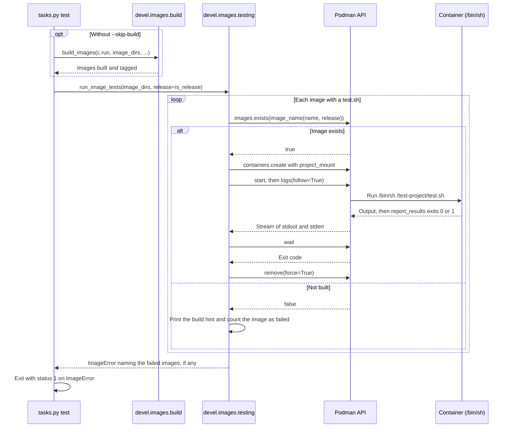

# Image tests

How the image tests run each image's test project inside the built image, and the `test_utils.sh` helpers a test project uses. It's for engineers who change [testing.py](../../devel/images/testing.py) or write the tests for an image.

## Contents

1. [Overview](#overview)
1. [How it works](#how-it-works)
1. [Interfaces](#interfaces)
1. [The test helpers](#the-test-helpers)
1. [Write tests for a new image](#write-tests-for-a-new-image)
1. [Errors](#errors)
1. [Decisions](#decisions)
1. [Limits](#limits)
1. [Sources](#sources)

## Overview

[testing.py](../../devel/images/testing.py) runs `images/test/<image>/test.sh` in a podman container of the image that [Image builds](builds.md) made. It runs every image, then raises `ImageError` naming the images that failed. It doesn't build images, choose which images to test or set the exit status. The `test` task in [tasks.py](../../tasks.py) does those, and turns the `ImageError` into an exit status, as [Between tasks.py and devel](../dev-tooling.md#between-taskspy-and-devel) describes. Where the test folders sit among the other image files is in [Container images](overview.md).

A test project is a POSIX `sh` script, `test.sh`, that sources its own copy of [test_utils.sh](../../images/test/base/test_utils.sh), runs checks and ends with `report_results`. The only one so far is [images/test/base/test.sh](../../images/test/base/test.sh).

## How it works

This sequence diagram shows one run of the `test` task, from the build to the report:



1. `run_image_tests` opens one podman client for the run, with `with podman.PodmanClient.from_env() as client:`, so the client closes when the run ends. Making the client doesn't connect: the first call to podman's API is `images.exists` (inferred from podman-py's source).
1. It takes each image's name from the base name of its folder, and skips an image whose `images/test/<image>/test.sh` doesn't exist.
1. `run_image_test` looks for the image by the name `image_name` gives it: the dev build, or the release build when `release` is true. It's the name the build gives the image (see [Names and tags](builds.md#names-and-tags)).
1. It creates a container of the image that runs `test.sh` with `/bin/sh`. Its only mount is `project_mount`: a read-only bind mount of the image's test folder at `/test-project`, which is also the working directory. [Decisions](#decisions) explains the mount options and the stop timeout.
1. `run_container` starts the container, prints its output as podman streams it and returns the exit code. Its `finally` block always removes the container, as [Errors](#errors) describes.
1. `run_image_test` passes when the exit code is `0`.
1. After the last image, `run_image_tests` raises `ImageError` if any image failed.

## Interfaces

| Function | Called by | Result |
| --- | --- | --- |
| `run_image_tests` | The `test` task | `None`. A failed image ends in `ImageError` (see [Errors](#errors)) |
| `run_image_test` | `run_image_tests`, with its client | `True` when `test.sh` exits `0`. `False` when it fails or the image isn't built |
| `run_container` | `run_image_test` | The container's exit code |
| `project_mount` | `run_image_test` | The bind mount, as one `dict` in podman-py's `mounts` list |

- `release` is keyword-only in `run_image_tests` and `run_image_test`, and defaults to `False`, the dev build.
- `test_folder` defaults to `IMAGES_TEST_FOLDER` in [config.py](../../devel/images/config.py), which is `images/test`. It's relative to the working directory, so run the tests from the repository root (see [Build and test](../../README.md#build-and-test)).
- The unit tests in [test_testing.py](../../devel/images/test/test_testing.py) mock the podman client and container. They don't start a container.

## The test helpers

[test_utils.sh](../../images/test/base/test_utils.sh) holds these functions. The comment above each one says exactly when it passes. Each check prints what it tests and whether it passed, and returns `1` on failure.

| Function | Passes when |
| --- | --- |
| `check LABEL COMMAND [ARGS...]` | `COMMAND` exits `0` |
| `check_version_ge LABEL CURRENT_VERSION REQUIRED_VERSION` | `CURRENT_VERSION` is at or above `REQUIRED_VERSION` |
| `check_multiple LABEL MINIMUM_PASSED EXPRESSION...` | At least `MINIMUM_PASSED` of the expressions exit `0` |
| `check_os_packages LABEL PACKAGE...` | Every package is installed, according to `dpkg-query` |
| `check_os_release KEY VALUE` | `KEY` in `/etc/os-release` is `VALUE` |
| `report_results` | Not a check. It lists the failed checks and exits `1`, or exits `0` |

- A check with no command, expressions or packages fails, and so does `check_version_ge` when either version has no digit.
- A failed check appends its label to `FAILED`. `report_results` reads it.
- The helpers are POSIX `sh`, because `/bin/sh` in the Ubuntu images is dash.
- `check_version_ge` compares versions as `sort -V` orders them. So it counts a hyphenated pre-release, such as `2.0.0-rc1`, as at or above `2.0.0`, but a tilde one, such as `2.0.0~rc1`, as below it (observed with `sort -V` on the Ubuntu 26.04 host).
- The helpers print anything that holds a label, version or package name with `printf`, not `echo`, because POSIX leaves `echo` with a backslash up to the shell.

## Write tests for a new image

Every image needs a test project, although the tooling skips an image without one. The other files an image needs are in [Add an image](overview.md#add-an-image), which also says what `test.sh` has to check.

1. Create `images/test/<image>/`, with the same name as the image's folder in `images/src/`.
1. Copy `test_utils.sh` from `images/test/base/`.
1. Write `test.sh` in POSIX `sh`. Start it the way the base image's does, then add checks and end with `report_results`:

   ```sh
   #!/usr/bin/env sh
   cd "$(dirname "$0")" || exit 1

   # shellcheck source=test_utils.sh
   . ./test_utils.sh

   check "bash" bash --version
   report_results
   ```

- Without `report_results`, the script exits with its last command's status, so a failed check before the last one is lost.
- The shebang tells ShellCheck and editors which shell the script is for, because [.shellcheckrc](../../.shellcheckrc) doesn't set one. The container runs the script with `/bin/sh` either way, so `test.sh` doesn't need to be executable. The base image's copy is mode `100644` (observed).
- `.shellcheckrc` sets `external-sources=true` and `source-path=SCRIPTDIR`, so ShellCheck follows the `source=` directive. The `[*.sh]` section of [.editorconfig](../../.editorconfig) sets the `shfmt` style, with `shell_variant = posix`. The commands that run them are in [Build and test](../../README.md#build-and-test).

## Errors

| Situation | What happens |
| --- | --- |
| No `test.sh` | `run_image_tests` prints `Skipping <image>: images/test/<image>/test.sh not found.` and moves on. A skipped image isn't a failure, so a run where no image has a `test.sh` passes without testing anything |
| Image not built | `run_image_test` prints ``Image <image name> not found. Build it first with `invoke build images`.`` For a release build, the command it names adds `--is-release`. It creates no container and returns `False`, so `run_image_tests` counts the image as failed |
| `test.sh` exits non-zero | `run_image_tests` counts the image as failed |
| Any image failed | After the last image, `run_image_tests` raises `ImageError` with `Image tests failed: <names>`. The task exits with status 1 |
| Podman's API service isn't reachable | `images.exists` raises `podman.errors.APIError`, and `run_image_test` creates no container. `run_image_tests` stops and turns it into an `ImageError` that gives podman-py's message, suggests checking `podman.socket` and names any images that had already failed. Without `--skip-build`, the build stops first, as [Image builds](builds.md#errors) describes. That podman-py raises `APIError` here is inferred from its source |
| An exception or <kbd>Ctrl</kbd>+<kbd>C</kbd> while the container runs | `run_container` removes the container and the `with` block closes the client. Then the exception carries on up |

## Decisions

The code records few of the reasons, so they're inferred unless a bullet says where they come from. The podman, Linux and upstream facts they rest on are in [Sources](#sources).

- **A plain podman container, not `devcontainer up` and `devcontainer exec`:** the upstream `devcontainers/images` smoke test starts the container with `devcontainer up` and runs the test project with `devcontainer exec`. Here the tests call the podman Python client directly, without the Dev Containers CLI. The cost is that `devcontainer.json` runtime settings, such as `remoteUser`, `containerEnv`, features and lifecycle commands, don't apply to the tests, so they run with the image's default user and environment. The base image's template uses none of them. It sets only `init` to `false`, and the test container doesn't pass `init` either.
- **`stop_timeout=0`:** `sh` runs as process ID (PID) 1, and the kernel doesn't deliver `SIGTERM` to a namespace's PID 1 unless it handles it. Without the setting, removing the running container after <kbd>Ctrl</kbd>+<kbd>C</kbd> would wait for podman's default stop timeout of 10 seconds before it kills `sh`.
- **`relabel: "z"`:** on a host where Security-Enhanced Linux (SELinux) is enforcing, the container can't read a bind mount that podman hasn't relabelled. `z` is podman's shorthand for a shared label.
- **A read-only mount:** a test can't change the files in the repository.
- **One test folder per container:** `project_mount` mounts only the image's own test folder, so its tests can't see another image's files. That's why each test folder has its own copy of `test_utils.sh`.
- **Helpers based on upstream:** the helpers follow `check`, `check-version-ge`, `checkMultiple`, `checkOSPackages` and `reportResults` in the upstream `base-ubuntu` test project. This project renames them in snake case and rewrites them in POSIX `sh`, because upstream's are Bash.
- **Everything to stdout:** upstream's `echoStderr` writes to stderr. Here the helpers print everything to stdout, so the output stays in order when podman streams it (from the comment at the top of `test_utils.sh`). A checked command's own stderr still goes to stderr.

## Limits

- The copies of `test_utils.sh` can drift apart. Nothing checks that they match.
- `test_utils.sh` has no `local` variables, because POSIX `sh` has none. Its functions set globals such as `label`, `count`, `missing`, `status` and `value`, so `test.sh` shouldn't rely on variables with those names.
- `test.sh` doesn't use `set -e`. With it, the first failed check would exit the script before `report_results` (inferred).
- `check_os_packages` uses `dpkg-query`, so it works only in Debian-based images.
- `check_version_ge` uses `sort -V`, which POSIX doesn't define. Ubuntu 26.04's default `sort` comes from uutils coreutils (`rust-coreutils`), which has it (observed on the Ubuntu 26.04 host; inferred for the image).

## Sources

- https://github.com/devcontainers/images/tree/main/src/base-ubuntu/test-project
- https://github.com/devcontainers/images/blob/main/.github/actions/smoke-test/build.sh
- https://github.com/devcontainers/images/blob/main/.github/actions/smoke-test/test.sh
- https://docs.podman.io/en/latest/markdown/podman-run.1.html, for the `--stop-timeout` default and the `relabel` mount option.
- https://man7.org/linux/man-pages/man7/pid_namespaces.7.html, for the signals a namespace's PID 1 receives.
- https://pubs.opengroup.org/onlinepubs/9799919799/utilities/echo.html, for `echo` with a backslash.
- https://github.com/containers/podman-py/blob/main/podman/api/client.py, which wraps an `OSError` from a request in `APIError`.
- Observed: the Git mode of `images/test/base/test.sh`, from `git ls-files -s`.
- Observed on the Ubuntu 26.04.1 host: `sort --version` prints `sort (uutils coreutils) 0.10.0`, and `dpkg -l coreutils-from-uutils rust-coreutils` lists both as installed. `printf '2.0.0~rc1\n2.0.0\n' | sort -V` puts `2.0.0` last, and the same with `2.0.0-rc1` puts `2.0.0-rc1` last.
