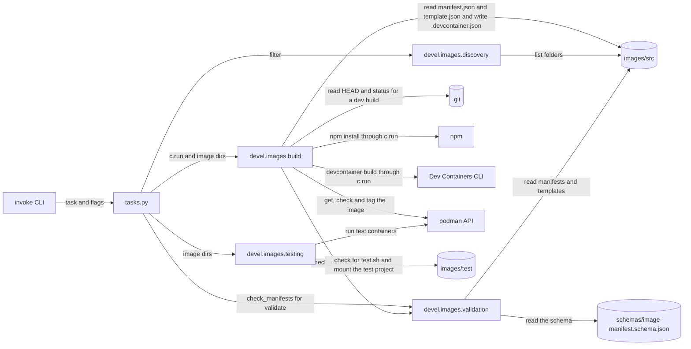

# Dev tooling

How `tasks.py` and the Python packages in `devel/` fit together, and how the Python, Node and dependency tooling is configured. It's for engineers who change a task, add a `devel` package or change the tooling settings. The set-up steps are in [Set up](../README.md#set-up), and every build, test and lint command is in [Build and test](../README.md#build-and-test).

## Contents

1. [Overview](#overview)
1. [How it works](#how-it-works)
1. [Interfaces](#interfaces)
1. [Errors](#errors)
1. [Tool configuration](#tool-configuration)
1. [Unit tests](#unit-tests)
1. [Decisions](#decisions)
1. [Limits](#limits)
1. [Sources](#sources)

## Overview

The dev tooling has two layers:

- **Command layer:** [tasks.py](../tasks.py) defines the Invoke tasks `build`, `test` and `validate`. Each task is a thin wrapper: it picks the suite, calls `devel.images` and turns its errors into exit codes.
- **Logic layer:** the packages in [devel/](../devel/), such as `devel.images`, do the work. They don't import Invoke.

`devel/` holds dev-time Python only. Nothing in it ships in an image. What the image modules do is in [Container images](container-images/overview.md), and the hook code in `devel/hooks/` is in [Claude Code hooks](claude-code-hooks.md).

This flowchart shows how a task reaches the `devel.images` modules, and the files and tools outside Python that each module uses:

## How it works

### Tasks and suites

- Each task takes a positional `suite`. Only `images` is implemented.
- `features` raises `NotImplementedError` on purpose (see [Decisions](#decisions)), and any other suite raises `Exit`. What each one prints is in [Errors](#errors).
- `tasks.py` imports the package as `from devel import images` and uses only what it exports. The list is in [The devel.images package](container-images/overview.md#the-develimages-package).
- `build images` finds the images first. Then the build checks every manifest, reads the commit for a dev build and installs the Dev Containers CLI with `npm install`, before it builds any image. The rest of the build is in [Image builds](container-images/builds.md).
- `test images` finds the images, builds them the same way, then runs each image's tests, as [Image tests](container-images/tests.md) describes.
- `test --skip-build` skips the whole build: the manifest checks, the commit read, `npm install` and the image builds. It tests the images that are already there.
- `validate images` only runs the manifest checks, then prints `The image manifests, their schema, ImageManifest and the templates agree.` (observed). It doesn't run discovery or npm: the checks find the manifests themselves (see [Validation](container-images/manifests.md#validation)).

### How imports resolve

- uv doesn't build or install the project: `[tool.uv]` sets `package = false` in [pyproject.toml](../pyproject.toml). `devel` isn't importable as an installed package.
- `tasks.py` can import `devel` because Invoke puts the directory that holds `tasks.py`, the repository root, on `sys.path` when it loads the tasks.
- pytest gets the same root through `pythonpath = [".", "devel/hooks"]`. The second entry lets the hook tests import a hook script as a top-level module (see [Claude Code hooks](claude-code-hooks.md)).
- Pyright resolves the root as its project folder (inferred), and `devel/hooks` through `extraPaths` in [pyrightconfig.json](../pyrightconfig.json).

## Interfaces

### Task flags

Invoke builds each flag from a task parameter.

| Parameter | Flag | Tasks | Notes |
| --- | --- | --- | --- |
| `suite` | positional, `-s` or `--suite` | all | Only `images` is implemented. See [Tasks and suites](#tasks-and-suites) |
| `filter_` | `-f`, `--filter` | `build`, `test` | A shell-style glob on the image folder name. The trailing underscore stops the parameter hiding Python's built-in `filter`, and Invoke strips it from the flag name |
| `no_cache` | `-n`, `--no-cache` | `build`, `test` | Passed to the build |
| `is_release` | `-i`, `--is-release` | `build`, `test` | Makes a release build instead of a dev build. `test` also tests the release build instead of the dev build, even with `--skip-build`. See [Names and tags](container-images/builds.md#names-and-tags) |
| `skip_build` | `-k`, `--skip-build` | `test` | Tests the images that are already built. See [Tasks and suites](#tasks-and-suites) |

- `--no-cache` with `--skip-build` prints `Warning: --no-cache has no effect with --skip-build, so it will be ignored.` and carries on.
- Name any new parameter that would hide a built-in with a trailing underscore, as `filter_` does.

### Between tasks.py and devel

- `tasks.py` holds only thin wrappers, and has no unit tests by design. Put any logic worth testing in a `devel` package.
- A `devel` function that runs a shell command takes a `Runner`, defined in [build.py](../devel/images/build.py) as `type Runner = Callable[[str], object]`. `tasks.py` passes `c.run`. Only the functions in `build.py` take one, and `build_images` is the one `tasks.py` calls.
- `devel` raises [`ImageError`](../devel/images/errors.py) for a failure the user can fix. Its message is ready to show as it is.
- `_exit_on_image_error` in `tasks.py` wraps each call into `devel.images`. It turns an `ImageError` into `invoke.exceptions.Exit` with `code=1`, so Invoke prints the message without a traceback.
- Any other exception from `devel` is a bug, and keeps its traceback. A failed shell command is the exception to this: `c.run` raises `UnexpectedExit`, which Invoke reports without a traceback (read in Invoke's `Program.run`, see [Sources](#sources)).
- The `devel` packages never exit the process, except a hook script's `__main__` entry point. The hook's `main()` returns its exit code (see [Claude Code hooks](claude-code-hooks.md)).

## Errors

| Situation | Where | Result |
| --- | --- | --- |
| No image folder has both a `manifest.json` and a `template.json`, or none matches `--filter` | `image_dirs` | `ImageError`, so `Exit` with status 1 (observed with `build` and `test --skip-build`). The message is in [Discovery](container-images/overview.md#discovery) |
| The manifest checks fail, in `build`, `validate` or `test` without `--skip-build` | `check_manifests` | `ImageError`, so `Exit` with status 1. The message starts `The image manifest checks failed:` and lists each error. See [Validation](container-images/manifests.md#validation) |
| `npm` isn't on `PATH` | `install_cli` | The shell can't run `npm`, so the task fails without a traceback. The exit status and how it was found are in [Image builds](container-images/builds.md#errors) |
| A build step fails, such as the commit read or the label check | `build_images` | `ImageError` for a failure the user can fix, so `Exit` with status 1. The other failures are in [Image builds](container-images/builds.md#errors) |
| Any image fails its tests | `run_image_tests` | `ImageError`, so `Exit` with `Image tests failed: <names>` and status 1. See [Image tests](container-images/tests.md#errors) |
| The `features` suite | all tasks | `NotImplementedError`, such as `Building for features is not implemented.` Invoke's `Program.run` doesn't catch it, so Python prints the traceback and exits with status 1 (observed with `build`) |
| Unknown suite | all tasks | `Exit` with `<suite> is not a valid <task> suite.` and status 1 (observed) |

- `build` and `test` find the images before the build starts, so a filter that matches nothing stops the task before the manifest checks or `npm install` run.
- A folder that discovery skips isn't an error. See [Discovery](container-images/overview.md#discovery).

## Tool configuration

### Python

- **Interpreter:** the system Python 3.14. `.python-version` holds `3.14`, `requires-python` is `>=3.14` and `[tool.uv]` sets `python-preference = "only-system"` and `python-downloads = "never"`, so uv never fetches its own Python.
- **Virtual environment:** the steps in [Set up](../README.md#set-up) create `.venv` with `--system-site-packages`. The reason is in [Decisions](#decisions).
- **Release age:** `exclude-newer = "7 days"` makes uv resolve only versions published at least 7 days ago.
- **Dependencies:** every Python dependency is in the `dev` dependency group in [pyproject.toml](../pyproject.toml). `[project]` has none, because nothing in the repository is installed.
- **Ruff:** its settings are in `[tool.ruff]` in [pyproject.toml](../pyproject.toml).
- **Pyright:** `typeCheckingMode` is `standard`, for Python 3.14 with the `.venv` environment. It excludes `node_modules`, `__pycache__` and every dot-directory (`**/.*`), and adds `devel/hooks` to `extraPaths`.

### Node and npm

- [package.json](../package.json) holds the one npm dependency, `@devcontainers/cli`, and the Node and npm versions in `engines`. [.nvmrc](../.nvmrc) selects the Node version for nvm.
- [.npmrc](../.npmrc) sets `min-release-age=7`, to match uv's `exclude-newer`. It needs npm 11.10.0 or later, and older versions ignore it without a warning.
- So `engines` requires npm 11.10.0 or later, and only allows a Node whose bundled npm is at least that: Node 24.14.1 is the first, with npm 11.11.0, and Node 25.0.0 to 25.6.1 bundle older ones, so the range skips them (from Node's release list, see [Sources](#sources)).
- `.npmrc` also sets `engine-strict=true`. Without it, npm only warns when `engines` doesn't match. With it, `npm install` fails with `notsup` (observed with npm 11.19.1 and a project that requires a newer Node), so an old npm stops instead of ignoring the release age.
- The range for `@devcontainers/cli` in `package.json` is a caret range on a `0.x` version. A caret range on `0.x` doesn't cross a minor version, so it allows only patch releases of that minor version.

### Lockfiles

Git tracks neither lockfile: [.gitignore](../.gitignore) ignores `uv.lock` and `package-lock.json`. uv and npm each write theirs locally and reuse it on later runs. See [Decisions](#decisions).

### Dependency updates

[.github/dependabot.yml](../.github/dependabot.yml) checks the `uv` and `npm` ecosystems every Monday.

- Each ecosystem has one group, `python` or `npm`, that matches `*`, so Dependabot opens one pull request (PR) per ecosystem.
- It covers every dependency type and waits 7 days before it proposes a new version (`cooldown`). Its commit messages start with `chore` and a scope.

## Unit tests

- `testpaths = ["devel"]`, so pytest only collects tests under `devel/`. `tasks.py` has no tests by design (see [Decisions](#decisions)).
- Put a package's tests in `devel/<package>/test/`, without an `__init__.py`.
- `addopts` sets `--import-mode=importlib`, so pytest imports each test file by path. Test files in different packages can then share a name, such as `test_testing.py`.
- `addopts` also sets `-ra`, `-q` and `-p no:cacheprovider`, and `minversion` is `9.1`.
- Don't start a library function's name with `test_`. pytest would collect it as a test in any test file that imports it.

## Decisions

The reasons below are inferred from the code, except where a bullet says otherwise.

- **Invoke stays in `tasks.py`.** The build functions in `devel.images` take a `Runner`, and `devel.images` raises `ImageError`, so their tests can pass a fake runner and check the commands and errors without Invoke or a shell. [test_build.py](../devel/images/test/test_build.py) passes `commands.append` as the runner.
- **One error type for what the user can fix.** `tasks.py` catches only `ImageError`, in one place, and any other exception keeps its traceback. Catching a broad type such as `RuntimeError` would hide real bugs behind a one-line message.
- **`tasks.py` has no tests.** The maintainer keeps it to thin wrappers, so the logic and its tests live in `devel`.
- **`features` raises `NotImplementedError`.** The maintainer will add features after the base image is done, and keeps the error until then.
- **`devel/` isn't a package uv installs.** It's dev-time code only, so `package = false` keeps it out of the environment. The import paths come from Invoke, pytest and Pyright instead.
- **System Python with system site packages.** Feature scripts will run on the container's system Python, so the `.venv` sees the system site packages too. Feature scripts and the editor then see the same packages as the target image. This is the maintainer's reason, from the earlier set-up steps. No feature scripts exist yet: `features/src` holds only a `.gitkeep`.
- **No lockfile for either environment.** The maintainer chose to treat the Python and Node tooling the same, with the comment in `.gitignore` that the project isn't a package. The version ranges in `pyproject.toml` and `package.json`, with the 7-day release age, decide what gets installed.
- **A 7-day release age everywhere.** uv, npm and Dependabot all wait 7 days for a new version, so a release that's pulled soon after publishing doesn't reach the project (inferred: the settings don't say why).
- **One grouped PR per ecosystem.** Dependabot's groups keep the weekly updates to two PRs.

## Limits

- Only the `images` suite is implemented. `features` fails with a traceback rather than a one-line message, because nothing turns its `NotImplementedError` into an `Exit`. That's deliberate until features exist (see [Decisions](#decisions)).
- The tasks only work from the repository root. See [Settings and paths](container-images/overview.md#settings-and-paths).
- Without tests for `tasks.py`, a mistake in a wrapper, such as a flag passed to the wrong argument, only shows when the task runs (inferred).
- Without a tracked lockfile, two machines can install different versions within the ranges. So can one machine before and after its local lockfile is deleted. Each local lockfile pins what it first resolved, so a machine doesn't pick up a new patch release until the file is gone or updated.

## Sources

- https://docs.pyinvoke.org/en/stable/concepts/invoking-tasks.html
- https://docs.pyinvoke.org/en/stable/concepts/loading.html
- https://docs.astral.sh/uv/reference/settings/
- https://docs.pytest.org/en/stable/explanation/pythonpath.html
- https://docs.npmjs.com/cli/v11/using-npm/config
- https://docs.npmjs.com/cli/v11/configuring-npm/package-json#dependencies
- https://nodejs.org/en/about/previous-releases
- https://nodejs.org/dist/index.json, which lists the npm version each Node release bundles.
- https://docs.github.com/en/code-security/dependabot/working-with-dependabot/dependabot-options-reference
- Observed with Invoke 3.0.3:
  - The success message from `validate`.
  - The unknown-suite message and exit status.
  - The `features` traceback and exit status, with `build`.
  - The no-match message and exit status, from `build` and from `test --skip-build`.
- Read in Invoke 3.0.3's `Program.run`, in `invoke/program.py`. For `Exit`, it prints the message and exits with its code. For `UnexpectedExit`, it exits with the failed command's status. It prints no traceback for either.
