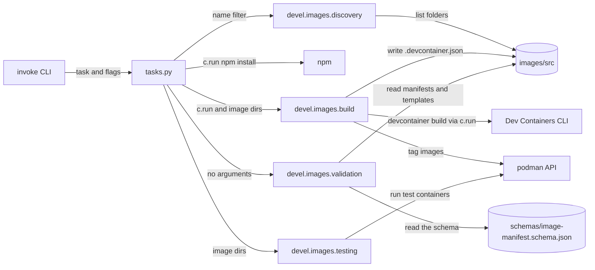

# Dev tooling

How `tasks.py` and the Python packages in `devel/` fit together, and how the Python, Node and dependency tooling is configured. It's for engineers who change a task, add a `devel` package or change the tooling settings. Build, test and lint commands are in [CONTRIBUTING.md](../CONTRIBUTING.md).

## Contents

1. [Overview](#overview)
1. [How it works](#how-it-works)
1. [Interfaces](#interfaces)
1. [Errors](#errors)
1. [Tool configuration](#tool-configuration)
1. [Unit tests](#unit-tests)
1. [Decisions](#decisions)
1. [Limits](#limits)
1. [Sources](#sources)

## Overview

The dev tooling has two layers:

- **Command layer:** [tasks.py](../tasks.py) defines the Invoke tasks `build`, `test` and `validate`. It parses flags, picks the images and turns results into exit codes.
- **Logic layer:** the packages in [devel/](../devel/), such as `devel.images`, do the work. They don't import Invoke.

`devel/` holds dev-time Python only. Nothing in it ships in an image. What the image modules do is in [Container images](container-images/overview.md), and the hook code in `devel/hooks/` is in [Claude Code hooks](claude-code-hooks.md).

This flowchart shows how a task reaches the tools outside Python:

## How it works

### Tasks and suites

- Each task takes a positional `suite`. Only `images` exists. Any other suite, including `features`, prints a message such as `features is not a valid build suite.` and exits 0 (observed).
- `tasks.py` imports the package as `from devel import images` and calls only the names that [`devel/images/__init__.py`](../devel/images/__init__.py) exports: `build_images`, `image_dirs`, `test_images`, `validate` and `ImageManifest`.
- `build` and `test` call `_image_dirs` once, before `_npm_install`. A filter that matches nothing exits before npm runs.
- `_npm_install` raises `RuntimeError` when `npm` isn't on `PATH`, then runs `npm install` through `c.run`.
- `test --skip-build` skips both `npm install` and the build, and tests the images that are already there.
- `validate` doesn't run npm or discovery. `devel.images.validate` finds the manifests itself.

### How imports resolve

- uv doesn't build or install the project: `[tool.uv]` sets `package = false` in [pyproject.toml](../pyproject.toml). `devel` isn't importable as an installed package.
- `tasks.py` can import `devel` because Invoke puts the directory that holds `tasks.py`, the repository root, on `sys.path` when it loads the tasks.
- pytest gets the same root through `pythonpath = [".", "devel/hooks"]`. The second entry lets the hook tests import a hook script as a top-level module (see [Claude Code hooks](claude-code-hooks.md)).
- Pyright resolves the root as its project folder (inferred), and `devel/hooks` through `extraPaths` in [pyrightconfig.json](../pyrightconfig.json).

## Interfaces

### Task flags

Invoke builds each flag from a task parameter.

| Parameter | Flag | Tasks | Notes |
| --- | --- | --- | --- |
| `suite` | positional, `-s` or `--suite` | all | Only `images` does anything |
| `filter_` | `-f`, `--filter` | `build`, `test` | Invoke strips the trailing underscore, which stops the parameter hiding the built-in `filter` |
| `no_cache` | `-n`, `--no-cache` | `build`, `test` | Passed to the build |
| `is_release` | `-i`, `--is-release` | `build`, `test` | Tags with the manifest versions instead of the commit. See [Image builds](container-images/builds.md#before-the-build) |
| `skip_build` | `-k`, `--skip-build[=STRING]` | `test` | Declared in `optional=["skip_build"]`, so it takes an optional value |

- Put `--skip-build` after the suite. Before it, Invoke can't tell the suite from the flag's value, and `invoke test --skip-build features` fails with `'features' is ambiguous when given after an optional-value flag` (observed).
- Any value counts as true, because the value arrives as a non-empty string. `--skip-build=false` still skips the build (observed: with `--no-cache` it prints the warning below).
- `--no-cache` with `--skip-build` prints `Warning: --no-cache has no effect with --skip-build, so it will be ignored.` and carries on. `--is-release` with `--skip-build` prints the same warning for `--is-release`.
- Name any new parameter that would hide a built-in with a trailing underscore, as `filter_` does.

### Between tasks.py and devel

- A `devel` function that runs a shell command takes a `Runner`, defined in [build.py](../devel/images/build.py) as `type Runner = Callable[[str], object]`. `tasks.py` passes `c.run`. Only the functions in `build.py` take one, and `build_images` is the one `tasks.py` calls.
- A `devel` function reports failure by returning it: `test_images` returns the names of the images that failed, and `validate` returns a list of error strings. An empty list means success.
- `tasks.py` turns a non-empty result into `invoke.exceptions.Exit` with `code=1`. The `devel` packages never exit the process.

## Errors

| Situation | Where | Result |
| --- | --- | --- |
| A `--filter` matches no image | `_image_dirs` | `Exit` with `No images match the filter '<filter>'.` and status 1 |
| `npm` isn't on `PATH` | `_npm_install` | `RuntimeError` with `npm is not on PATH.` |
| Any image fails its tests | `test` | `Exit` with `Image tests failed: <names>` and status 1 |
| Validation finds errors | `validate` | `Exit` that lists each error and status 1 |
| Unknown suite | all tasks | A message, then status 0 |

- How a failed build command stops the run is in [Image builds](container-images/builds.md#errors).
- A folder that discovery skips isn't an error. See [Discovery](container-images/overview.md#discovery).

## Tool configuration

### Python

- **Interpreter:** the system Python 3.14. `.python-version` holds `3.14`, `requires-python` is `>=3.14` and `[tool.uv]` sets `python-preference = "only-system"` and `python-downloads = "never"`, so uv never fetches its own Python.
- **Virtual environment:** `.venv` is created with `--system-site-packages`. The set-up steps are in [CONTRIBUTING.md](../CONTRIBUTING.md).
- **Release age:** `exclude-newer = "7 days"` makes uv resolve only versions published at least 7 days ago.
- **Lockfile:** [.gitignore](../.gitignore) ignores `uv.lock`, with the comment that the project isn't a package, so the repository has no Python lockfile. `package-lock.json` is committed.
- **Dependencies:** every Python dependency is in the `dev` dependency group in [pyproject.toml](../pyproject.toml). `[project]` has none, because nothing in the repository is installed.
- **Ruff:** its settings are in `[tool.ruff]` in [pyproject.toml](../pyproject.toml).
- **Pyright:** `typeCheckingMode` is `standard`, for Python 3.14 with the `.venv` environment. It excludes `node_modules`, `__pycache__` and every dot-directory (`**/.*`), and adds `devel/hooks` to `extraPaths`.

### Node and npm

- [package.json](../package.json) holds the one npm dependency, `@devcontainers/cli`, and the Node version it needs. [.nvmrc](../.nvmrc) selects the Node version for nvm.
- [.npmrc](../.npmrc) sets `min-release-age=7`, to match uv's `exclude-newer`. It needs npm 11.10.0 or later, and older versions ignore it.

### Dependency updates

[.github/dependabot.yml](../.github/dependabot.yml) checks the `uv` and `npm` ecosystems every Monday.

- Each ecosystem has one group, `python` or `npm`, that matches `*`, so Dependabot opens one pull request (PR) per ecosystem.
- It covers every dependency type and waits 7 days before it proposes a new version (`cooldown`). Its commit messages start with `chore` and a scope.

## Unit tests

- `testpaths = ["devel"]`, so pytest only collects tests under `devel/`.
- Put a package's tests in `devel/<package>/test/`, without an `__init__.py`.
- `addopts` sets `--import-mode=importlib`, so pytest imports each test file by path. Test files in different packages can then share a name, such as `test_testing.py`.
- `addopts` also sets `-ra`, `-q` and `-p no:cacheprovider`, and `minversion` is `9.1`.
- In a test, import the module, such as `from devel.images import testing`, not a function whose name starts with `test_`. pytest would collect an imported `test_images` as a test.

## Decisions

- **Invoke stays in `tasks.py`.** The `devel` packages take a `Runner` and return results, so their tests can pass a fake runner and check return values without Invoke or a shell. [test_build.py](../devel/images/test/test_build.py) passes `commands.append` as the runner.
- **`devel/` isn't a package uv installs.** It's dev-time code only, so `package = false` keeps it out of the environment. The import paths come from Invoke, pytest and Pyright instead.
- **System Python with system site packages.** [CONTRIBUTING.md](../CONTRIBUTING.md) gives the reason: feature scripts and the editor see the same packages as the target image. No feature scripts exist yet: `features/src` holds only a `.gitkeep`.
- **A 7-day release age everywhere.** uv, npm and Dependabot all wait 7 days for a new version, so a release that's pulled soon after publishing doesn't reach the project (inferred: the settings don't say why).
- **One grouped PR per ecosystem.** Dependabot's groups keep the weekly updates to two PRs.

## Limits

- Only the `images` suite exists. `features` is accepted as a value but does nothing.
- An unknown suite exits 0, so a typo in a script doesn't fail it.
- The tasks only work from the repository root. See [Image names and paths](container-images/overview.md#image-names-and-paths).
- `--skip-build` can't be turned off with a value.
- npm older than 11.10.0 ignores `min-release-age` without a warning.

## Sources

- https://docs.pyinvoke.org/en/stable/concepts/invoking-tasks.html
- https://docs.pyinvoke.org/en/stable/concepts/loading.html
- https://docs.astral.sh/uv/reference/settings/
- https://docs.pytest.org/en/stable/explanation/pythonpath.html
- https://docs.npmjs.com/cli/v11/using-npm/config
- https://docs.github.com/en/code-security/dependabot/working-with-dependabot/dependabot-options-reference
- Observed with Invoke 3.0.3: the unknown-suite message and exit status, the `--skip-build` parsing and the `--no-cache` warning.
