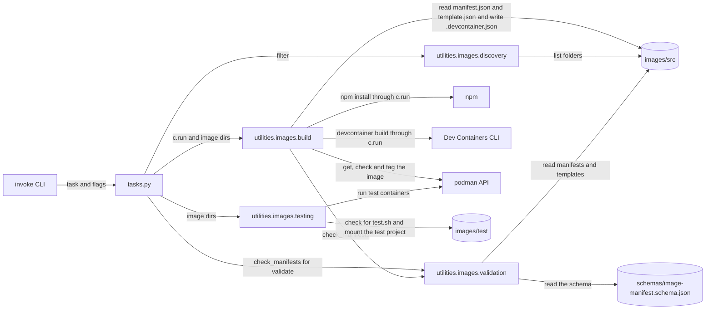

# Dev tooling

The high-level design of `tasks.py` and the Python packages in `utilities/`, and why the Python, Node and dependency tooling is set up the way it is. It's for engineers who change a task, a `utilities` package or the tooling settings.

## Contents

1. [Overview](#overview)
1. [Tool configuration](#tool-configuration)
1. [Limits](#limits)

## Overview

The tooling has two layers. [tasks.py](../tasks.py) defines the Invoke tasks `build`, `test` and `validate` as thin wrappers, and the packages in [utilities/](../utilities/) do the work without importing Invoke. A function that runs a shell command takes a `Runner`, so its tests can pass a fake instead of Invoke's `c.run`. `utilities.images` raises `ImageError` for a failure the user can fix, which `tasks.py` turns into a one-line exit, and any other exception is a bug that keeps its traceback.

uv doesn't install the project, so `utilities` isn't an installed package. Invoke, pytest and Pyright each find it from the repository root, which is why the tasks only work from there.

## Tool configuration

- **System Python only, with system site packages.** uv never downloads its own Python, and the `.venv` sees the system site packages, because feature scripts will run on the container's system Python. The editor then sees the same packages as the target image.
- **A 7-day release age everywhere.** uv's `exclude-newer`, npm's `min-release-age` and Dependabot's `cooldown` all wait 7 days for a new version, so a release that's pulled soon after publishing never reaches the project.
- **`engines` with `engine-strict`.** npm older than 11.10.0 ignores `min-release-age` without a warning, so `package.json` requires that npm and `engine-strict` makes an older one fail.
- **No lockfiles.** The project isn't a package, so the version ranges and the release age decide what's installed.

## Limits

- Without tests for `tasks.py`, a mistake in a wrapper only shows when the task runs.
- Without a tracked lockfile, two machines can install different versions within the ranges.
