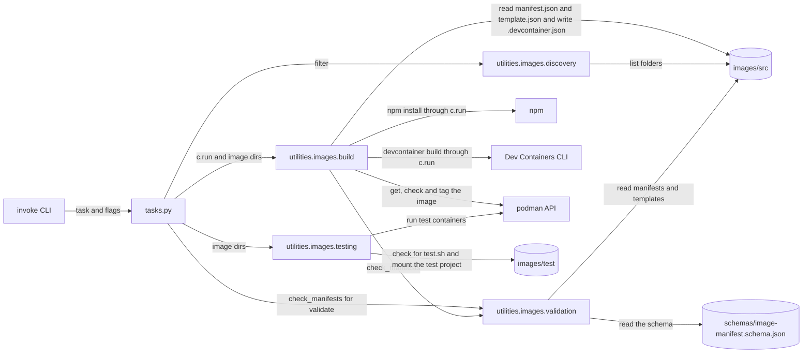

# Dev tooling

How `tasks.py` and the Python packages in `utilities/` fit together, and why the Python, Node and dependency tooling is set up the way it is. It's for engineers who change a task, a `utilities` package or the tooling settings. The set-up steps and commands are in [README.md](../README.md#set-up).

## Contents

1. [Overview](#overview)
1. [Between tasks.py and utilities](#between-taskspy-and-utilities)
1. [How imports resolve](#how-imports-resolve)
1. [Tool configuration](#tool-configuration)
1. [Unit tests](#unit-tests)
1. [Limits](#limits)

## Overview

The tooling has two layers. [tasks.py](../tasks.py) defines the Invoke tasks `build`, `test` and `validate` as thin wrappers, and the packages in [utilities/](../utilities/) do the work without importing Invoke. Nothing in `utilities/` ships in an image. This flowchart shows how a task reaches the `utilities.images` modules, and what each one uses outside Python:

Only the `images` suite is implemented. `features` raises `NotImplementedError` until features exist, so it fails with a traceback.

## Between tasks.py and utilities

- A `utilities` function that runs a shell command takes a `Runner`, `Callable[[str], object]`, defined in [build.py](../utilities/images/build.py). `tasks.py` passes `c.run`, and the tests pass a list's `append`, so they check the commands without Invoke or a shell.
- `utilities.images` raises [`ImageError`](../utilities/images/errors.py) for a failure the user can fix, with a message ready to show. `tasks.py` turns it into `Exit` with status 1, so Invoke prints it without a traceback.
- Any other exception is a bug and keeps its traceback, so don't catch a broad type such as `RuntimeError`. A failed shell command is the exception: Invoke reports `UnexpectedExit` without a traceback.
- Nothing in `utilities` exits the process, except a hook script's `__main__` block.
- `tasks.py` has no unit tests by design, so any logic worth testing goes in `utilities`.

## How imports resolve

uv doesn't install the project (`package = false` in [pyproject.toml](../pyproject.toml)), so `utilities` isn't an installed package. Each tool finds it from the repository root instead:

- Invoke puts the directory that holds `tasks.py` on `sys.path`.
- pytest uses `pythonpath = [".", "utilities/hooks"]`. The second entry lets the hook tests import a hook script as a top-level module.
- Pyright uses its project folder, and `extraPaths` in [pyrightconfig.json](../pyrightconfig.json) for `utilities/hooks`. It skips every dot-directory, which is why hook code lives in `utilities/hooks` (see [Claude Code hooks](claude-code-hooks.md)).

## Tool configuration

- **System Python only.** uv uses the system Python 3.14 and never downloads its own. The `.venv` is created with `--system-site-packages`, because feature scripts will run on the container's system Python, so the editor should see the same packages as the target image.
- **A 7-day release age everywhere.** uv's `exclude-newer`, npm's `min-release-age` in [.npmrc](../.npmrc) and Dependabot's `cooldown` all wait 7 days for a new version, so a release that's pulled soon after publishing never reaches the project.
- **`engines` with `engine-strict`.** npm older than 11.10.0 ignores `min-release-age` without a warning. So [package.json](../package.json)'s `engines` requires that npm, and a Node that bundles it, and `engine-strict=true` makes `npm install` fail rather than warn on an older one.
- **No lockfiles.** Git ignores `uv.lock` and `package-lock.json`, so the ranges and the release age decide what's installed. The caret range on the `0.x` Dev Containers CLI only allows patch releases.

### Dependency updates

[.github/dependabot.yml](../.github/dependabot.yml) updates the `uv`, `npm` and `github-actions` ecosystems weekly, with one grouped pull request per ecosystem. For `github-actions`, it updates the commit SHA each workflow pins and the version comment after it.

## Unit tests

- Put a package's tests in `utilities/<package>/test/`, without an `__init__.py`. pytest runs with `--import-mode=importlib`, so test files in different packages can share a name.
- Don't start a library function's name with `test`, or pytest collects it as a test in every test file that imports it.

## Limits

- Without tests for `tasks.py`, a mistake in a wrapper, such as a flag passed to the wrong argument, only shows when the task runs.
- Without a tracked lockfile, two machines can install different versions within the ranges. A local lockfile keeps what it first resolved until it's deleted.
- The tasks only work from the repository root, because the paths in config.py are relative to it.
