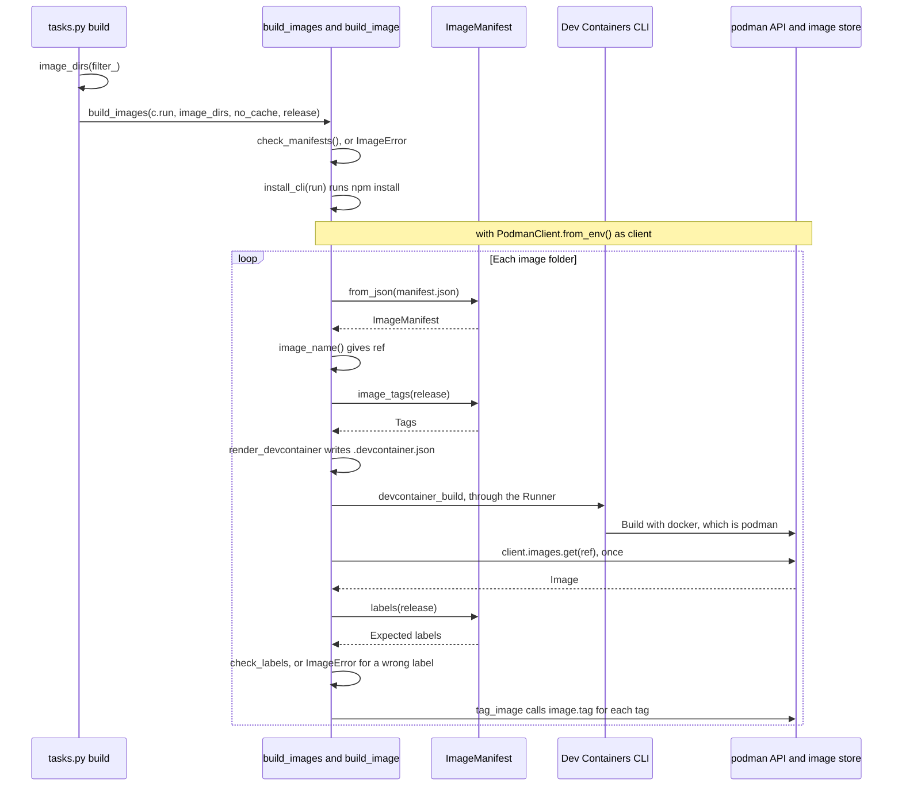

# Image builds

How `devel.images` builds, names, labels and tags each image: it checks the manifests, renders the image's `.devcontainer.json`, runs the Dev Containers CLI and tags the result with podman. It's for engineers who change [build.py](../../devel/images/build.py) or the `build` task in [tasks.py](../../tasks.py).

## Contents

1. [Overview](#overview)
1. [How it works](#how-it-works)
1. [Interfaces](#interfaces)
1. [Errors](#errors)
1. [Decisions](#decisions)
1. [Limits](#limits)
1. [Sources](#sources)

## Overview

[build.py](../../devel/images/build.py) turns image folders in `images/src/` into tagged images in podman's local image store. It doesn't find the image folders, define the manifest or run the image tests:

- [Container images](overview.md) covers how image folders are found, and [Add an image](overview.md#add-an-image) the rules for adding or changing one.
- [Image manifests](manifests.md) covers `manifest.json`, `ImageManifest`, rendering the template and the checks that the build runs first.
- [Image tests](tests.md) covers what `invoke test images` does after the build.
- [Dev tooling](../dev-tooling.md) covers the `build` and `test` tasks, their flags and the Python and npm tooling.

For the commands, see [Build and test](../../README.md#build-and-test).

## How it works

This sequence diagram shows one run of `invoke build images`, from the task to podman:



### Before the build

`build_images` does these steps in order before it builds the first image, so a mistake stops the run before anything slow starts:

1. `check_manifests` runs every manifest check on every image under `images/src`, not only the ones `image_dirs` picked. A broken manifest in one image stops a build of any other. [Validation](manifests.md#validation) describes the checks.
1. `install_cli` runs `npm install`, which installs `@devcontainers/cli` within the range in [package.json](../../package.json). The repository tracks no `package-lock.json`, as [Lockfiles](../dev-tooling.md#lockfiles) describes.
1. It opens one podman client with `with podman.PodmanClient.from_env() as client`, passes it to `build_image` for each image and closes it when the run ends. In podman-py 5.8.0, `from_env` reads `CONTAINER_HOST` or `DOCKER_HOST` and doesn't contact the service, so the first request is the `images.get` after the first build (inferred from the podman-py source).

### Names and tags

[config.py](../../devel/images/config.py) and [manifest.py](../../devel/images/manifest.py) work out every name the build gives an image. The name and every tag are in `IMAGE_REPOSITORY`, which is `ghcr.io/froazin/devcontainers`.

| What | Release | Dev build | From |
| --- | --- | --- | --- |
| Image name | `<IMAGE_REPOSITORY>:<folder>`, such as `ghcr.io/froazin/devcontainers:base` | `<IMAGE_REPOSITORY>:<folder>-dev`, such as `ghcr.io/froazin/devcontainers:base-dev` | `image_name` |
| Tags | Each manifest tag on its own and with `-vMAJOR`, `-vMAJOR.MINOR` and `-vMAJOR.MINOR.PATCH`. `["base"]` at `0.1.0` gives `base`, `base-v0`, `base-v0.1` and `base-v0.1.0` | The release tags, each with `-dev` on the end. `["base"]` at `0.1.0` gives `base-dev`, `base-v0-dev`, `base-v0.1-dev` and `base-v0.1.0-dev` | `image_tags` |
| Version label | `v<version>`, such as `v0.1.0` | `v<version>-dev`, such as `v0.1.0-dev` | `image_version` |

- `<folder>` is the image folder's name. No manifest field names the image.
- The image tests look for an image by the same name (see [Image tests](tests.md)).
- `manifest.json` holds the plain version, such as `0.1.0`. The build adds the `v`, `IMAGE_VERSION_PREFIX` in [config.py](../../devel/images/config.py), to every tag and label.
- After the `v`, a dev build's version is a Semantic Versioning (SemVer) 2.0.0 pre-release, so a dev image never carries a release's version. Its tags end in `-dev` the same way, so each one reads as a pre-release of the matching release tag.

### For each image

[`build_image`](../../devel/images/build.py) loads the manifest and works out the image's name and tags before it writes anything. It then renders `.devcontainer.json` (see [Rendering template.json](manifests.md#rendering-templatejson)), runs the Dev Containers CLI through the `Runner`, gets the built image from podman once, checks its labels and tags it. The CLI command is:

```text
npm exec @devcontainers/cli -- build --workspace-folder=<image_dir> --image-name=<ref> --no-lockfile [--no-cache]
```

`<ref>` is the image name, and `--no-cache` is there only when the task is given it.

### Labels

Each image carries four of the standard Open Container Initiative (OCI) labels, set from build arguments that the template fills in:

| Label | Build argument | Value |
| --- | --- | --- |
| `org.opencontainers.image.version` | `IMAGE_VERSION` | The version label from [Names and tags](#names-and-tags) |
| `org.opencontainers.image.title` | `IMAGE_TITLE` | The manifest's `name` |
| `org.opencontainers.image.description` | `IMAGE_DESCRIPTION` | The manifest's `description` |
| `org.opencontainers.image.source` | `IMAGE_SOURCE` | `IMAGE_SOURCE` in [config.py](../../devel/images/config.py), the repository's GitHub URL |

- The image's `template.json` puts the four values in `build.args`, after the manifest's `build_args`. Don't use the four argument names in a manifest's `build_args`. The rendered `build.args` then has the key twice, and the Dev Containers CLI keeps the last value for a repeated key (observed with `devcontainer read-configuration`, CLI 0.88.0), so the manifest's value is silently dropped.
- The `Containerfile` declares each one with `ARG` after `FROM`, runs `RUN true` and sets the labels with one `LABEL` instruction. An `ARG` before `FROM` isn't visible after it, so the label arguments can't share the `BASE_IMAGE` line.
- `RUN true` stops podman's layer cache from keeping old label values. podman caches layers by default, and the cache key for an `ARG` or `LABEL` step is its text, without the argument values. Without the `RUN`, a release built after a dev build kept the dev version label. The cache key for a `RUN` step does include the build arguments, so a changed value rebuilds from there, and the same values still reuse the cache (both observed with podman 5.7.0 and buildah 1.42.1). It costs one empty layer, since `true` changes no files (inferred).
- After the build, `check_labels` compares the four labels on the image with `manifest.labels(release)`. That catches a stale cache, and a template or `Containerfile` that leaves a label out: buildah sets a label to `""` when its argument isn't passed (observed).

### Where the image lands

- The command passes no `--docker-path`, so the CLI runs `docker`. In CLI 0.88.0, the `build` command's `--docker-path` has no default, and the code falls back to `docker` when it isn't set (observed in its source).
- The CLI builds into whatever store `docker` writes to. The podman client then looks the image up in podman's store. If `docker` isn't podman, the image lands in a store the podman client can't see, and `images.get` fails.
- On the dev machine, `/usr/bin/docker` is a shell script that runs `exec /usr/bin/podman "$@"` (observed).

## Interfaces

The docstrings in [build.py](../../devel/images/build.py) say what each function does. These facts aren't in them:

- `build_images` is the entry point that `tasks.py` calls (see [The devel.images package](overview.md#the-develimages-package)).
- `build_images` takes `release` and passes it on to `build_image`. A dev build and a release differ only in the name, tags and version label that `release` picks.
- [test_build.py](../../devel/images/test/test_build.py) passes a list's `append` as the `Runner` and checks the command text. The `Runner` contract is in [Between tasks.py and devel](../dev-tooling.md#between-taskspy-and-devel).
- `render_devcontainer` gets the text from `render_template` in [manifest.py](../../devel/images/manifest.py), which validation uses too.

## Errors

Each error stops the whole run. Images built before it stay built and tagged, and later images aren't built. `build.py` raises `ImageError` for a failure the user can fix, and `tasks.py` turns it into `Exit` with status 1, which prints the message without a traceback, as [Between tasks.py and devel](../dev-tooling.md#between-taskspy-and-devel) describes. Errors in the task before `build_images`, such as a filter that matches no image, are in [Dev tooling](../dev-tooling.md#errors).

| Cause | What happens |
| --- | --- |
| A manifest isn't valid JSON, or breaks the schema with a missing, unknown or wrongly typed field or a `version` that isn't `MAJOR.MINOR.PATCH` | `check_manifests` raises `ImageError` that lists every error (see [Validation](manifests.md#validation)), before anything is installed |
| A template doesn't render, or doesn't render to valid JSON | The same |
| The schema can't be read, isn't valid JSON or isn't a valid schema | The same, with one error that names the schema file (see [Validation](manifests.md#validation)) |
| `npm install` or the CLI build fails, or `npm` isn't on `PATH` | Invoke's `c.run` raises `UnexpectedExit`, and the task exits with the command's status. [Between tasks.py and devel](../dev-tooling.md#between-taskspy-and-devel) describes how Invoke reports it. A missing `npm` fails through the shell with status 127 (observed) |
| The built image has a missing or wrong label | `check_labels` raises `ImageError` with each wrong label, after the build and before tagging. The image keeps only the name the CLI gave it, which [Decisions](#decisions) explains |
| The image isn't in podman's store, or podman's API service isn't reachable | `images.get`, the label check or tagging raises `podman.errors.APIError`, or its subclass `ImageNotFound`. `build_images` turns it into an `ImageError` that gives podman-py's message and suggests checking `podman.socket` |

## Decisions

The code records few of these reasons. The reasons below are inferred, unless a bullet says otherwise.

- **Check every manifest before every build:** `from_json` checks only the field names, so without the check a build would accept a manifest that breaks the schema anywhere the build doesn't parse, such as an empty `name`. Running `check_manifests` first makes the schema the one description of a valid manifest, for dev builds and releases alike. It checks every image, not only the filtered ones, because the checks are quick and build nothing.
- **Work out the name and tags first:** a bad `version` makes `image_tags` fail before `.devcontainer.json` is overwritten or a slow build starts. `check_manifests` catches it earlier, so this is a second line of defence, which `test_build_image_checks_the_version_before_building` checks.
- **Tag with podman-py after the label check:** the CLI's `build` accepts several `--image-name` values (observed in its source), so it could apply every tag itself. Tagging in `tag_image`, after `check_labels`, means an image with the wrong labels gets none of the tags `tag_image` adds, such as `base-v0.1.0` or `base-v0.1.0-dev`. It keeps only the image name the CLI gives it. When a manifest tag matches the folder name, as `base` does, that name is also its plain `base` or `base-dev` tag, so a failed build still takes that name off the previous image (inferred). Why the original choice was made isn't known. The tag list stays in Python, where `test_tag_image_applies_each_tag_to_the_repository` checks it with a mock image.
- **Pass `--no-lockfile`:** the CLI otherwise generates and verifies a lockfile for Dev Container features (`--no-lockfile` is "Disable lockfile generation and verification." in its source). The images don't use features, and no lockfile is kept in the image folders.
- **Tag dev builds with the version, not the commit:** the maintainer chose it once [CI](../ci.md#version-review) reviewed every changed image's version before it builds anything, so a dev build in CI has the version it's heading for. Locally, and in CI without the review's token, a dev build takes whatever version the manifest holds, even before it's bumped. It also dropped the commit read and pygit2 from the build. The commit used to be in the dev tags and the version label, with `-dirty` for uncommitted changes.
- **Prefix versions with `v`:** the maintainer chose it, to match the `v` on Git release tags. The manifest keeps the plain version, so the schema and the version review stay plain SemVer.
- **Name dev builds `<folder>-dev`:** the maintainer chose it so a dev build stands out from a release, which keeps the plain tags. A dev build never takes the release name, so it can't take a tag off a release image in the store. The dev build's name doesn't change with the version, so `invoke test images --skip-build` finds the latest dev build without knowing it.
- **Set the labels through build arguments:** the maintainer chose to fill them in from the manifest through the template, so the `Containerfile` doesn't repeat the manifest's values.
- **Break the cache with `RUN true`, not `--label` or `--no-cache`:** the maintainer wanted the labels in the `Containerfile`. Passing `--label` through `build.options` would also avoid the stale cache, and `--no-cache` would make every build slow.
- **One podman client per `build_images` call:** `build_images` opens it once with `with`, and `build_image` takes it as an argument, so the tests can pass a mock.

## Limits

- No push or publish. The command doesn't pass the CLI's `--push`, and nothing else uploads the images. The image name and every tag exist only in the local podman store.
- One architecture. The command doesn't pass `--platform`, so the CLI builds for the host's platform (inferred).
- Images build one after another, in the order `image_dirs` gives them.
- `docker` must be podman, and podman's API service must be running for the label check and the tagging step.
- A plain build reuses the base image that's already in podman's store, so it doesn't pick up a newer image behind the same tag, such as the base image's `ubuntu:26.04`. `--no-cache` pulls it again, because the CLI adds `--pull` to the build with `--no-cache` for an image without Dev Container features (inferred from the CLI 0.88.0 source).
- Tags are only added. Old tags from an earlier version stay in the local store. A new build takes over every tag it shares with an older one, so an old dev build of `0.1.0` keeps `base-v0.1.0-dev` after a dev build of `0.1.1` takes `base-dev`, `base-v0-dev` and `base-v0.1-dev`.
- A dev build doesn't record its commit, in its tags or its labels. Every dev build of the same version takes the same tags, so the image behind `base-v0.1.0-dev` is whichever was built last, from any commit or working tree.
- The labels can't be checked from `test.sh`, because a container can't see its image's labels. `check_labels` checks them during the build instead.
- Nothing checks a manifest's `build_args` for the label argument names (see [Labels](#labels)).
- The schema allows a tag of up to 100 characters, and the version suffix and `-dev` add to it. A long tag with a long version can pass the 128 characters the OCI distribution spec's tag pattern allows, and tagging then fails after the build (inferred). `0.1.0` adds 11 characters to a dev tag, `-v0.1.0-dev`.

## Sources

- Dev Containers CLI: https://github.com/devcontainers/cli
- podman-py: https://podman-py.readthedocs.io/
- OCI distribution spec, tag pattern: https://github.com/opencontainers/distribution-spec/blob/main/spec.md
- OCI image spec, pre-defined annotation keys: https://github.com/opencontainers/image-spec/blob/main/annotations.md
- SemVer 2.0.0: https://semver.org/
- Dockerfile `ARG` and `FROM`: https://docs.docker.com/reference/dockerfile/#understand-how-arg-and-from-interact
- Invoke `Context.run`: https://docs.pyinvoke.org/en/stable/api/context.html
- Observed on the dev machine, with podman 5.7.0, buildah 1.42.1, Invoke 3.0.3 and CLI 0.88.0:
  - `/usr/bin/docker` is a podman shim.
  - The layer cache keys for `ARG`, `LABEL` and `RUN` steps, and buildah's `""` label for an argument that isn't passed.
  - A command that isn't on `PATH`, run through `c.run`, prints `command not found` and exits with status 127.
  - `devcontainer read-configuration` keeps the last value of a repeated `build.args` key.
- Read in CLI 0.88.0's `node_modules/@devcontainers/cli/dist/spec-node/devContainersSpecCLI.js`: it falls back to `docker` when `--docker-path` isn't set, takes a repeated `--image-name` as a list, adds `--pull` with `--no-cache` and describes `--no-lockfile`.
