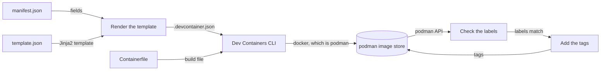

# Image builds

The high-level design of how an image is built, named, labelled and tagged, and why. It's for engineers who change [build.py](../../utilities/images/build.py) or an image's `Containerfile` or template.

## Contents

1. [Overview](#overview)
1. [Names and tags](#names-and-tags)
1. [Design](#design)
1. [Limits](#limits)

## Overview

The build renders each image's template into a `.devcontainer.json`, builds it with the Dev Containers command-line interface (CLI), then checks and tags the result through podman's API:

## Names and tags

Every image goes in one repository, `ghcr.io/froazin/devcontainers`, named after its folder. A release of `base` at `0.1.0` is `base` and is tagged `base`, `base-v0`, `base-v0.1` and `base-v0.1.0`. A dev build, which is any build without `--is-release`, adds `-dev` to the name and every tag. The version label is `v0.1.0` or `v0.1.0-dev`.

## Design

- **`docker` must be podman.** The CLI builds with `docker`, and the build then reads the image through podman's API. With real Docker, the image lands in a store podman can't see.
- **`RUN true` before `LABEL` keeps the labels fresh.** podman's cache key for an `ARG` or `LABEL` step ignores the argument values, so a release built after a dev build kept the dev version label. A `RUN` step's key includes them (observed with podman 5.7.0). That's also why content steps go before the label `ARG`s.
- **Labels come from build arguments,** so the `Containerfile` doesn't repeat the manifest's values. The CLI also writes the template's runtime settings, such as `init` and later `remoteUser`, into a `devcontainer.metadata` label (observed). Nothing checks that label.
- **Tagging happens after the label check,** in Python rather than through the CLI, so an image with the wrong labels gets none of the version tags.
- **Dev builds carry the version, not the commit,** so a dev build can never take a release's tag, and `test --skip-build` finds the latest dev build by name. CI reviews the version before it builds, so a dev build in CI has the version it's heading for.

## Limits

- Nothing is pushed or published, and the CLI builds for the host's platform only.
- A plain build reuses the base image already in podman's store. `--no-cache` pulls it again.
- Tags are only added, so an old build keeps any tag a newer one doesn't take. A dev build doesn't record its commit.
