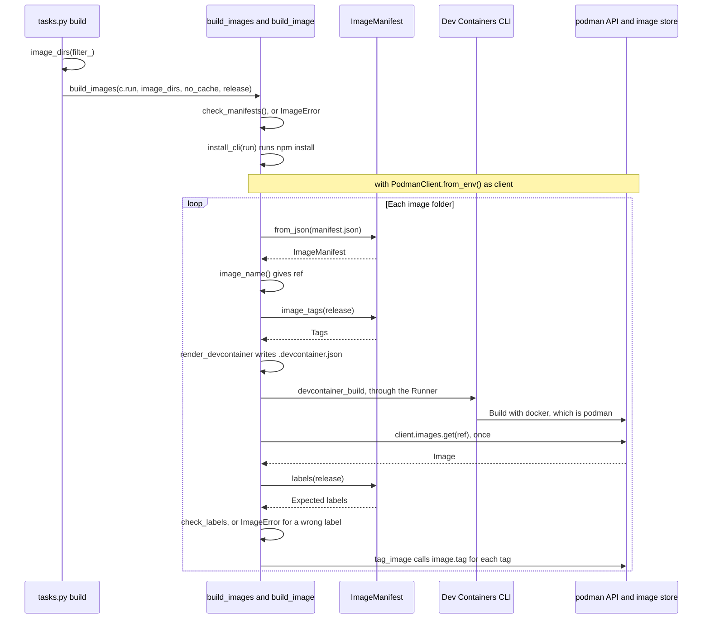

# Image builds

How [build.py](../../utilities/images/build.py) names, builds, labels and tags each image, and why it works that way. It's for engineers who change the build or an image's `Containerfile` or template.

## Contents

1. [Overview](#overview)
1. [Names and tags](#names-and-tags)
1. [Labels](#labels)
1. [Decisions](#decisions)
1. [Limits](#limits)

## Overview

This sequence diagram shows one run of `invoke build images`:

- The Dev Containers command-line interface (CLI) runs `docker`, because the build passes no `--docker-path`. The image lands in whatever store `docker` writes to, and the podman client then looks it up in podman's store. So `docker` must be podman, such as the podman-docker shim, and podman's API socket must be running.
- Each error stops the run. Images built before it stay built and tagged.

## Names and tags

Every name and tag is in one repository, `IMAGE_REPOSITORY` in [config.py](../../utilities/images/config.py), which is `ghcr.io/froazin/devcontainers`. No manifest field names the image.

| What | Release | Dev build |
| --- | --- | --- |
| Image name | `<folder>`, such as `ghcr.io/froazin/devcontainers:base` | `<folder>-dev`, such as `...:base-dev` |
| Tags | Each manifest tag on its own and with `-vMAJOR`, `-vMAJOR.MINOR` and `-vMAJOR.MINOR.PATCH`. `["base"]` at `0.1.0` gives `base`, `base-v0`, `base-v0.1` and `base-v0.1.0` | The release tags with `-dev` on the end, such as `base-v0.1.0-dev` |
| Version label | `v0.1.0` | `v0.1.0-dev` |

A dev build is any build without `--is-release`. The image tests look an image up by the same name.

## Labels

Each image carries four Open Container Initiative (OCI) labels, set from build arguments that the template fills in:

| Label | Build argument | Value |
| --- | --- | --- |
| `org.opencontainers.image.version` | `IMAGE_VERSION` | The version label from [Names and tags](#names-and-tags) |
| `org.opencontainers.image.title` | `IMAGE_TITLE` | The manifest's `name` |
| `org.opencontainers.image.description` | `IMAGE_DESCRIPTION` | The manifest's `description` |
| `org.opencontainers.image.source` | `IMAGE_SOURCE` | `IMAGE_SOURCE` in config.py |

- **The `RUN true` before `LABEL` is load-bearing.** podman's cache key for an `ARG` or `LABEL` step is its text, without the argument values, so without the `RUN` a release built after a dev build kept the dev version label. A `RUN` step's key does include the build arguments, so a changed value rebuilds from there (observed with podman 5.7.0 and buildah 1.42.1). It's also why content goes before the label `ARG`s.
- The label `ARG`s come after `FROM`, because an `ARG` before `FROM` isn't visible after it.
- The template puts the label arguments after the manifest's `build_args`. The CLI keeps the last value of a repeated key (observed with CLI 0.88.0), so a manifest that reuses a label argument's name is silently overridden.
- `check_labels` compares the four labels with the manifest's before tagging. It catches a stale cache, and a template or `Containerfile` that leaves a label out, which buildah sets to `""` (observed).
- The CLI also writes the template's runtime settings, such as `init`, into a `devcontainer.metadata` label (observed: `[ {"init":false} ]`). Settings such as `remoteUser` will land there too. Nothing checks that label, and the tests can't see it.

## Decisions

- **Check every manifest before every build.** `from_json` only checks field names, so the schema is the one description of a valid manifest, for dev builds and releases alike.
- **Tag with podman-py after the label check,** rather than passing every tag to the CLI. An image with wrong labels gets none of the version tags. It keeps the plain name the CLI gave it, which takes that name off the previous image (inferred).
- **Name dev builds `<folder>-dev` and tag them with the version, not the commit.** A dev build can never take a release's tag, and `invoke test images --skip-build` finds the latest dev build without knowing its version. CI reviews the version before it builds, so a dev build in CI carries the version it's heading for.
- **Prefix versions with `v`** to match the Git release tags. The manifest keeps the plain version, so the schema stays plain Semantic Versioning (SemVer).
- **Labels through build arguments,** so the `Containerfile` doesn't repeat the manifest's values. `--label` through `build.options` would also avoid the stale cache, but the labels stay visible in the `Containerfile`.
- **`--no-lockfile`,** because the images don't use Dev Container features and no feature lockfile is kept.

## Limits

- Nothing is pushed or published. The names and tags exist only in the local podman store.
- The CLI builds for the host's platform only (inferred).
- A plain build reuses the base image already in podman's store, so it doesn't pick up a newer `ubuntu:26.04`. `--no-cache` pulls it again, because the CLI adds `--pull` with `--no-cache` for an image without features (inferred from the CLI 0.88.0 source).
- Tags are only added. An old build keeps any tag a newer build doesn't take, such as `base-v0.1.0-dev` after a dev build of `0.1.1`.
- A dev build doesn't record its commit. The image behind `base-v0.1.0-dev` is whichever was built last.
- A long tag with a long version can pass the 128 characters the OCI distribution spec allows, and tagging then fails after the build (inferred).
