# Image manifests

How each image's `manifest.json`, its schema, the `ImageManifest` dataclass and the image's `template.json` are kept in step. It's for engineers who change a manifest field, the schema, `ImageManifest` or a template.

## Contents

1. [Overview](#overview)
1. [Validation](#validation)
1. [Schema design rules](#schema-design-rules)
1. [Rendering template.json](#rendering-templatejson)
1. [Decisions](#decisions)
1. [Limits](#limits)

## Overview

Four files describe an image's settings, and they must agree: the [schema](../../schemas/image-manifest.schema.json), [`ImageManifest`](../../utilities/images/manifest.py), each image's `manifest.json` and its `template.json`. The schema describes each field. This flowchart shows which check compares which:

```mermaid
flowchart LR
    accTitle: How the manifest files relate and which check compares them
    accDescr: schema_errors checks the schema against the draft 2020-12 metaschema and checks that it rejects unknown fields. dataclass_errors compares the schema's properties, required list and defaults with ImageManifest, and its property types with SCHEMA_TYPES. manifest_errors validates each manifest.json against the schema and loads it into ImageManifest. It renders template.json in memory with render_template, which takes its variables from template_vars. The build renders the same template into .devcontainer.json. VS Code checks each manifest.json against the schema while it's edited, through .vscode/settings.json.
    meta["Draft 2020-12 metaschema"]
    schema["image-manifest.schema.json"]
    dc["ImageManifest"]
    types["SCHEMA_TYPES"]
    man["manifest.json"]
    tpl["template.json"]
    out[".devcontainer.json"]
    vscode[".vscode/settings.json"]
    meta -->|"schema_errors: check_schema and additionalProperties false"| schema
    schema <-->|"dataclass_errors: properties, required and defaults"| dc
    types -->|"dataclass_errors: property types"| schema
    man -->|"manifest_errors: iter_errors"| schema
    man -->|"keyword arguments"| dc
    dc -->|"template_vars: every field and the label values"| tpl
    tpl -->|"manifest_errors: render_template in memory must parse as JSON"| tpl
    tpl -->|"render_devcontainer during the build"| out
    vscode -->|"json.schemas: editor checks against image-manifest.schema.json"| man
```

The `image-manifest-schema` skill in `.claude/skills/` lists every file a field change touches, including the test field lists that nothing checks.

## Validation

`check_manifests` in [validation.py](../../utilities/images/validation.py) runs every check and raises `ImageError` listing the errors. It runs from `invoke validate images`, before every build and from the Claude Code hook after an edit.

- If the schema can't be read or isn't a valid draft 2020-12 schema with `"additionalProperties": false`, it stops there, since the other checks rely on it.
- `dataclass_errors` checks that the schema's properties, `required` list, defaults and types match `ImageManifest`, using `SCHEMA_TYPES` for the types.
- `manifest_errors` validates each `images/src/*/manifest.json` against the schema, then renders its `template.json` in memory and checks that the result parses as JSON. It writes no files and builds nothing, so it's quick enough to run after every edit.

## Schema design rules

`validation.py` checks the rules about `additionalProperties`, `required`, defaults and types. These it doesn't:

- Use JSON Schema draft 2020-12.
- Give every property a `description`, and `examples` for anything with a format or naming convention.
- Anchor every `pattern` with `^` and `$`, and keep it the same as what the code accepts. For example, `version` must be `MAJOR.MINOR.PATCH`, because `image_tags` splits it into three integers.
- Keep each `description` true to the code, such as the suffixes the `tags` description lists.
- Add a type to `SCHEMA_TYPES` before you use it in `ImageManifest`.

## Rendering template.json

`render_template` renders the template with `ImageManifest.template_vars`: every field, plus `image_version` and `image_source` for the labels.

- `StrictUndefined` makes a removed or renamed field fail the render, rather than produce an empty value.
- `tojson` on every string value is what keeps the output valid JSON (see [Limits](#limits)).
- The loader only reads from the image's own folder, so a template can't include a shared file.
- Validation renders the release variant only. Nothing exposes `release` to the template yet.

## Decisions

- **A schema and a dataclass, kept in step by a check,** rather than one generated from the other. The schema serves editors and the validator, and the dataclass gives the code typed fields.
- **Strict loading.** `ImageManifest` takes keyword arguments only and the schema rejects unknown fields, so a misspelt field fails in both places rather than being ignored.
- **`render_template` sits in manifest.py,** so validation doesn't depend on build.py, which imports validation.
- **One repository for every image,** so the manifest has no registry, owner or repository field.

## Limits

- Validation catches a quoted template value, such as `"{{ name }}"`, only once a manifest value holds a character JSON must escape. A quoted template can pass today and break later.
- Nothing checks that a `pattern` matches what the code accepts.
- A manifest in a folder without a `template.json` is checked against the schema, but discovery skips that folder, so it's never built.
