# Image manifests

How each image's `manifest.json` is described, loaded, rendered into its template and checked. It's for engineers who change a manifest field, the schema, the `ImageManifest` dataclass or a `template.json`.

## Contents

1. [Overview](#overview)
1. [Manifest fields](#manifest-fields)
1. [Schema design rules](#schema-design-rules)
1. [The ImageManifest dataclass](#the-imagemanifest-dataclass)
1. [Rendering template.json](#rendering-templatejson)
1. [Validation](#validation)
1. [Decisions](#decisions)
1. [Limits](#limits)
1. [Sources](#sources)

## Overview

Four files describe an image's settings, and they must agree:

- [`schemas/image-manifest.schema.json`](../../schemas/image-manifest.schema.json) is the JSON schema for every manifest.
- [`ImageManifest`](../../devel/images/manifest.py) is the dataclass the code loads a manifest into.
- `images/src/<image>/manifest.json` holds one image's values, such as [the base image's manifest](../../images/src/base/manifest.json).
- `images/src/<image>/template.json` is a Jinja2 template that renders into the image's `.devcontainer.json`, such as [the base image's template](../../images/src/base/template.json).

[`devel/images/validation.py`](../../devel/images/validation.py) checks that they agree. Building and tagging the image is in [Image builds](builds.md), and how images fit together is in [Container images](overview.md).

This flowchart shows how the files relate and which check compares which:

```mermaid
flowchart LR
    accTitle: How the manifest files relate and which check compares them
    accDescr: schema_errors checks the schema against the draft 2020-12 metaschema and checks that it rejects unknown fields. dataclass_errors compares the schema's properties, required list and defaults with ImageManifest, and its property types with SCHEMA_TYPES. manifest_errors validates each manifest.json against the schema and loads it into ImageManifest. It renders template.json in memory with render_template, which takes its variables from template_vars. The build renders the same template into .devcontainer.json. VS Code checks each manifest.json against the schema while it's edited, through .vscode/settings.json.
    meta["Draft 2020-12 metaschema"]
    schema["image-manifest.schema.json"]
    dc["ImageManifest"]
    types["SCHEMA_TYPES"]
    man["manifest.json"]
    tpl["template.json"]
    out[".devcontainer.json"]
    vscode[".vscode/settings.json"]
    meta -->|"schema_errors: check_schema and additionalProperties false"| schema
    schema <-->|"dataclass_errors: properties, required and defaults"| dc
    types -->|"dataclass_errors: property types"| schema
    man -->|"manifest_errors: iter_errors"| schema
    man -->|"keyword arguments"| dc
    dc -->|"template_vars: every field and the label values"| tpl
    tpl -->|"manifest_errors: render_template in memory must parse as JSON"| tpl
    tpl -->|"render_devcontainer during the build"| out
    vscode -->|"json.schemas: editor checks against image-manifest.schema.json"| man
```



## Manifest fields

The [schema](../../schemas/image-manifest.schema.json) holds the exact patterns and a description of each field.

| Field | Type | Required | Schema constraint | Used by |
| --- | --- | --- | --- | --- |
| `name` | string | Yes | At least one character | `template.json`, as the dev container's `name` and the title label |
| `description` | string | Yes | At least one character | `template.json`, as the description label |
| `version` | string | Yes | `MAJOR.MINOR.PATCH`, with no leading zeros | `image_tags` and `image_version`, for the tags and the version label, which add a `v` |
| `tags` | array of strings | Yes | At least one, with no duplicates. Each is up to 100 letters, digits, `_`, `.` and `-`. It doesn't start with `.` or `-` | `image_tags` |
| `build_args` | object of strings | No, defaults to `{}` | Each key is letters, digits and `_`. It doesn't start with a digit | `template.json`, as `build.args` for the `Containerfile`. [Labels](builds.md#labels) lists the names it mustn't use |

- The top level sets `"additionalProperties": false`, so the schema rejects any other field.
- No field names the image or says where it goes. The build names it after its folder, in `IMAGE_REPOSITORY`, as [Names and tags](builds.md#names-and-tags) describes. The labels' values are in [Labels](builds.md#labels).
- Bump `version` as [Add an image](overview.md#add-an-image) describes.

VS Code checks each manifest against the schema as you edit it. The `json.schemas` entry in [`.vscode/settings.json`](../../.vscode/settings.json) maps `/images/src/*/manifest.json` to `./schemas/image-manifest.schema.json`.

## Schema design rules

Follow these rules whenever you change the schema or `ImageManifest`. [`validation.py`](../../devel/images/validation.py) enforces the ones marked **checked**, as [Validation](#validation) describes.

- Use JSON Schema draft 2020-12: `"$schema": "https://json-schema.org/draft/2020-12/schema"`.
- Keep `"additionalProperties": false` at the top level, because `ImageManifest` rejects unknown fields (**checked** by `schema_errors`).
- Give every property a `description`. Add `examples` for anything with a format or a naming convention, as `version`, `tags` and `build_args` have.
- Put a field in `required` if, and only if, its dataclass field has no default (**checked** by `dataclass_errors`).
- For an optional field, set the schema's `default` to the same value as the dataclass default (**checked** by `dataclass_errors`).
- Give a string with a fixed format a `pattern` anchored with `^` and `$`. Keep the pattern the same as what the code accepts. For example, `version` must be `MAJOR.MINOR.PATCH`, because `image_tags` splits it into three integers.
- When a property's `description` says how the code uses the field, check that the code does that. For example, `tags` lists the suffixes `image_tags` adds.
- Map each dataclass type to its schema type with this table (**checked** by `dataclass_errors`):

  | Schema | Dataclass |
  | --- | --- |
  | `"type": "string"` | `str` |
  | `"type": "array", "items": {"type": "string"}` | `list[str]` |
  | `"type": "object", "additionalProperties": {"type": "string"}` | `dict[str, str]` |

- `SCHEMA_TYPES` in `validation.py` holds the same mapping. Add a type there before you use it in `ImageManifest`.
- Give a field with a mutable default, such as a list or a dict, `field(default_factory=...)`. Python's `dataclass` raises `ValueError` for a plain `[]` or `{}` default (observed).

## The ImageManifest dataclass

[`ImageManifest`](../../devel/images/manifest.py) is declared `@dataclass(frozen=True, kw_only=True)`, and its docstrings say what each method returns. What they don't say:

- **Frozen:** assigning to a field raises `FrozenInstanceError` (observed).
- **Keyword only:** every field must be passed by name.
- **Defaults:** only `build_args` has one, `field(default_factory=dict)`, so each manifest gets its own empty dict.
- **`from_json(path)`:** checks only the field names. Invalid JSON raises `json.JSONDecodeError`, and a wrong type gets through. The build runs [Validation](#validation) first, so a manifest that reaches `from_json` there has passed the schema.
- **Tags and versions:** [Names and tags](builds.md#names-and-tags) describes what `image_tags` and `image_version` give, for a release or, with `release=False`, a dev build. `image_tags` raises `ValueError` unless `version` splits on `.` into exactly three integers, for either kind of build.
- **`labels(release)`:** the four Open Container Initiative (OCI) labels, which the build checks on the built image (see [Labels](builds.md#labels)).
- **`template_vars(release)`:** builds the variables with `dict(**...)`, so a field ever named `image_version` or `image_source` raises `TypeError` rather than hiding a label value.

## Rendering template.json

[`render_template(image_dir, manifest, release=True)`](../../devel/images/manifest.py) renders an image's `template.json` with `manifest.template_vars(release)` and returns the text. The build's `render_devcontainer` writes it to `.devcontainer.json`, and validation parses it in memory.

- Its Jinja2 `Environment` uses `FileSystemLoader(image_dir)`, so a template can load files only from its own image folder.
- It uses `StrictUndefined`, so a variable the manifest doesn't have fails the render (see [Decisions](#decisions)).
- It sets `keep_trailing_newline=True`, so the output ends the way the template does.

A template passes every string value through Jinja2's `tojson` filter, which quotes and escapes it as JSON, as [Add an image](overview.md#add-an-image) requires. The base template loops over `build_args.items()` the same way, and adds a comma after every item, because the label arguments always come last:

```jinja
{{ key | tojson }}: {{ value | tojson }},
```

The build writes `.devcontainer.json` next to the template, and [`.gitignore`](../../.gitignore) ignores `images/src/*/.devcontainer.json`.

## Validation

`check_manifests()` in [`validation.py`](../../devel/images/validation.py) runs every check. When anything disagrees, it raises `ImageError` with `The image manifest checks failed:` and one `- <error>` line per error. Three things run it:

- The `validate` task, which exits with status 1 and the errors, or prints that everything agrees. The command is in [Build and test](../../README.md#build-and-test).
- `build_images`, before every dev build and release, as [Before the build](builds.md#before-the-build) describes.
- A Claude Code hook, after an edit to a file the checks cover (see [Claude Code hooks](../claude-code-hooks.md)).

`validate(schema_path, src_folder)` does the work and returns the errors as a list, which is empty when everything agrees:

1. It returns one error, without running any check, when it can't read the schema or the schema isn't a valid JSON object.
1. `schema_errors` checks the schema against draft 2020-12 with `Draft202012Validator.check_schema`, and that it sets `"additionalProperties": false`. If it finds an error, `validate` returns straight away, since the other checks rely on the schema (inferred).
1. `dataclass_errors` checks the rules marked **checked** in [Schema design rules](#schema-design-rules). It also checks that every property has a field, every field has a property and every name in `required` has a property. A property can hold more than `SCHEMA_TYPES` gives, such as a `pattern`.
1. `manifest_errors` checks each `images/src/*/manifest.json`, in sorted order. It reports a file it can't read or that isn't valid JSON, or each schema error in it, then moves on to the next file. Otherwise, if the image has a `template.json`, it renders it in memory as a release, without writing `.devcontainer.json`. It reports any Jinja2 `TemplateError` or `TypeError` and any output that doesn't parse as JSON.

## Decisions

The reasons below are inferred from the code, except where a bullet says otherwise.

- **A schema and a dataclass:** the schema gives editors and the validator a description of each field, and the dataclass gives the code typed fields. `dataclass_errors` keeps the two in step, rather than generating one from the other.
- **Strict loading:** `from_json` doesn't filter the JSON, and the schema sets `"additionalProperties": false`, so a misspelt field fails in both places instead of being ignored. The `schema_errors` message gives that reason.
- **`StrictUndefined`:** a template that uses a removed or renamed field fails the render, rather than producing a `.devcontainer.json` with an empty value.
- **Render in memory:** validation renders each template without writing files or building images, so it's quick enough to run after every edit and before every build.
- **One repository for every image:** the maintainer chose to send every image to `IMAGE_REPOSITORY` in config.py, so the manifest has no registry, owner or repository field. The code still handles several images in that repository.
- **Render in manifest.py:** `render_template` sits next to `ImageManifest`, so validation doesn't depend on build.py. build.py imports `check_manifests` from validation.py, so the other way round would be an import cycle.

## Limits

- `manifest_errors` catches a quoted value in a template, such as `"{{ name }}"`, only once a manifest value holds a character JSON must escape, such as `"`, `\` or a newline. A quoted template can pass today and break later, and the schema can't prevent it.
- `dataclass_errors` doesn't check that a `pattern` matches what the code accepts. Keep them in step by hand.
- `validate` checks the manifest in a folder that has no `template.json` against the schema, but renders nothing. Discovery skips that folder, so it's never built or tested (see [Discovery](overview.md#discovery)).

## Sources

- https://json-schema.org/draft/2020-12
- https://jinja.palletsprojects.com/en/stable/templates/#jinja-filters.tojson
- https://jinja.palletsprojects.com/en/stable/api/#jinja2.StrictUndefined
- https://code.visualstudio.com/docs/languages/json#_mapping-in-the-user-settings
- Observed with Python 3.14 on the dev machine: assigning to a field of a frozen dataclass raises `FrozenInstanceError`, and a plain `[]` or `{}` field default raises `ValueError`.
