```mermaid
flowchart LR
    accTitle: How the manifest files relate and which check compares them
    accDescr: schema_errors checks the schema against the draft 2020-12 metaschema and checks that it rejects unknown fields. dataclass_errors compares the schema's properties, required list and defaults with ImageManifest, and its property types with SCHEMA_TYPES. manifest_errors validates each manifest.json against the schema and loads it into ImageManifest. It renders template.json in memory with render_template, which takes its variables from template_vars. The build renders the same template into .devcontainer.json. VS Code checks each manifest.json against the schema while it's edited, through .vscode/settings.json.
    meta["Draft 2020-12 metaschema"]
    schema["image-manifest.schema.json"]
    dc["ImageManifest"]
    types["SCHEMA_TYPES"]
    man["manifest.json"]
    tpl["template.json"]
    out[".devcontainer.json"]
    vscode[".vscode/settings.json"]
    meta -->|"schema_errors: check_schema and additionalProperties false"| schema
    schema <-->|"dataclass_errors: properties, required and defaults"| dc
    types -->|"dataclass_errors: property types"| schema
    man -->|"manifest_errors: iter_errors"| schema
    man -->|"keyword arguments"| dc
    dc -->|"template_vars: every field and the label values"| tpl
    tpl -->|"manifest_errors: render_template in memory must parse as JSON"| tpl
    tpl -->|"render_devcontainer during the build"| out
    vscode -->|"json.schemas: editor checks against image-manifest.schema.json"| man
```

# Image manifests

The high-level design of how each image's `manifest.json`, its schema, the `ImageManifest` dataclass and the image's `template.json` are kept in step. It's for engineers who change a manifest field, the schema or a template.

## Contents

1. [Overview](#overview)
1. [Schema design rules](#schema-design-rules)
1. [Limits](#limits)

## Overview

The [schema](../../schemas/image-manifest.schema.json) describes each field for editors and the validator, and [`ImageManifest`](../../utilities/images/manifest.py) gives the code typed fields. Rather than generate one from the other, [validation.py](../../utilities/images/validation.py) checks that they agree, then validates every manifest and renders every template in memory. It's quick enough to run on `invoke validate images`, before every build and from the Claude Code hook after an edit. This flowchart shows which check compares which:

Both sides are strict: the schema rejects unknown fields and `ImageManifest` takes keyword arguments only, so a misspelt field fails rather than being ignored. The template renders with `StrictUndefined`, so a removed field fails the render rather than producing an empty value.

## Schema design rules

The checks cover the schema's structure, `required` list, defaults and types. They don't cover these:

- Give every property a `description`, and `examples` for anything with a format.
- Keep each anchored `pattern` the same as what the code accepts, such as `version`, which `image_tags` splits into three integers.
- Keep each `description` true to the code.

## Limits

- Validation catches a template value quoted by hand, rather than through `tojson`, only once a manifest value holds a character JSON must escape.
- Validation renders the release variant only.
- Nothing checks that `MANIFEST` in [test_build.py](../../utilities/images/test/test_build.py) lists every field.
