# Image manifests

The high-level design of how each image's `manifest.json`, its schema, the `MANIFEST_FIELDS` table behind the `ImageManifest` type and the shared image template, `images/src/template.hbs`, are kept in step. It's for engineers who change a manifest field, the schema or a template.

## Contents

1. [Overview](#overview)
1. [Schema design rules](#schema-design-rules)
1. [Limits](#limits)

## Overview

The [schema](../../schemas/image-manifest.schema.json) describes each field for editors and the validator. [`MANIFEST_FIELDS`](../../tasks/images/manifest.ts) lists each field's kind and default for the code, and the `ImageManifest` type is derived from it. TypeScript's types are gone at run time, so the table is what the checks read. Rather than generate one from the other, [validation.ts](../../tasks/images/validation.ts) checks that they agree, then validates every manifest and renders the template in memory with each one. It's quick enough to run on `npm run tasks -- validate images`, before every build and from the Claude Code hook after an edit. This flowchart shows which check compares which:

```mermaid
flowchart LR
    accTitle: How the manifest files relate and which check compares them
    accDescr: schemaErrors checks the schema against the draft 2020-12 metaschema and checks that it rejects unknown fields. fieldErrors compares the schema's properties, required list and defaults with MANIFEST_FIELDS, and its property types with SCHEMA_TYPES. manifestErrors validates each manifest.json against the schema and loads it with parseManifest. It renders the shared template.hbs in memory with renderTemplate for each manifest, which takes its variables from templateVars. The build renders the same template into each image's .devcontainer.json. VS Code checks each manifest.json against the schema while it's edited, through .vscode/settings.json.
    meta["Draft 2020-12 metaschema"]
    schema["image-manifest.schema.json"]
    fields["MANIFEST_FIELDS"]
    types["SCHEMA_TYPES"]
    man["manifest.json"]
    tpl["images/src/template.hbs"]
    out[".devcontainer.json"]
    vscode[".vscode/settings.json"]
    meta -->|"schemaErrors: validateSchema and additionalProperties false"| schema
    schema <-->|"fieldErrors: properties, required and defaults"| fields
    types -->|"fieldErrors: property types"| schema
    man -->|"manifestErrors: Ajv validation"| schema
    man -->|"parseManifest"| fields
    fields -->|"templateVars: every field and the label values"| tpl
    tpl -->|"manifestErrors: renderTemplate in memory must parse as JSON"| tpl
    tpl -->|"renderDevcontainer during the build"| out
    vscode -->|"json.schemas: editor checks against image-manifest.schema.json"| man
```

Both sides are strict: the schema rejects unknown fields and so does `parseManifest`, so a misspelt field fails rather than being ignored. The template renders with Handlebars' `strict` mode, and the `json` helper fails on a missing value, because `strict` alone doesn't check a helper's arguments. So a removed field fails the render rather than producing an empty value.

## Schema design rules

The checks cover the schema's structure, `required` list, defaults and types. They don't cover these:

- Give every property a `description`, and `examples` for anything with a format.
- Keep each anchored `pattern` the same as what the code accepts, such as `version`, which `imageTags` splits into three integers.
- Keep each `description` true to the code.

## Limits

- Validation catches a template value quoted by hand, rather than written through the `json` helper, only once a manifest value holds a character JSON must escape.
- Validation renders the release variant only.
- Nothing checks that `MANIFEST` in [build.test.ts](../../tasks/images/build.test.ts) lists every field.
