# Container images

How the repository turns each image folder into a built, tagged and tested container image, and the rules for adding or changing an image. It's for engineers who work on an image or on `utilities.images`. The stages have their own docs: [Image manifests](manifests.md), [Image builds](builds.md) and [Image tests](tests.md).

## Contents

1. [Overview](#overview)
1. [Image folders](#image-folders)
1. [Add an image](#add-an-image)
1. [Limits](#limits)

## Overview

```mermaid
flowchart LR
    accTitle: The image pipeline
    accDescr: image_dirs finds each image folder with a manifest.json and a template.json, and passes the folders to build_images. build_images runs check_manifests on every image first, then build_image for each folder. render_devcontainer renders template.json with the fields of manifest.json and writes .devcontainer.json. devcontainer_build builds the image from it and the Containerfile, under the name image_name gives it. check_labels compares the built image's labels with the manifest's, and tag_image then tags it. run_image_test runs test.sh from images/test in a podman container of that image, and run_image_tests collects the results.
    discovery["image_dirs"] -->|image folders| build["build_images"]
    build -->|every image, first| check["check_manifests"]
    build -->|build_image, for each folder| render["render_devcontainer"]
    manifest["manifest.json"] -->|fields| render
    template["template.json"] -->|Jinja2 template| render
    render -->|writes| devcontainer[".devcontainer.json"]
    devcontainer -->|config| cli["devcontainer_build"]
    containerfile["Containerfile"] -->|build file| cli
    cli -->|image named by image_name| labels["check_labels"]
    manifest -->|expected labels| labels
    labels -->|labels match| tag["tag_image"]
    tag -->|image found by image_name| test["run_image_test"]
    testsh["test.sh in images/test"] -->|mounted read-only| test
    test -->|passed or failed| tests["run_image_tests"]
```

[tasks.py](../../tasks.py) runs `utilities.images` through the `build`, `test` and `validate` Invoke tasks. This flowchart shows one image going through the pipeline:

- Discovery sorts the folders under `images/src` by name and skips, with a message, any folder without both `manifest.json` and `template.json`. `--filter` is a case-sensitive shell-style glob on the folder name.
- `build_images` checks every manifest, not only the filtered ones, before it installs the Dev Containers command-line interface (CLI) or builds anything.
- The paths in [config.py](../../utilities/images/config.py) are relative to the repository root, and Invoke doesn't change directory, so the tasks only work from the root.

## Image folders

Each image has a source folder, `images/src/<image>/`, and a test folder with the same name, `images/test/<image>/`. The folder name is the image's name. `base` is the only image so far.

| File | What it's for |
| --- | --- |
| `manifest.json` | The image's name, description, version, tags and build arguments. See [Image manifests](manifests.md) |
| `template.json` | The Jinja2 template the build renders into `.devcontainer.json`, which Git ignores |
| `Containerfile` | The build file, named as `build.dockerfile` in the template |
| `README.md` | The image's user doc, until the wiki exists. The tooling doesn't read it |
| `images/test/<image>/test.sh` | The test script that runs inside the built image, with its own copy of `test_utils.sh`. See [Image tests](tests.md) |

## Add an image

These rules hold for adding or changing an image. Most of them are conventions that no check enforces.

- **Folder name:** lowercase letters, digits and hyphens, such as `python-3`. CI rejects anything outside `[a-z0-9._-]`.
- **Base image:** the `Containerfile` starts with `ARG BASE_IMAGE` and `FROM ${BASE_IMAGE}`, and the manifest sets `BASE_IMAGE` in `build_args`, so the base image shows in the manifest. It must be an upstream image for now, as [Limits](#limits) explains.
- **Layer order:** put the steps that add content between `FROM` and the label `ARG`s, and keep the `ARG`, `RUN true` and `LABEL` block last. A `RUN` step's cache key includes the build arguments, so a step after the label `ARG`s reruns on every version bump and every switch between a dev build and a release. See [Labels](builds.md#labels).
- **Build arguments:** upper snake case. Don't reuse a label argument's name, or the CLI silently drops the manifest's value (see [Labels](builds.md#labels)).
- **Template:** edit `template.json`, never `.devcontainer.json`. Write every string value through `tojson`, such as `"name": {{ name | tojson }}`, because a quoted value breaks the JSON once it holds `"` or `\`.
- **Tags:** name what the image is, such as `ubuntu-26.04`. Don't add `latest`, a version or a commit, because the build adds the version suffixes and `-dev`. No name or tag may repeat another image's, including the ones the build generates (see [Names and tags](builds.md#names-and-tags)).
- **Tests:** check everything the `Containerfile` adds, except the labels, which a container can't see.
- **README:** update it in the same change as anything it describes. Don't copy values that change with the image, such as the version. Use a placeholder such as `MAJOR.MINOR.PATCH`, with a worked example.
- **Version:** `version` is the image's semantic version. Bump it in the same change as anything that changes what the image contains or how it's labelled: its `Containerfile`, a `template.json` change that changes the built image or the manifest's `name`, `description` or `build_args`. A change to only the tooling, tests or docs bumps nothing. Which part to bump depends on the image's stage:
  - **Alpha, `0.0.x`:** every change bumps the patch version, even a breaking change or a new feature.
  - **Beta, `0.x` from `0.1.0`:** a breaking change or a new feature bumps the minor version, and anything else the patch version.
  - **Stable, from `1.0.0`:** a breaking change bumps the major version, a new feature the minor version and anything else the patch version.

  What a commit changes decides the bump, not its type: a `feat` commit that only edits the README bumps nothing. A `!` before the colon in a commit header marks a breaking change, and a change that clearly breaks the image's users is breaking without one. Only commits that touch the image's own folder count.

  Bump once per branch. The pull request is squash-merged into one commit, so the most significant change on the branch sets the bump: `1.2.3` with two new features gives `1.3.0`, not `1.4.0`. A new image starts at `0.0.1`, however many commits add it. A changed version must be newer than every release tag of the image, `<image>-vX.Y.Z`, which are planned. The maintainer moves an image to beta or stable by hand, with a jump to exactly `0.1.0` or `1.0.0`. CI's [Version review](../ci.md#version-review) checks these rules, and its prompt copies them, so change both together.

## Limits

- **No image can build `FROM` another of this repository's images yet.** Nothing is published, a template can't tell a dev build from a release, images build in name order rather than dependency order and each CI job builds one image in an empty podman store.
- Dev Container features are planned. `features/src` and `features/test` hold only a `.gitkeep`, and the `features` suite raises `NotImplementedError`.
- Nothing checks that two images have different names or tags. A copy of `images/src/base` keeps `"tags": ["base"]`.
- Discovery doesn't recurse. Each image is one folder directly under `images/src`.
