# Container images

How the repository turns each image folder into a built, tagged and tested container image, described at the level of the parts. It's for engineers who add or change an image, or change the `devel.images` package. Each stage has its own doc: [Image manifests](manifests.md), [Image builds](builds.md) and [Image tests](tests.md). [Image READMEs](readmes.md) covers each image's README.

## Contents

1. [Overview](#overview)
1. [Image folders](#image-folders)
1. [Add an image](#add-an-image)
1. [The devel.images package](#the-develimages-package)
1. [Settings and paths](#settings-and-paths)
1. [Discovery](#discovery)
1. [Errors](#errors)
1. [Limits](#limits)
1. [Sources](#sources)

## Overview

The `devel.images` package does the work, and [tasks.py](../../tasks.py) runs it through the `build`, `test` and `validate` Invoke tasks. The package finds the images, checks their manifests, renders their Dev Container configuration, builds them with the Dev Containers command-line interface (CLI), checks their labels, tags them and runs their tests. It doesn't publish anything (see [Image builds](builds.md#limits)). For the commands, see [Build and test](../../README.md#build-and-test), and for Invoke and the rest of the tooling, see [Dev tooling](../dev-tooling.md).

This flowchart shows one image going through the whole pipeline:

```mermaid
flowchart LR
    accTitle: The image pipeline
    accDescr: image_dirs finds each image folder with a manifest.json and a template.json, and passes the folders to build_images. build_images runs check_manifests on every image first, then build_image for each folder. render_devcontainer renders template.json with the fields of manifest.json and writes .devcontainer.json. devcontainer_build builds the image from it and the Containerfile, under the name image_name gives it. check_labels compares the built image's labels with the manifest's, and tag_image then tags it. run_image_test runs test.sh from images/test in a podman container of that image, and run_image_tests collects the results.
    discovery["image_dirs"] -->|image folders| build["build_images"]
    build -->|every image, first| check["check_manifests"]
    build -->|build_image, for each folder| render["render_devcontainer"]
    manifest["manifest.json"] -->|fields| render
    template["template.json"] -->|Jinja2 template| render
    render -->|writes| devcontainer[".devcontainer.json"]
    devcontainer -->|config| cli["devcontainer_build"]
    containerfile["Containerfile"] -->|build file| cli
    cli -->|image named by image_name| labels["check_labels"]
    manifest -->|expected labels| labels
    labels -->|labels match| tag["tag_image"]
    tag -->|image found by image_name| test["run_image_test"]
    testsh["test.sh in images/test"] -->|mounted read-only| test
    test -->|passed or failed| tests["run_image_tests"]
```

1. `image_dirs` finds the image folders under `images/src`, as [Discovery](#discovery) describes.
1. `build_images` runs `check_manifests` on every image, not only the ones the filter picks. It then installs the Dev Containers CLI.
1. For each folder, `render_devcontainer` renders the image's `template.json` with the fields of its `manifest.json`, and writes the result to `.devcontainer.json` in the same folder.
1. `devcontainer_build` runs the Dev Containers CLI, which builds the image from that file and the `Containerfile`. It gives the image the name [Names and tags](builds.md#names-and-tags) describes.
1. `check_labels` compares the built image's labels with the manifest's, and `tag_image` then tags the image through the podman Python client. [Image builds](builds.md) covers steps 2 to 5.
1. `run_image_tests` runs each image's `test.sh` in a podman container of the built image. It runs every image, then raises `ImageError` naming the ones that failed, if any did. See [Image tests](tests.md).

`invoke test images` runs the build first, unless it's given `--skip-build` (see [Dev tooling](../dev-tooling.md#task-flags)). `invoke validate images` runs only `check_manifests`, which checks the manifests against their schema and renders each template without building anything. See [Validation](manifests.md#validation).

## Image folders

Each image has a source folder, `images/src/<image>/`, and a test folder with the same name, `images/test/<image>/`. The `base` image is the only one so far.

| File | Folder | What it's for |
| --- | --- | --- |
| `manifest.json` | `images/src/<image>/` | The image's settings, such as its name, version, tags and build arguments. Required. See [Image manifests](manifests.md) |
| `template.json` | `images/src/<image>/` | The Jinja2 template that the build renders into `.devcontainer.json`. Required. See [Rendering template.json](manifests.md#rendering-templatejson) |
| `.devcontainer.json` | `images/src/<image>/` | The Dev Container configuration. The build generates it from `template.json`, and Git ignores it |
| `Containerfile` | `images/src/<image>/` | The image's build file. The `base` template names it as `build.dockerfile`, with the image folder as `build.context` |
| `README.md` | `images/src/<image>/` | The image's README, for people who use the image. Its shape is in [Image READMEs](readmes.md). The tooling doesn't read it |
| `test.sh` | `images/test/<image>/` | The test script that runs inside the built image. Every image needs one, as [Add an image](#add-an-image) says, although the tooling skips an image without one |
| `test_utils.sh` | `images/test/<image>/` | The POSIX `sh` check helpers that `test.sh` sources. See [Image tests](tests.md) |

## Add an image

Follow these rules when you add an image or change one. Most of them are conventions that no check enforces.

- **Folder name:** use lowercase letters, digits and hyphens, such as `base` or `python-3`. The folder name becomes the image's name, as [Names and tags](builds.md#names-and-tags) describes.
- **Files:** give every image all of these, in the same change:
  - `manifest.json`, `template.json`, `Containerfile` and `README.md` in `images/src/<image>/`.
  - A test project in `images/test/<image>/`: a `test.sh` and a copy of `images/test/base/test_utils.sh`. Only that folder is mounted in the test container. [Write tests for a new image](tests.md#write-tests-for-a-new-image) shows how to start one.
- **Base image:** take it from a build argument. The `Containerfile` starts with `ARG BASE_IMAGE` and `FROM ${BASE_IMAGE}`, and the manifest sets `BASE_IMAGE` in `build_args`, so the base image is visible in the manifest. The base image's [Containerfile](../../images/src/base/Containerfile) and [manifest.json](../../images/src/base/manifest.json) show both.
- **Build arguments:** name them in upper snake case, such as `BASE_IMAGE`.
- **Labels:** give every image the Open Container Initiative (OCI) labels, as [Labels](builds.md#labels) describes. Don't use the label arguments' names in the manifest's `build_args`.
- **Tags:** give each tag in `tags` a name that says what the image is, such as `ubuntu-26.04`. Don't add `latest`, a version or a commit: the plain tag already acts as the latest, and the build adds the version suffixes, and `-dev` for a dev build.
- **Version:** treat `version` as the image's semantic version, and bump it in the same change as anything that changes what the image contains or how it's labelled: its `Containerfile`, a `template.json` change that changes the built image or the manifest's `name`, `description` or `build_args`. A change to only the tooling, tests or docs bumps nothing. Which part to bump depends on the image's stage:
  - **Alpha, `0.0.x`:** every change bumps the patch version, even a breaking change or a new feature.
  - **Beta, `0.x` from `0.1.0`:** a breaking change or a new feature bumps the minor version, and anything else the patch version.
  - **Stable, from `1.0.0`:** a breaking change bumps the major version, a new feature the minor version and anything else the patch version.

  When you change the version, make it newer than every release tag of the image. Releases are planned, and each will have a Git tag `<image>-vX.Y.Z`, such as `base-v1.2.3`, because each image is versioned on its own. An unchanged version can equal the newest tag, which is the released version.

  The maintainer decides when an image moves from alpha to beta, and when it reaches `1.0.0`. CI asks Claude to check each changed image's bump against these rules, so change the prompt in [Version review](../ci.md#version-review) when you change them.
- **Template:** edit `template.json`, never `.devcontainer.json`. Write every string value through `tojson`, such as `"name": {{ name | tojson }}`, because quotes alone break the JSON for a value that holds `"` or `\`. See [Rendering template.json](manifests.md#rendering-templatejson).
- **Tests:** in `test.sh`, check everything the `Containerfile` adds, except the labels, which a container can't see. End `test.sh` with `report_results`.
- **README:** write the image's `README.md` in the shape [Image READMEs](readmes.md) gives. Update it in the same change as anything it describes, as its [Rules](readmes.md#rules) list.

## The devel.images package

[`devel/images/__init__.py`](../../devel/images/__init__.py) exports `ImageError`, `build_images`, `check_manifests`, `image_dirs` and `run_image_tests`, the names `tasks.py` uses. How `tasks.py` turns an `ImageError` into an exit is in [Dev tooling](../dev-tooling.md#between-taskspy-and-devel).

| Module | What it does | Detail |
| --- | --- | --- |
| [config.py](../../devel/images/config.py) | Holds the paths, file names and registry settings as constants. Its `image_name` names each build | [Settings and paths](#settings-and-paths) |
| [errors.py](../../devel/images/errors.py) | Defines `ImageError`, which the package raises for a failure the user can fix | [Dev tooling](../dev-tooling.md#between-taskspy-and-devel) |
| [discovery.py](../../devel/images/discovery.py) | `image_dirs` finds the image folders to work on | [Discovery](#discovery) |
| [manifest.py](../../devel/images/manifest.py) | `ImageManifest` loads a `manifest.json` and works out the image's tags, labels and template variables. `render_template` renders an image's `template.json` with them | [Image manifests](manifests.md) |
| [build.py](../../devel/images/build.py) | Checks the manifests, installs the CLI, renders `.devcontainer.json`, runs `devcontainer build`, checks the labels and tags the image | [Image builds](builds.md) |
| [testing.py](../../devel/images/testing.py) | Runs each image's `test.sh` in a podman container, and raises `ImageError` naming the images that failed, if any did | [Image tests](tests.md) |
| [validation.py](../../devel/images/validation.py) | Checks that the schema, `ImageManifest`, each `manifest.json` and its `template.json` agree. `check_manifests` raises `ImageError` listing the errors | [Validation](manifests.md#validation) |

The unit tests for the package are in [devel/images/test/](../../devel/images/test/). A Claude Code hook also runs `check_manifests`. See [Claude Code hooks](../claude-code-hooks.md).

## Settings and paths

[config.py](../../devel/images/config.py) holds the package's settings as constants. These are the ones that shape every image:

- `IMAGE_REPOSITORY`, `ghcr.io/froazin/devcontainers`, is the one repository that every image's name and tags go in. [Names and tags](builds.md#names-and-tags) describes how `image_name` names each build.
- `IMAGE_SOURCE`, `https://github.com/froazin/devcontainers`, is the value of every image's source label.
- `IMAGE_DEV_SUFFIX`, `-dev`, marks a dev build's name, tags and label version.
- `IMAGE_VERSION_PREFIX`, `v`, goes before the version in every tag and version label.

The paths in config.py, such as `IMAGES_SRC_FOLDER` and `IMAGE_MANIFEST_SCHEMA`, are relative to the repository root. Invoke finds `tasks.py` from a subfolder but doesn't change directory, so the tasks only work from the root:

- Run from `images/`, `uv run invoke validate images` reports `The image manifest checks failed:` followed by `- Can't read schemas/image-manifest.schema.json: No such file or directory.`, and exits with status 1 (observed).
- Run from `images/`, `uv run invoke build images --filter nope` fails with a `FileNotFoundError` traceback for `images/src`, because `image_dirs` can't list it (observed). It lists the folder before it applies the filter, so a build without one fails the same way, and so does `test`, which calls `image_dirs` first too (inferred from the code).

## Discovery

[`image_dirs`](../../devel/images/discovery.py) takes an optional `name_filter` and a `src_folder`, which defaults to `IMAGES_SRC_FOLDER`. It returns the image folders as paths joined onto `src_folder`, such as `images/src/base`, and the other modules take the image's name from the folder name.

1. It lists `src_folder` and sorts the entries by name, so images are always processed in the same order.
1. It skips any entry that isn't a directory, without a message.
1. If `name_filter` is set, it skips any folder whose name doesn't match it. The filter is a shell-style glob, matched with `fnmatch.fnmatchcase`, so it's case-sensitive: `Base` doesn't match `base`.
1. It checks that the folder has both `manifest.json` and `template.json`. If either is missing, it prints a message that lists every missing file and skips the folder, such as `Skipping empty: manifest.json, template.json not found.`
1. If no folder is left, it raises `ImageError`, such as `No image in images/src with a manifest.json and a template.json matches the filter 'nope'.` (observed). Without a filter, the message ends `was found.` instead.

- The filter runs before the file check, so a folder the filter excludes is never reported as skipped.
- Discovery checks only that the two files exist. It doesn't read or check the manifest. `build_images` and `invoke validate images` do, with `check_manifests`.
- `check_manifests` finds the manifests without `image_dirs`. How the two differ is in [Image manifests](manifests.md#limits).

## Errors

- **Skipped folder:** a folder without a manifest or template prints a message and isn't an error.
- **No image left:** `image_dirs` raises `ImageError` when a filter matches nothing or no folder has both files. `tasks.py` turns it into an exit with status 1, as [Dev tooling](../dev-tooling.md#between-taskspy-and-devel) describes.
- **No `images/src` folder:** `os.listdir` raises `FileNotFoundError`. It isn't an `ImageError`, so it ends in a traceback. See [Settings and paths](#settings-and-paths) for when that happens.
- **Later stages:** for errors from checking, rendering, building, tagging or testing, see [Validation](manifests.md#validation), [Image builds](builds.md#errors) and [Image tests](tests.md#errors).

## Limits

- The pipeline only covers images. Dev Container features are planned. Until then, the `features/src` and `features/test` folders hold only a `.gitkeep`, and the `features` suite raises `NotImplementedError` (see [Dev tooling](../dev-tooling.md#errors)).
- The folder name becomes the image's name, but nothing checks that it's a valid tag (inferred). A folder named like another image's dev build, such as `base-dev`, would share its name.
- Nothing checks that two images have different `tags`. A copy of `images/src/base` keeps `"tags": ["base"]`, and the image built later takes the other's tags (inferred from the code).
- Discovery doesn't recurse: each image is one folder directly under `images/src`.

## Sources

- Observed on the dev machine, on this branch: `uv run invoke validate images` and `uv run invoke build images --filter nope`, run from the repository root and from `images/`.
