# Container images

The high-level design of the image pipeline, and the rules for adding or changing an image that the code can't show. It's for engineers who work on an image or on `tasks/images`.

## Contents

1. [Overview](#overview)
1. [Add an image](#add-an-image)
1. [Limits](#limits)

## Overview

```mermaid
flowchart LR
    accTitle: The image pipeline
    accDescr: imageDirs finds each image folder with a manifest.json, and passes the folders to buildImages. buildImages runs checkManifests on every image first, then buildImage for each folder. renderDevcontainer renders the shared images/src/template.hbs with the fields of manifest.json and writes .devcontainer.json into the image folder. devcontainerBuild builds the image from it and the Dockerfile, under the name imageName gives it. checkLabels compares the built image's labels with the manifest's, and tagImage then tags it. runImageTest runs test.sh from images/test in a Docker container of that image, and runImageTests collects the results.
    discovery["imageDirs"] -->|image folders| build["buildImages"]
    build -->|every image, first| check["checkManifests"]
    build -->|buildImage, for each folder| render["renderDevcontainer"]
    manifest["manifest.json"] -->|fields| render
    template["images/src/template.hbs"] -->|Handlebars template, shared| render
    render -->|writes| devcontainer[".devcontainer.json"]
    devcontainer -->|config| cli["devcontainerBuild"]
    dockerfile["Dockerfile"] -->|build file| cli
    cli -->|image named by imageName| labels["checkLabels"]
    manifest -->|expected labels| labels
    labels -->|labels match| tag["tagImage"]
    tag -->|image found by imageName| test["runImageTest"]
    testsh["test.sh in images/test"] -->|mounted read-only| test
    test -->|passed or failed| tests["runImageTests"]
```

Each image is a folder in `images/src/<image>/`, whose name is the image's name, with a test project in `images/test/<image>/`. [tasks/index.ts](../../tasks/index.ts), which `npm run tasks` runs, calls `tasks/images`, which checks every manifest, then builds, labels, tags and tests each image:

The stages have their own docs: [Image manifests](manifests.md), [Image builds](builds.md) and [Image tests](tests.md). How every image runs systemd is in [systemd in the images](systemd.md).

## Add an image

Copy `images/src/base` and `images/test/base`. Then keep to these rules, which nothing enforces:

- **Layer order:** put the steps that add content between `FROM` and the label `ARG`s. A step after them reruns on every version bump, because a `RUN` step's cache key includes the build arguments (see [Image builds](builds.md#design)).
- **Build arguments:** don't reuse a label argument's name in `build_args`. The template adds the label arguments last, so the manifest's value is silently dropped.
- **systemd:** keep the `ENV`, `STOPSIGNAL` and `CMD` steps, the masked units, `devcontainer-init.sh` and the manifest's `devcontainer` settings from `base`. They only work together: the settings tell the Dev Containers CLI to run the image's command, and the image without the rest won't start systemd. See [systemd in the images](systemd.md).
- **Template:** every image renders the one template, `images/src/template.hbs`, so a change to it can change every image. Write every value through the `json` helper, as `{{json name}}`, or a value holding `"` or `\` breaks the JSON. Don't put a JSON `}` straight after `}}`: Handlebars reads `}}}` as the end of a triple-stash and fails to parse, so leave a space or a new line between them.
- **Tags:** no image's name or tags may repeat another's, including the `-dev` and version suffixes the build adds. A copy of `base` keeps `"tags": ["base"]`.
- **Version:** `version` is the image's semantic version. Bump it in the same change as anything that changes what the image contains or how it's labelled: its `Dockerfile`, a change to the shared template that changes the `.devcontainer.json` it renders for the image or the manifest's `name`, `description` or `build_args`. A template change can bump every image it changes, and one that renders an image the same, such as moving the template, bumps nothing. A change to only the README, tests, tooling or docs bumps nothing. Which part to bump depends on the image's stage:
  - **Alpha, `0.0.x`:** every change bumps the patch version, even a breaking change or a new feature.
  - **Beta, `0.x` from `0.1.0`:** a breaking change or a new feature bumps the minor version, and anything else the patch version.
  - **Stable, from `1.0.0`:** a breaking change bumps the major version, a new feature the minor version and anything else the patch version.

  What a commit changes decides the bump, not its type: a `feat` commit that only edits the README bumps nothing. A `!` before the colon in a commit header marks a breaking change, and a change that clearly breaks the image's users is breaking without one. Only commits that touch the image's own folder or the shared template count.

  Bump once per branch. The pull request is squash-merged into one commit, so the most significant change on the branch sets the bump: `1.2.3` with two new features gives `1.3.0`, not `1.4.0`. A new image starts at `0.0.1`, however many commits add it. A changed version must be newer than every release tag of the image, `<image>-vX.Y.Z`, which are planned. The maintainer moves an image to beta or stable by hand, with a jump to exactly `0.1.0` or `1.0.0`. CI's version review checks these rules, and its prompt in [ci-images.yml](../../.github/workflows/ci-images.yml) copies them, so change both together.

## Limits

- **No image can build `FROM` another of this repository's images yet.** Nothing is published, a template can't tell a dev build from a release, images build in name order rather than dependency order and each CI job builds one image on a fresh runner.
- Dev Container features are planned. Every task exits with an error for the `features` suite until they exist.
