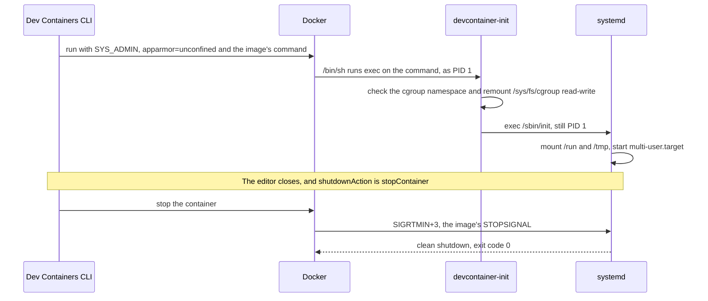

# systemd in the images

The high-level design of how every image runs systemd as process ID (PID) 1, the way an init image such as Red Hat's `ubi-init` does, and how a dev container stops when its editor closes. It's for engineers who change an image's `Containerfile`, its `devcontainer-init.sh` or the `devcontainer` settings in its `manifest.json`.

## Contents

1. [Overview](#overview)
1. [Design](#design)
1. [Limits](#limits)

## Overview

The image sets everything systemd needs, so a user's `devcontainer.json` only has to name it. The `devcontainer` settings in the image's `manifest.json` go through the shared template into its `devcontainer.metadata` label, and the Dev Containers command-line interface (CLI) applies them when it creates the container. It starts the image's command in place of its usual keep-alive loop, and that command ends by running systemd as PID 1. When the editor closes, the CLI or VS Code stops the container, and Docker sends systemd the image's stop signal:

## Design

- **The manifest sets the runtime settings, not the `Containerfile`.** The CLI writes the `devcontainer.metadata` label at build time from the image's `.devcontainer.json`, so a `LABEL` in the `Containerfile` would be overwritten. The template renders each key of the manifest's `devcontainer` field into `.devcontainer.json`, and the [schema](../../schemas/image-manifest.schema.json) lists the keys it allows. The settings are `overrideCommand: false`, `init: false`, `capAdd: ["SYS_ADMIN"]`, `securityOpt: ["apparmor=unconfined"]` and `shutdownAction: "stopContainer"`. A user's `devcontainer.json` can override any of them.
- **`overrideCommand: false` and `init: false` make systemd PID 1.** The CLI always replaces the entrypoint with a `/bin/sh` script. With `overrideCommand: false`, that script runs `exec` on the image's `ENTRYPOINT` and `CMD` rather than sleeping, and without `init` there's no tini in front of it (observed in the CLI's source).
- **The command is a wrapper, because the label can't carry an entrypoint.** The CLI copies `entrypoint` into the label only from features, not from a `devcontainer.json`. So `CMD` runs `/usr/local/sbin/devcontainer-init`, which runs `exec` on `/sbin/init`. The image has no `ENTRYPOINT`, so the test runner's command replaces the wrapper.
- **`SYS_ADMIN` rather than `privileged`.** Docker mounts `/sys/fs/cgroup` read-only in a container that isn't privileged, and systemd exits at once when it can't create its control groups (cgroups) (observed). With `SYS_ADMIN`, the wrapper remounts the container's own cgroup tree read-write and systemd mounts its own tmpfs on `/run` and `/tmp` (observed with Docker 29.10). AppArmor's default Docker profile denies `mount`, hence `apparmor=unconfined` (inferred: the WSL host has no AppArmor).
- **The wrapper refuses the host's cgroups.** In a private cgroup namespace on cgroup v2, which is Docker's default there, PID 1 sees itself at `0::/`. Anything else means `--cgroupns=host` or cgroup v1, so the wrapper exits 1 rather than let systemd take over the host's cgroups (observed).
- **`STOPSIGNAL SIGRTMIN+3`, because systemd treats SIGTERM as a request to re-execute itself.** With it, `docker stop` takes about 0.35 seconds and exits 0. With SIGTERM, Docker waits out its timeout and kills the container with exit code 137 (observed).
- **The units `ubi-init` masks are masked here too,** for hardware, consoles and logins, and the default target is `multi-user.target`. `ENV container=oci` tells systemd it's in a container, as `ubi-init` does.

## Limits

- On a Windows Subsystem for Linux (WSL) host, systemd detects `wsl` rather than a container, so a unit with `ConditionVirtualization=!container` still runs (observed). None fail with the current units.
- The image tests run in a plain container, so they check how systemd is set up, not that it boots. Booting and stopping were checked by hand with `devcontainer up` and `docker stop`.
- `SYS_ADMIN` and an unconfined AppArmor profile give the container more power than Docker's default. A Docker that runs rootless or in user namespace remap mode is untested.
- With `shutdownAction: "none"`, or when the editor is killed, systemd keeps the container running until something stops it.
