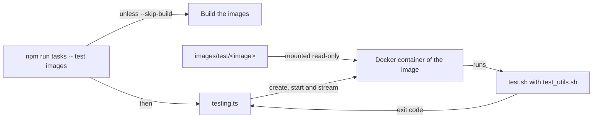

# Image tests

The high-level design of how each image's test project runs inside the built image. It's for engineers who change [testing.ts](../../tasks/images/testing.ts) or write an image's tests.

## Contents

1. [Overview](#overview)
1. [Design](#design)
1. [Limits](#limits)

## Overview

Each image's `test.sh` is a POSIX `sh` script that sources its own copy of [test_utils.sh](../../images/test/base/test_utils.sh), runs checks and ends with `report_results`. The runner starts a container of the built image with the test folder mounted, and the script's exit code decides whether the image passes:

## Design

- **A plain Docker container, not `devcontainer up`.** It's simpler than going through the Dev Containers CLI, but `devcontainer.json` runtime settings, such as `remoteUser`, `containerEnv` and features, don't apply. The tests run as the image's default user, so a check for the dev container's user has to switch to it, such as with `runuser -u <user> --`.
- **Ctrl+C removes the container.** The runner listens for it from before it creates the container, so a Ctrl+C at any point leaves no container behind, even one still being created (observed).
- **One test folder per container,** so an image's tests can't see another's files. That's why each image has its own copy of `test_utils.sh`.
- **POSIX `sh`,** because `/bin/sh` in the Ubuntu images is dash. The helpers print everything to stdout, so the output stays in order when Docker streams it.

## Limits

- The copies of `test_utils.sh` can drift apart. Nothing checks that they match.
- The helpers set global variables, because POSIX `sh` has no `local`, and `check_os_packages` only works in Debian-based images.
- `check_version_ge` uses `sort -V`, which POSIX doesn't define, but Ubuntu's `sort` has.
- A container can't see its image's labels, so the build checks them instead.
