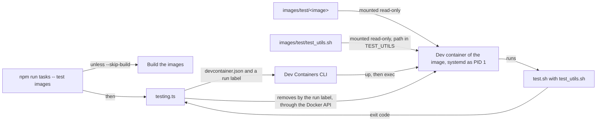

# Image tests

The high-level design of how each image's test project runs inside the built image. It's for engineers who change [testing.ts](../../tasks/images/testing.ts) or write an image's tests.

## Contents

1. [Overview](#overview)
1. [Design](#design)
1. [Limits](#limits)

## Overview

Each image's `test.sh` is a POSIX `sh` script that sources the shared helpers, [test_utils.sh](../../images/test/test_utils.sh), runs checks and ends with `report_results`. The runner brings up a dev container of the built image with the Dev Containers command-line interface (CLI), as an editor would, with the image's test folder and the helpers mounted. It runs `test.sh` in it, and the script's exit code decides whether the image passes:

## Design

- **A dev container, not a plain Docker container.** `devcontainer up` applies the image's `devcontainer.metadata` label as an editor does, so the image's command runs and systemd boots as PID 1, and a check can test it running. `test.sh` runs through `devcontainer exec`, as the image's `remoteUser`, which is root while no image sets one. See [systemd in the images](systemd.md).
- **The CLI is given its own config.** The runner writes a temporary `devcontainer.json` that names the built image and sets the mounts, rather than use the image folder's `.devcontainer.json`, which builds the image.
- **Each run labels its container** with `IMAGE_TEST_LABEL` and a random value, through `--id-label`. The CLI has no command to remove a container, so the runner removes every container with the label through the Docker API, after a pass, a failure or a Ctrl+C. The label also stops `up` reusing a container from an earlier run.
- **Any CLI failure fails the image.** An image whose command doesn't start fails at `up`, and a failed check makes `exec` exit with `test.sh`'s code (observed). Both count as a failed image, not an error that stops the other images' tests.
- **Ctrl+C removes the container.** A Ctrl+C in the terminal reaches the CLI, which stops, and the runner, which removes the container and reports the interruption (observed).
- **One test folder per container,** so an image's tests can't see another's files. The shared helpers are a second mount, at `/test-utils/test_utils.sh` rather than inside the test folder. Docker would have to create a mount point there, and fails because the test folder is read-only (observed). `test.sh` reads the path from `TEST_UTILS`, so it doesn't repeat the one in [config.ts](../../tasks/images/config.ts).
- **POSIX `sh`,** because `/bin/sh` in the Ubuntu images is dash. The helpers print everything to stdout, so the output stays in order.

## Limits

- A change to `test_utils.sh` can break every image's tests, so CI tests every image when it changes.
- The helpers set global variables, because POSIX `sh` has no `local`, and `check_os_packages` only works in Debian-based images.
- `check_version_ge` uses `sort -V`, which POSIX doesn't define, but Ubuntu's `sort` has.
- A container can't see its image's labels, so the build checks them instead.
- A SIGINT sent only to the task, rather than to its process group as a terminal sends it, doesn't stop the CLI. The runner waits for the CLI command to finish before it removes the container (inferred).
- The runner removes each container with `force`, so the tests don't check that it stops cleanly on `SIGRTMIN+3`.
