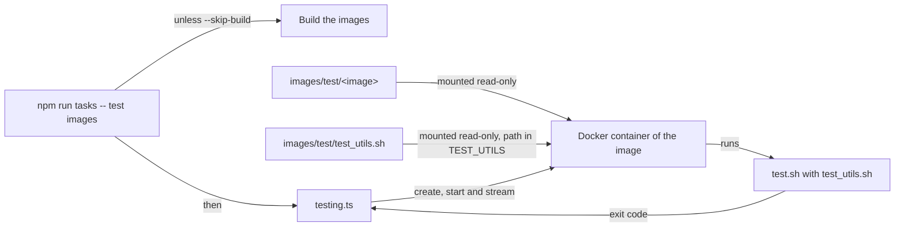

# Image tests

The high-level design of how each image's test project runs inside the built image. It's for engineers who change [testing.ts](../../tasks/images/testing.ts) or write an image's tests.

## Contents

1. [Overview](#overview)
1. [Design](#design)
1. [Limits](#limits)

## Overview

Each image's `test.sh` is a POSIX `sh` script that sources the shared helpers, [test_utils.sh](../../images/test/test_utils.sh), runs checks and ends with `report_results`. The runner starts a container of the built image with the image's test folder and the helpers mounted, and the script's exit code decides whether the image passes:

## Design

- **A plain Docker container, not `devcontainer up`.** It's simpler than going through the Dev Containers CLI, but `devcontainer.json` runtime settings, such as `remoteUser`, `containerEnv` and features, don't apply. The tests run as the image's default user, so a check for the dev container's user has to switch to it, such as with `runuser -u <user> --`. The test command also replaces the image's `CMD`, so systemd doesn't boot, and a check can only look at how it's set up. See [systemd in the images](systemd.md).
- **Ctrl+C removes the container.** The runner listens for it from before it creates the container, so a Ctrl+C at any point leaves no container behind, even one still being created (observed).
- **One test folder per container,** so an image's tests can't see another's files. The shared helpers are a second mount, at `/test-utils/test_utils.sh` rather than inside the test folder. Docker would have to create a mount point there, and fails because the test folder is read-only (observed). `test.sh` reads the path from `TEST_UTILS`, so it doesn't repeat the one in [config.ts](../../tasks/images/config.ts).
- **POSIX `sh`,** because `/bin/sh` in the Ubuntu images is dash. The helpers print everything to stdout, so the output stays in order when Docker streams it.

## Limits

- A change to `test_utils.sh` can break every image's tests, so CI tests every image when it changes.
- The helpers set global variables, because POSIX `sh` has no `local`, and `check_os_packages` only works in Debian-based images.
- `check_version_ge` uses `sort -V`, which POSIX doesn't define, but Ubuntu's `sort` has.
- A container can't see its image's labels, so the build checks them instead.
