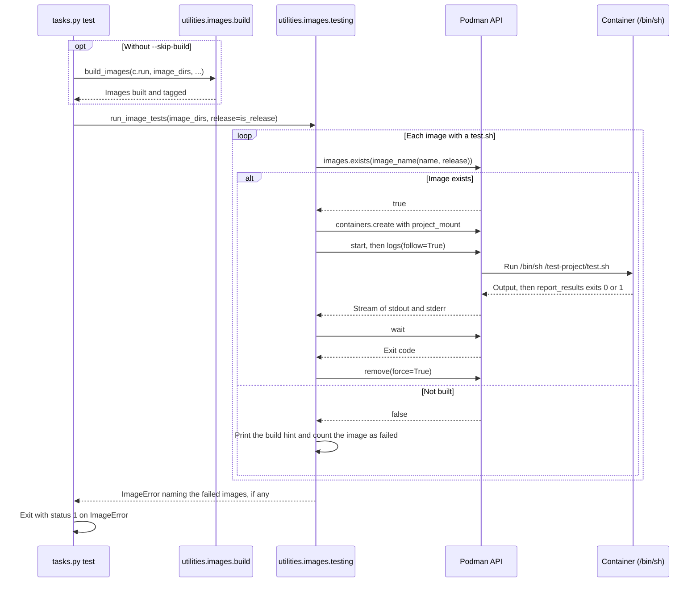

# Image tests

How [testing.py](../../utilities/images/testing.py) runs each image's test project inside the built image, and what the `test_utils.sh` helpers assume. It's for engineers who change the test runner or write an image's tests.

## Contents

1. [Overview](#overview)
1. [The test helpers](#the-test-helpers)
1. [Decisions](#decisions)
1. [Limits](#limits)

## Overview

A test project is a POSIX `sh` script, `images/test/<image>/test.sh`, that sources its own copy of [test_utils.sh](../../images/test/base/test_utils.sh), runs checks and ends with `report_results`. [The base image's test.sh](../../images/test/base/test.sh) is the one to copy. This sequence diagram shows one run of the `test` task:

- The test folder is bind-mounted read-only at `/test-project`, which is the working directory. It's the container's only mount.
- An image without a `test.sh` is skipped, not failed. An image that isn't built counts as failed.
- The container is always removed, including after <kbd>Ctrl</kbd>+<kbd>C</kbd>.

## The test helpers

[test_utils.sh](../../images/test/base/test_utils.sh) has `check`, `check_version_ge`, `check_multiple`, `check_os_packages`, `check_os_release` and `report_results`. The comment above each says when it passes. `check` runs its command in a subshell, so a check can run anything, such as a command as another user with `runuser -u <user> --`.

- They're POSIX `sh`, because `/bin/sh` in the Ubuntu images is dash. They print with `printf`, because `echo` with a backslash differs between shells.
- `check_version_ge` compares as `sort -V` does, so `2.0.0-rc1` counts as at or above `2.0.0`, but `2.0.0~rc1` as below it (observed).
- Without `report_results` at the end, the script exits with its last command's status and loses earlier failures. Don't use `set -e`, which would exit at the first failed check.

## Decisions

- **A plain podman container, not `devcontainer up` and `devcontainer exec`.** Upstream's `devcontainers/images` smoke test uses the CLI. Calling podman directly is simpler, but `devcontainer.json` runtime settings, such as `remoteUser`, `containerEnv`, features and lifecycle commands, don't apply. The tests run as the image's default user, so a check for the dev container's user has to switch to it.
- **One test folder per container,** so an image's tests can't see another's files. That's why each image has its own copy of `test_utils.sh`.
- **`stop_timeout=0`,** because `sh` runs as process ID (PID) 1 and ignores `SIGTERM`, so removing a running container would otherwise wait 10 seconds.
- **`relabel: "z"`,** so the container can read the mount on a host where Security-Enhanced Linux (SELinux) is enforcing.
- **Everything to stdout,** so the output stays in order when podman streams it. The helpers are based on upstream's `base-ubuntu` test helpers, rewritten from Bash.

## Limits

- The copies of `test_utils.sh` can drift apart. Nothing checks that they match.
- The helpers set global variables such as `label`, `count`, `missing`, `status` and `value`, because POSIX `sh` has no `local`. `test.sh` shouldn't use those names.
- `check_os_packages` uses `dpkg-query`, so it only works in Debian-based images.
- `check_version_ge` uses `sort -V`, which POSIX doesn't define. Ubuntu 26.04's uutils `sort` has it (observed on the host, inferred for the image).
